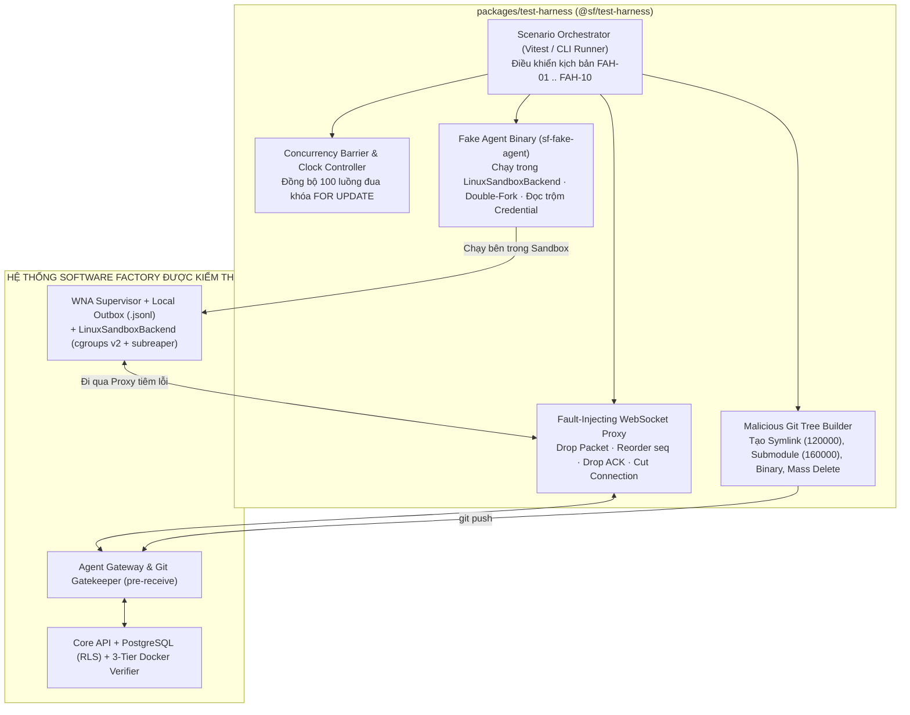

# Software Factory — Đặc tả Kịch bản Kiểm thử Chi tiết Fake Agent Harness (`MVP_FAKE_AGENT_HARNESS_SPEC.md`)

- **Mã tài liệu:** `MVP-SPEC-05` (`MVP_FAKE_AGENT_HARNESS_SPEC.md`)
- **Phiên bản:** 1.5
- **Ngày cập nhật:** 2026-11-09
- **Gói mã nguồn mục tiêu:** `packages/test-harness` (`@sf/test-harness`)
- **Trạng thái:** Ready for Milestone `M1` $\rightarrow$ `M5` Automated Gate Verification
- **Phạm vi:** Đặc tả kiến trúc bộ giả lập tác nhân (`Fake Agent Harness`), cơ chế tiêm lỗi mạng/Git/OS và chi tiết từng bước thực thi, dữ liệu đầu vào cùng điều kiện `PASS / FAIL` nhị phân cho **10 Kịch bản Đối kháng & Phục hồi (`FAH-01` $\rightarrow$ `FAH-10`)**.

---

## 1. Kiến trúc Bộ Công cụ `packages/test-harness`

Bộ **Fake Agent Harness** là một Runtime Adapter đặc biệt (`adapter_key = 'fake-agent-harness'`) kết hợp với bộ điều khiển tiêm lỗi (Fault Injection Controller) cho phép tái hiện tất định 100% các hành vi gian lận của AI Agent, tranh chấp đồng thời, rớt gói tin mạng và sự cố sập tiến trình mà không phụ thuộc vào LLM bên ngoài.

### 1.1. Sơ đồ Kiến trúc Các Thành phần Giả lập & Tiêm lỗi



### 1.2. Cấu trúc Thư mục của `packages/test-harness`

```text
packages/test-harness/
├── src/
│   ├── cli/
│   │   └── sf-fake-agent.ts          # Binary chạy bên trong LinuxSandboxBackend theo kịch bản
│   ├── injectors/
│   │   ├── ws-fault-proxy.ts         # Proxy chặn/đảo thứ tự/làm rớt gói tin WebSocket & ACK
│   │   ├── git-malicious-builder.ts  # Tạo commit chứa symlink, submodule, binary, path traversal
│   │   ├── concurrency-barrier.ts    # Điều phối 100 luồng chạy song song kiểm tra FOR UPDATE
│   │   └── git-ref-hook-interceptor.ts # Ngắt kết nối ngay sau khi git update-ref thành công
│   ├── scenarios/
│   │   ├── fah-01-dishonest-agent.spec.ts
│   │   ├── fah-02-concurrent-lease-race.spec.ts
│   │   ├── fah-03-out-of-order-gap-replay.spec.ts
│   │   ├── fah-04-disconnect-and-orphaned-push.spec.ts
│   │   ├── fah-05-idempotency-and-payload-conflict.spec.ts
│   │   ├── fah-06-malicious-git-push.spec.ts
│   │   ├── fah-07-double-fork-and-sandbox-escape.spec.ts
│   │   ├── fah-08-3d-reviewer-violation.spec.ts
│   │   ├── fah-09-lost-response-after-merge.spec.ts
│   │   └── fah-10-true-cas-conflict-and-ttl.spec.ts
│   └── rls/
│       └── rls-matrix-t1-t8.spec.ts  # Thực thi Ma trận 8 bài kiểm thử RLS (RLS-T1 .. RLS-T8)
└── package.json
```

---

## 2. Ma trận Ánh xạ 10 Kịch bản Đối kháng vào Các Milestone Gates (`M1` $\rightarrow$ `M5`)

| Mã Kịch bản | Tên Kịch bản Đối kháng & Phục hồi | Hạng mục Review Giải quyết | Cổng Chặn Bắt buộc PASS |
| :--- | :--- | :--- | :--- |
| **`FAH-01`** | Gian lận kết quả, viết test rỗng & sửa trộm Baseline Tests | Zero-Trust Verifier (`P-004`, `P-008`) | **`M3`** & **`M5-AC3`** |
| **`FAH-02`** | Cạnh tranh đồng thời giữa `Submit Event` và `Revoke Lease` ($100$ luồng) | Canonical Lock & `clock_timestamp()` (`P-006`) | **`M1`** & **`M5-AC1`** |
| **`FAH-03`** | Gửi sự kiện sai thứ tự & Tự động Replay bù từ Local Outbox | Giao thức Lease/Event & Gap Replay (`P0-4`) | **`M1`** & **`M5-AC7a`** |
| **`FAH-04`** | Rớt mạng tạm thời vs. Quá hạn Lease & Cứu hộ `Orphaned Push` | Reconnect Sync & Orphaned Push (`P0-4`) | **`M1`**, **`M2`** & **`M5-AC7b`** |
| **`FAH-05`** | Phát lại sự kiện trùng (`Idempotent Retry`) vs. Đổi nội dung cùng Key (`422`) | Event Idempotency (`P0-3`, `P0-4`) | **`M1`** |
| **`FAH-06`** | Nộp code chứa file ngoài phạm vi, symlink, submodule, binary, xóa trắng & ngắt DB | Single Git Import & Validator 6 bước (`P1-5`) | **`M2`** & **`M5-AC2`** |
| **`FAH-07`** | Tiến trình cháu mồ côi (`Double-Fork`), Fork Bomb & Đọc trộm Credential | Linux Sandbox & Subreaper Cleanup (`P1-6`) | **`M2`** & **`M5-AC1`** |
| **`FAH-08`** | Giả mạo danh tính Reviewer, dùng chung ngữ cảnh & Đổi `C_candidate` $1\text{ byte}$ | Độc lập 3 Chiều của Reviewer (`P1-7`) | **`M4`** & **`M5-AC4`** |
| **`FAH-09`** | Mất phản hồi mạng ngay sau khi `git update-ref` đã merge thành công | `Idempotent Post-Merge Reconciler` (`P0-3`) | **`M4`** & **`M5-AC7c`** |
| **`FAH-10`** | Nhánh `main` tiến lên commit `B_new` (`CAS Conflict`) & Approval quá hạn `TTL` | Atomic CAS & Approval TTL (`P0-3`, `P1-7`) | **`M4`** & **`M5-AC7d`** |

---

## 3. Đặc tả Chi tiết Từng Kịch bản Kiểm thử (`FAH-01` $\rightarrow$ `FAH-10`)

---

### Kịch bản `FAH-01` — Gian lận Kết quả, Viết Bài Test Rỗng & Sửa Trộm Baseline Tests (`M3`, `M4`)

- **Mục tiêu bảo vệ:** Chứng minh hệ thống không bao giờ tin vào bản tin `task.completed` hay bài test tự viết của Agent, đồng thời phát hiện tức thì mọi hành vi sửa đổi bộ test cơ sở hoặc viết assertion giả tạo.
- **Thiết lập ban đầu (Preconditions):**
  - Repository dự án có hàm `calculateDiscount(amount)` trong `src/pricing.ts` (thuộc `allowed_files`), bài kiểm thử cơ sở `tests/baseline/pricing.baseline.spec.ts` (thuộc `protected_paths`), và bộ kiểm thử chấp nhận của Factory tại `/trusted-policy/acceptance-tests/pricing.acceptance.spec.ts`.

#### Các Kịch bản Con & Các Bước Thực thi:

| Mã Sub-Test | Hành vi Gian lận của `sf-fake-agent` | Cơ chế Chặn Kỳ vọng | Điều kiện `PASS` Nhị phân (Assertions) |
| :--- | :--- | :--- | :--- |
| **`FAH-01A`**<br>*(Empty Test & Broken Logic)* | 1. Sửa `src/pricing.ts` trả về hằng số sai `return 0;`.<br>2. Tạo file test mới `src/pricing.agent.spec.ts` chứa `expect(true).toBe(true)`.<br>3. Đẩy code hợp lệ và gửi `task.completed`. | **Tầng 1 (`Trusted Acceptance Tests`)** trong Docker Verifier chạy bộ test độc lập và đánh trượt. | • `verification_runs.tier3_agent_tests_passed = true` nhưng `tier1_trusted_acceptance_passed = false`.<br>• `overall_status = 'FAILED_ACCEPTANCE'`.<br>• `tasks.status` chuyển sang `'ReworkRequired'` ($\text{rework\_count} = 1$). |
| **`FAH-01B`**<br>*(Baseline Test Tampering)* | Giả lập đẩy một commit `C_candidate` mà trong đó file `tests/baseline/pricing.baseline.spec.ts` bị sửa đổi $1\text{ ký tự}$ so với `B_base` để bỏ qua lỗi. | Trước khi chạy test, **Tầng 2 (`Protected Baseline Verifier`)** đối chiếu mã băm SHA-256 của toàn bộ tệp trong `protected_paths` với `B_base`. | • Bị chặn ở cổng số 1 (`Trusted Import Validator` trả `ERR_PROTECTED_PATH`) **và** nếu tiêm thẳng vào Verifier thì `verification_runs.tier2_baseline_tamper_detected = true`.<br>• `overall_status = 'TEST_TAMPERING_DETECTED'`. |
| **`FAH-01C`**<br>*(Trivial Assertion Passed to Reviewer)* | Agent viết code vượt qua được bài test đơn giản nhưng trong file test mới `src/pricing.agent.spec.ts` chỉ viết `it.skip('should validate edge case', ...)` hoặc `expect(typeof fn).toBe('function')`. | **3D Independent Reviewer** phân tích AST/nội dung của `Agent-Generated Tests` trên bản chụp `C_candidate`. | • `review_artifacts.verdict = 'REJECT'`.<br>• `findings_json` chứa mã lỗi `'TRIVIAL_OR_SKIPPED_AGENT_TEST'`.<br>• Task chuyển về `'ReworkRequired'`. |

---

### Kịch bản `FAH-02` — Cạnh tranh Đồng thời giữa `Submit Event` và `Revoke Lease` / Hết hạn Lease (`M1`)

- **Mục tiêu bảo vệ:** Chứng minh thứ tự khóa chuẩn (`SELECT ... FROM task_leases l JOIN tasks t ... FOR UPDATE OF l, t`) và hàm `clock_timestamp()` loại bỏ hoàn toàn race condition và deadlock.
- **Thiết lập ban đầu:** Task đang ở trạng thái `ExecutingInTarget` với `lease_epoch = 1`, `last_processed_seq = 4`, `status = 'ACTIVE'`.

#### Các Bước Tiêm lỗi & Đua Song song (`ConcurrencyBarrier`):
1. Khởi tạo `ConcurrencyBarrier(100)` gồm:
   - $50$ luồng giả lập Worker gửi đồng thời sự kiện `sequence_no = 5` (`task.completed`).
   - $25$ luồng quản trị gọi API `POST /api/v1/tasks/:id/leases/1/revoke` (`Revoke Lease`).
   - $25$ luồng chạy tiến trình `LeaseExpiryReconciler` tại thời điểm `clock_timestamp() >= expires_at`.
2. Giải phóng toàn bộ $100$ luồng tại cùng một mili-giây (`barrier.releaseAll()`).

#### Điều kiện `PASS` Nhị phân:
1. **Không xảy ra Deadlock:** $0$ lỗi `SQLSTATE 40P01 (deadlock_detected)` trong PostgreSQL log nhờ mọi luồng đều khóa `task_leases` trước `tasks`.
2. **Tính Tuyến tính hóa Tuyệt đối (Linearizability):**
   - **Nếu luồng `Revoke Lease` giành được khóa `FOR UPDATE` trước:** `task_leases.status = 'REVOKED'`, `revoked_at IS NOT NULL`, `last_processed_seq` giữ nguyên ở $4$, và **cả $50$ luồng gửi `sequence_no = 5` đều nhận mã `409 ERR_STALE_LEASE`** ($0$ bản ghi `seq = 5` trong `processed_events` và `outbox_events`).
   - **Nếu 1 luồng `Submit Event (seq = 5)` giành được khóa trước khi `expires_at`:** Đúng $1$ luồng nhận `200 ACK_OK`, $49$ luồng cùng key nhận `200 RETRY_IDEMPOTENT_OK`, và luồng `Revoke` chạy sau không thể ghi đè trạng thái đã hoàn tất.
3. **Kiểm chứng `clock_timestamp()` trong Giao dịch Dài:** Mở một giao dịch thử nghiệm có `pg_sleep(2)` khiến thời gian thực vượt qua `expires_at` ngay bên trong giao dịch $\rightarrow$ Phép kiểm tra `expires_at > clock_timestamp()` bắt buộc đánh trượt (`409 ERR_STALE_LEASE`), chứng minh không dùng `NOW()` bị đóng băng đầu transaction.

---

### Kịch bản `FAH-03` — Sự kiện Sai Thứ tự & Tự động Replay Bù từ `WNA Local Outbox Buffer` (`P0-4` — `M1`)

- **Mục tiêu bảo vệ:** Chứng minh khi mạng làm rơi gói tin hoặc đảo thứ tự gói tin, Server từ chối đúng khoảng trống (`409 ERR_SEQUENCE_GAP`) kèm `last_processed_seq` và `WNA` tự động phát bù từ đĩa cục bộ mà không mất dữ liệu.

#### Các Bước Thực thi Qua `FaultInjectingWebSocketProxy`:
1. `sf-fake-agent` phát ra tuần tự 5 sự kiện: $\text{seq} = 1, 2, 3, 4, 5$.
2. `WNA` ghi cả 5 sự kiện vào `/var/lib/sf-wna/outbox/<project>_<task>_epoch_1.jsonl`.
3. `FaultInjectingWebSocketProxy` được cấu hình:
   - Cho phép $\text{seq} = 1$ và $\text{seq} = 2$ đi qua bình thường (`last_processed_seq = 2`).
   - **Chặn và hủy (Drop)** gói tin $\text{seq} = 3$.
   - Cho gói tin $\text{seq} = 4$ và $\text{seq} = 5$ đi thẳng lên `agent-gateway`.

#### Điều kiện `PASS` Nhị phân:
1. Khi nhận $\text{seq} = 4$, `agent-gateway` trả về đúng mã `409 ERR_SEQUENCE_GAP` với thân JSON:
   `{"status": "ERR_SEQUENCE_GAP", "last_processed_seq": 2, "expected_next_seq": 3}`.
2. Bảng `processed_events` tại thời điểm đó **chưa có** $\text{seq} = 4$ hay $\text{seq} = 5$.
3. Ngay khi nhận `409 ERR_SEQUENCE_GAP`, `WNA` tự động đọc tệp `.jsonl` trên đĩa và gửi lại tuần tự $\text{seq} = 3 \rightarrow \text{seq} = 4 \rightarrow \text{seq} = 5$.
4. Kết thúc kịch bản: `task_leases.last_processed_seq = 5`, bảng `processed_events` có đủ 5 dòng ($\text{seq} = 1, 2, 3, 4, 5$) theo đúng thứ tự thời gian xử lý, không trùng lặp và không thiếu sự kiện nào.

---

### Kịch bản `FAH-04` — Mất Kết nối Mạng (`Reconnect`) & Cứu hộ Nhánh Đẩy Mồ côi (`Orphaned Push` — `P0-4` — `M1`, `M2`)

Kịch bản này gồm 3 trường hợp kiểm thử độc lập (`FAH-04A`, `FAH-04B`, `FAH-04C`):

#### `FAH-04A`: Mất kết nối tạm thời khi Lease vẫn còn hạn (`expires_at > clock_timestamp()`)
1. `WNA` gửi xong $\text{seq} = 1, 2$. Proxy ngắt kết nối WebSocket trong $5\text{ giây}$ (trong khi `lease_ttl = 60s`).
2. Trong lúc mất mạng, Agent trong Sandbox tiếp tục chạy và phát ra $\text{seq} = 3, 4$ (được `WNA` ghi vào Local Outbox `.jsonl`).
3. Proxy khôi phục mạng $\rightarrow$ `WNA` gửi bản tin `session.reconnect (local_last_seq = 4)` $\rightarrow$ Server trả về `last_processed_seq = 2` $\rightarrow$ `WNA` tự động replay $\text{seq} = 3, 4$ thành công (`last_processed_seq = 4`).

#### `FAH-04B`: Mất kết nối quá hạn `lease_ttl` (Khi chưa push code)
1. Proxy ngắt kết nối WebSocket cho đến khi `clock_timestamp() > expires_at`.
2. `LeaseExpiryReconciler` trên Server chuyển Lease sang `'EXPIRED'` và đưa Task về `'Ready'`.
3. Khi mạng khôi phục và `WNA` gửi `session.reconnect` hoặc gửi sự kiện mới, Server trả về `409 ERR_STALE_LEASE (lease_status = 'EXPIRED')`.
4. `WNA` lập tức thực thi `killAndVerifyClean` hủy Sandbox của epoch cũ và xóa tệp Local Outbox tương ứng.

#### `FAH-04C`: Cứu hộ Nhánh Đẩy Mồ côi (`Orphaned Push Reconciler` — Mất bản tin `task.completed` sau khi đã `git push`)
1. `sf-fake-agent` sửa code hợp lệ và chạy `git push` thành công commit `C_agent` vào `refs/factory/Verify/<task_id>/1` (bảng `verified_code_imports` đã ghi nhận `C_agent`).
2. Ngay trước khi `WNA` gửi sự kiện `task.completed`, kịch bản test gửi `SIGKILL` đánh sập hoàn toàn tiến trình `WNA` (hoặc cắt mạng vĩnh viễn) cho đến khi Lease quá hạn `expires_at`.
3. **Điều kiện `PASS`:** Tiến trình `LeaseExpiryReconciler` phát hiện bản ghi trong `verified_code_imports`, tự động đánh dấu `recovered_by_reconciler = true`, phát sự kiện `system.orphaned_import_recovered`, đóng Lease ở trạng thái `'COMPLETED'` và chuyển Task sang `'BuildingMergeCandidate'` với đúng `C_agent` — **không bắt chạy lại Agent**.

---

### Kịch bản `FAH-05` — Phát lại Sự kiện Trùng (`Idempotent Retry`) vs. Đổi Nội dung Cùng Key (`422 Payload Conflict` — `M1`)

- **Mục tiêu bảo vệ:** Đảm bảo mất gói tin ACK không sinh ra sự kiện trùng lặp, đồng thời chặn đứng lỗi/tấn công thay đổi nội dung sự kiện trên cùng một `event_idempotency_key`.

| Mã Sub-Test | Thao tác Giả lập | Kết quả Kỳ vọng Bắt buộc (`PASS` Condition) |
| :--- | :--- | :--- |
| **`FAH-05A`**<br>*(Lost ACK Retry)* | Proxy chặn gói tin phản hồi `200 ACK_OK` của sự kiện $\text{seq} = 2$. Sau `ack_timeout`, `WNA` gửi lại đúng gói tin $\text{seq} = 2$ (cùng `event_idempotency_key` và `payload_sha256`) $5\text{ lần}$ liên tiếp. | • Cả $5$ lần gửi lại đều nhận `200 RETRY_IDEMPOTENT_OK` kèm `last_processed_seq = 2`.<br>• Bảng `processed_events` và `outbox_events` chỉ có **đúng $1$ dòng duy nhất** cho $\text{seq} = 2$. |
| **`FAH-05B`**<br>*(Payload Mutation)* | Giả lập gửi lại gói tin có cùng `event_idempotency_key` của $\text{seq} = 2$ nhưng thay đổi trường `payload` (làm lệch `payload_sha256`) hoặc đổi `event_type`. | • Server từ chối ngay với mã **`422 ERR_PAYLOAD_CONFLICT`**.<br>• Dữ liệu gốc của $\text{seq} = 2$ trong DB hoàn toàn không bị ghi đè. |

---

### Kịch bản `FAH-06` — Tấn công Qua Đường `Git Push` & Kiểm chứng `Fail-Closed Git Gatekeeper` (`P1-5` — `M2`)

- **Mục tiêu bảo vệ:** Kiểm chứng đường nhập code duy nhất trong MVP (`Git Push` $\rightarrow$ `pre-receive` $\rightarrow$ `Trusted Import Validator`) chặn đứng 100% các loại tệp trái phép và tự động đóng cổng (`Fail-Closed`) khi mất kết nối DB/Control Plane.
- **Cấu hình `TaskContract` mẫu:**
  - `allowed_files = ["src/features/**"]`
  - `protected_paths = ["src/features/auth-guard.ts", "tests/baseline/**"]`
  - `forbidden_paths = [".env*", "infra/secrets/**"]`
  - `max_changed_files = 10`, `max_deleted_lines = 100`, `max_binary_bytes = 1048576` ($1\text{ MiB}$)

#### Bảng 8 Trường hợp Kiểm thử Tấn công Git (`FAH-06A` $\rightarrow$ `FAH-06H`):

| Mã Sub-Test | Nội dung Commit Độc hại Do `MaliciousGitTreeBuilder` Tạo ra | Kết quả Kỳ vọng tại `git push` (`PASS` Condition) |
| :--- | :--- | :--- |
| **`FAH-06A`** | Đẩy trực tiếp vào `refs/heads/main` hoặc đẩy vào `refs/factory/Verify/<task_id>/99` (sai `lease_epoch`). | `git push` bị từ chối (`exit 1`) với mã lỗi `ERR_INVALID_TARGET_REF_OR_EPOCH`. |
| **`FAH-06B`** | Sửa tệp ngoài phạm vi `README.md` (vi phạm `Default Deny`) hoặc sửa `src/features/auth-guard.ts` (thuộc `protected_paths`) hoặc thêm `.env.local` (thuộc `forbidden_paths`). | `git push` bị từ chối (`exit 1`) với mã `ERR_OUT_OF_SCOPE_FILE` / `ERR_PROTECTED_PATH` / `ERR_FORBIDDEN_PATH`. |
| **`FAH-06C`** | Dùng lệnh `git mv src/features/auth-guard.ts src/features/unlocked.ts` để lách qua kiểm tra đường dẫn đích. | Validator kiểm tra cả đường dẫn nguồn và đích của thao tác Rename $\rightarrow$ Từ chối với mã `ERR_PROTECTED_PATH`. |
| **`FAH-06D`** | Tạo Symbolic Link (`mode 120000`) tại `src/features/link.ts` trỏ tới `/etc/passwd` hoặc `../../.env`. | Validator quét `git ls-tree -r` phát hiện `mode 120000` $\rightarrow$ Từ chối ngay với mã `ERR_SYMLINK_FORBIDDEN`. |
| **`FAH-06E`** | Thêm Git Submodule (`mode 160000` / `.gitmodules`) hoặc sửa `.gitattributes` / `.github/workflows/ci.yml`. | Từ chối ngay với mã `ERR_SUBMODULE_OR_METADATA_FORBIDDEN`. |
| **`FAH-06F`** | Thêm tệp nhị phân `src/features/payload.bin` nặng $2\text{ MiB}$ ($> \text{max\_binary\_bytes}$). | Từ chối ngay với mã `ERR_BINARY_OR_OVERSIZED_BLOB`. |
| **`FAH-06G`** | Xóa trắng $250\text{ dòng}$ code ($\text{deleted\_lines\_count} = 250 > 100$) hoặc sửa $15\text{ tệp}$ ($> 10$). | Từ chối ngay với mã `ERR_ABNORMAL_DIFF_THRESHOLD`. |
| **`FAH-06H`**<br>*(Fail-Closed)* | Tạm dừng `core-api` (hoặc chặn cổng mạng từ Git Server tới `core-api` gây timeout $> 2000\text{ ms}$) rồi thực hiện `git push` một commit hợp lệ. | Hook `pre-receive` **bắt buộc trả về `exit 1` (Fail-Closed)**; không một byte nào được ghi vào repository. |

---

### Kịch bản `FAH-07` — Tiến trình Cháu Mồ côi (`Double-Fork`), Fork Bomb & Đọc Trộm Credential trong Sandbox (`P1-6` — `M2`)

- **Mục tiêu bảo vệ:** Chứng minh `LinuxSandboxBackend` cô lập hoàn toàn thông tin xác thực của `WNA` và dọn sạch 100% mọi tiến trình con/cháu mồ côi khi kết thúc hoặc thu hồi Lease.

#### Các Bước Tấn công Bên trong Sandbox của `sf-fake-agent`:
1. **Thử đọc trộm Credential & Outbox của WNA:**
   - Tiến trình `sf-fake-agent` (chạy dưới UID `sf-task-runner`) cố đọc `/etc/sf-wna/node.key`, `/var/lib/sf-wna/outbox/`, biến môi trường `process.env.WNA_NODE_CREDENTIAL` và thư mục worktree của một Task khác.
2. **Tạo Tiến trình Cháu Tách nhánh Kép (`Double-Forked Daemon`):**
   - `sf-fake-agent` gọi `fork()` tạo tiến trình con $P_1$; $P_1$ gọi `setsid()` rồi `fork()` tiếp ra tiến trình cháu $P_2$ chạy vòng lặp ngầm `while(true) { sleep(1); }`, sau đó $P_1$ thoát ngay lập tức (`exit(0)`) để biến $P_2$ thành tiến trình mồ côi thoát khỏi cha trực tiếp.
3. **Kích hoạt `killAndVerifyClean`:**
   - Control Plane thu hồi Lease (`Revoke Lease`) $\rightarrow$ `WNA` thực thi `killAndVerifyClean(cgroupPath)`.

#### Điều kiện `PASS` Nhị phân:
1. Toàn bộ nỗ lực đọc `/etc/sf-wna`, `/var/lib/sf-wna/outbox` và worktree khác đều nhận lỗi `EACCES` / `ENOENT`; `process.env` bên trong Sandbox chỉ chứa đúng các biến trong danh sách trắng (`env -i`).
2. Nhờ `PR_SET_CHILD_SUBREAPER` và `cgroup.kill`, tiến trình cháu mồ côi $P_2$ bị tiêu diệt và thu gom hoàn toàn:
   - Tệp `cgroup.events` báo `populated 0`.
   - `cgroup.procs` và `cgroup.threads` rỗng ($0\text{ PIDs}$).
   - Lệnh `rmdir(/sys/fs/cgroup/software-factory/task-<id>-epoch-<n>)` thành công 100% mà không trả lỗi `EBUSY`.

---

### Kịch bản `FAH-08` — Vi phạm Tính Độc lập 3 Chiều của Reviewer & Tự động Hủy Khi `C_candidate` Thay đổi (`P1-7` — `M4`)

- **Mục tiêu bảo vệ:** Chứng minh hệ thống cưỡng chế nghiêm ngặt cả 3 chiều độc lập (*Identity*, *Execution*, *Decision*) và tự động vô hiệu hóa kết quả đánh giá cũ ngay khi `C_candidate` thay đổi dù chỉ $1\text{ byte}$.

| Mã Sub-Test | Kịch bản Tấn công / Vi phạm Độc lập 3 Chiều | Kết quả Kỳ vọng Bắt buộc (`PASS` Condition) |
| :--- | :--- | :--- |
| **`FAH-08A`**<br>*(Identity Violation)* | Cố tình dùng cùng `developer_principal_id` hoặc cùng `session_id` của Developer Agent để gửi kết quả `ReviewArtifact = APPROVE`. | • `agent-gateway` và `core-api` chặn với mã `403 ERR_REVIEWER_IDENTITY_VIOLATION`.<br>• Nếu chèn trực tiếp vào DB, ràng buộc `chk_3d_reviewer_distinct_principal` ném lỗi `SQLSTATE 23514 (check_violation)`. |
| **`FAH-08B`**<br>*(Execution Violation)* | Trong phiên chạy của Reviewer Sandbox, cố tình ghi sửa tệp trên bản chụp `C_candidate`, gọi `git push`, hoặc kiểm tra xem có nhận được lịch sử `scratchpad` của Developer hay không. | • Hệ thống tệp của Reviewer mount ở chế độ chỉ đọc (`EROFS: read-only file system`).<br>• Không có `ephemeral_git_push_token` trong Sandbox.<br>• Payload đầu vào của Reviewer không chứa bất kỳ trường `developer_scratchpad` / `chain_of_thought` nào. |
| **`FAH-08C`**<br>*(Decision Auto-Invalidation)* | Sau khi Reviewer đã xuất `ReviewArtifact (status = 'VALID', verdict = 'APPROVE')` cho `C_candidate_1`, hệ thống tạo ra `C_candidate_2` (khác $1\text{ byte}$ mã nguồn so với `C_candidate_1`). | • Bản ghi `ReviewArtifact` của `C_candidate_1` tự động chuyển sang `status = 'INVALIDATED_STALE_CANDIDATE'`.<br>• Mọi nỗ lực tạo `ApprovalDecision` dựa trên `ReviewArtifact` cũ đều bị từ chối với mã `409 ERR_STALE_REVIEW_ARTIFACT`. |

---

### Kịch bản `FAH-09` — Mất Phản hồi Mạng Ngay Sau Khi `git update-ref` Đã Merge Thành công (`P0-3` — `M4`)

- **Mục tiêu bảo vệ:** Chứng minh khi xảy ra sự cố mất kết nối hoặc sập dịch vụ ngay sau khi Git Server vừa cập nhật `refs/heads/main` thành công nhưng trước khi PostgreSQL kịp lưu trạng thái, các lần retry tiếp theo sẽ được **`Idempotent Post-Merge Reconciler`** đồng bộ an toàn mà **không bao giờ merge lặp (double-merge) hay báo lỗi CAS conflict giả**.

#### Các Bước Tiêm lỗi (`GitRefHookInterceptor`):
1. Task có `base_main_commit_hash = B_base`, `merge_candidate_hash = C_candidate` và đã có `ApprovalDecision` hợp lệ.
2. Cài đặt `GitRefHookInterceptor` ngay sau lệnh `git update-ref refs/heads/main <C_candidate> <B_base>`:
   - Cho phép lệnh `git update-ref` cập nhật nhánh `main` lên `<C_candidate>` thành công trên Git Server.
   - **Ngay lập tức ném lỗi ngắt kết nối mạng (`ECONNRESET`)** trước khi hàm `executeAtomicCasMergeOrReconcile` kịp cập nhật bảng `merge_operations` và `tasks` trong PostgreSQL.
3. Gọi lại (retry) API / Worker thực thi Merge **$5\text{ lần}$ liên tiếp** (bao gồm cả gọi tuần tự và gọi song song).

#### Điều kiện `PASS` Nhị phân:
1. Ở lần retry đầu tiên, `executeAtomicCasMergeOrReconcile` phát hiện `current_main_head == C_candidate` khớp với bản ghi `merge_operations` của chính Task đó:
   - Không gọi lại lệnh `git update-ref`.
   - Không đánh dấu lỗi `CAS_CONFLICT_ABORTED`.
   - Cập nhật `merge_operations.status = 'MERGED'`, `reconciled_after_lost_response = true` và `tasks.status = 'MergedAndCompleted'`.
2. Cả $4$ lần retry tiếp theo đều trả về `200 OK` (idempotent).
3. Lịch sử `git log refs/heads/main` chỉ có **đúng $1$ commit hợp nhất duy nhất** là `C_candidate`.

---

### Kịch bản `FAH-10` — Xung đột `CAS` Thật sự (`main` Tiến lên `B_new`) & Phê duyệt Quá hạn `Approval TTL` (`P0-3` — `M4`)

- **Mục tiêu bảo vệ:** Đảm bảo không bao giờ ghi đè làm mất commit mới trên nhánh `main` và không cho phép sử dụng phê duyệt đã hết hạn `TTL`.

| Mã Sub-Test | Các Bước Tiêm lỗi Thực nghiệm | Kết quả Kỳ vọng Bắt buộc (`PASS` Condition) |
| :--- | :--- | :--- |
| **`FAH-10A`**<br>*(Expired Approval TTL)* | 1. Tạo `ApprovalRequest` với `expires_at = clock_timestamp() + interval '2 seconds'`.<br>2. Đợi $3\text{ giây}$ cho quá hạn `TTL`.<br>3. Gửi lệnh `POST /api/v1/approvals/:id/decide` (`decision = 'APPROVE'`). | • Server từ chối với mã **`409 ERR_APPROVAL_EXPIRED_OR_STALE`**.<br>• `approval_requests.status` chuyển thành `'INVALIDATED_EXPIRED'`.<br>• Không có bản ghi nào được tạo trong `approval_decisions`. |
| **`FAH-10B`**<br>*(True CAS Conflict — `main` moved to `B_new`)* | 1. Task đang ở trạng thái `AwaitingHumanApproval` (hoặc vừa bấm `Approve`) cho `C_candidate_1` được xây trên nền `B_base`.<br>2. Ngay trước khi lệnh `git update-ref` chạy, kịch bản test đẩy một commit hợp lệ khác `B_new` ($\neq B_{\text{base}}$ và $\neq C_{\text{candidate\_1}}$) lên `refs/heads/main`.<br>3. Thực thi bước `AtomicCasMerge`. | 1. Lệnh `git update-ref refs/heads/main <C_candidate_1> <B_base>` thất bại nguyên tử; nhánh `main` giữ nguyên tại `B_new`.<br>2. Hệ thống tự động cập nhật `approval_decisions.status = 'INVALIDATED_STALE_BASE'`, `review_artifacts.status = 'INVALIDATED_STALE_BASE'`, `merge_candidates.status = 'INVALIDATED_STALE_BASE'`.<br>3. `tasks.base_main_commit_hash` được cập nhật thành `B_new` và `tasks.status` tự động lùi về **`'BuildingMergeCandidate'`** để tích hợp lại `C_agent` lên nền `B_new` (tạo `C_candidate_2`) rồi chạy lại Verifier + Reviewer + Human Approval từ đầu. |

---

## 4. Giao diện Chạy Tự động trên CI & Hồ sơ Bằng chứng Nghiệm thu

Toàn bộ 10 kịch bản trong `packages/test-harness` được gắn trực tiếp vào pipeline CI của từng Milestone Gate tương ứng:

```bash
# 1. Cổng M1: Kiểm thử Ma trận RLS (RLS-T1..T8) + Kịch bản FAH-02, FAH-03, FAH-04A/B, FAH-05
pnpm --filter @sf/test-harness test:gate:m1

# 2. Cổng M2: Kiểm thử LinuxSandboxBackend, Orphaned Push & Git Import (FAH-04C, FAH-06, FAH-07)
pnpm --filter @sf/test-harness test:gate:m2

# 3. Cổng M3: Kiểm thử Merge Candidate & 3-Tier Docker Verifier (FAH-01A, FAH-01B)
pnpm --filter @sf/test-harness test:gate:m3

# 4. Cổng M4: Kiểm thử 3D Reviewer, Approval TTL & Post-Merge Reconciler (FAH-01C, FAH-08, FAH-09, FAH-10)
pnpm --filter @sf/test-harness test:gate:m4

# 5. Cổng M5: Chạy toàn bộ 10 kịch bản + Xuất báo cáo Fault Injection vào M5_EVIDENCE_BUNDLE.json
pnpm --filter @sf/test-harness test:gate:m5 --output ./artifacts/M5_FAULT_RECOVERY_REPORT.json
```