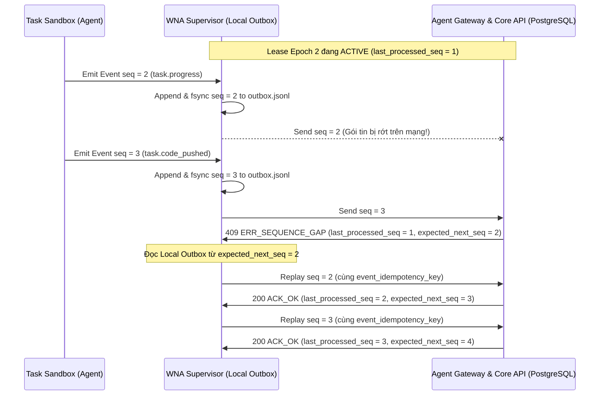

# Software Factory — Đặc tả Giao thức Lease/Event, Phục hồi Mất Gói tin, Linux Sandbox & Cổng Nhập Git (`MVP_LEASE_EVENT_AND_SANDBOX_SPEC.md`)

- **Mã tài liệu:** `MVP-SPEC-03` ([`MVP_LEASE_EVENT_AND_SANDBOX_SPEC.md`](./mvp_lease_event_protocol_sandbox_and_git_import_specification_v1_5.md))
- **Phiên bản:** 1.5
- **Ngày cập nhật:** 2026-11-09
- **Trạng thái:** Ready for Milestone `M1`–`M2` Implementation (`M0` Gate Locked)
- **Bộ tài liệu Core Specs `M0.2`:** [MVP-SPEC-01](./mvp_scope_and_architecture_specification_v1_5.md) · [MVP-SPEC-02](./mvp_database_schema_and_rls_specification_v1_5.md) · [MVP-SPEC-03](./mvp_lease_event_protocol_sandbox_and_git_import_specification_v1_5.md) · [MVP-SPEC-04](./mvp_verifier_3d_reviewer_approval_and_recovery_specification_v1_5.md)
- **Phạm vi:** Định nghĩa chi tiết giao thức Lease/Event/Heartbeat tuần tự, **Worker Local Outbox Buffer & Gap Replay (`P0-4`)**, **Orphaned Push Reconciler (`P0-4`)**, cơ chế cô lập **Linux Task Sandbox (`cgroups v2` + `PR_SET_CHILD_SUBREAPER` — `P1-6`)**, giao diện **`SandboxBackend` & `AgentRuntimeAdapter` (`P-010`)**, và đường nhập code duy nhất trong MVP (**`Fail-Closed Git Gatekeeper` + `Trusted Import Validator` 6 bước — `P1-5`**).

---

## 1. Giao thức Sự kiện Tuần tự, Heartbeat & Đồng bộ `last_processed_seq` (`P0-4`)

### 1.1. Cấu trúc Bản tin Sự kiện từ Worker (`WorkerEventEnvelope`)

Mọi sự kiện phát sinh từ một kỳ thuê `(project_id, task_id, lease_epoch)` phải được `WNA` đóng gói theo lược đồ JSON chuẩn dưới đây trước khi lưu vào Local Outbox và gửi qua WebSocket lên `agent-gateway`:

```json
{
  "event_id": "9b1deb4d-3b7d-4bad-9bdd-2b0d7b3dcb6d",
  "project_id": "22222222-2222-2222-2222-222222222222",
  "task_id": "33333333-3333-3333-3333-333333333333",
  "lease_epoch": 2,
  "worker_id": "44444444-4444-4444-4444-444444444444",
  "session_id": "55555555-5555-5555-5555-555555555555",
  "sequence_no": 3,
  "event_idempotency_key": "22222222-2222-2222-2222-222222222222:33333333-3333-3333-3333-333333333333:epoch-2:seq-3",
  "event_type": "task.progress",
  "payload": {
    "step": "running_local_tests",
    "message": "Executed unit test suite inside sandbox"
  },
  "payload_sha256": "e3b0c44298fc1c149afbf4c8996fb92427ae41e4649b934ca495991b7852b855",
  "emitted_at": "2026-11-09T12:00:05.100Z"
}
```

- **Quy tắc định danh bất biến:**
  - `sequence_no` bắt đầu từ $1$ cho mỗi `lease_epoch` (`1: task.started`, `2..N-1: task.progress / task.code_pushed`, `N: task.completed | task.failed`).
  - `event_idempotency_key` được tính tất định theo công thức: `"<project_id>:<task_id>:epoch-<lease_epoch>:seq-<sequence_no>"`.
  - `payload_sha256` là mã băm SHA-256 của chuỗi JSON canonical của trường `payload`.

### 1.2. Cấu trúc Phản hồi Đồng bộ từ Server (`ServerEventAckContract`)

**100% phản hồi từ `agent-gateway` / `core-api`** (bao gồm cả phản hồi sự kiện, phản hồi Heartbeat và phản hồi bắt tay kết nối lại `session.reconnect`) **bắt buộc trả về `last_processed_seq` và `expected_next_seq`**:

```json
{
  "http_status": 200,
  "status": "ACK_OK",
  "project_id": "22222222-2222-2222-2222-222222222222",
  "task_id": "33333333-3333-3333-3333-333333333333",
  "lease_epoch": 2,
  "lease_status": "ACTIVE",
  "last_processed_seq": 3,
  "expected_next_seq": 4,
  "lease_expires_at": "2026-11-09T12:15:00.000Z",
  "server_clock": "2026-11-09T12:00:05.145Z"
}
```

#### Bảng Mã Phản hồi & Hành động Bắt buộc của `WNA`:

| Mã HTTP & `status` | Điều kiện Xảy ra tại Server | Hành động Xử lý Bắt buộc phía `WNA` |
| :--- | :--- | :--- |
| `200 ACK_OK` | Sự kiện có $\text{sequence\_no} = \text{last\_processed\_seq} + 1$ được ghi mới thành công. | Đánh dấu đã gửi thành công tới `last_processed_seq` trong Local Outbox; gửi tiếp sự kiện `expected_next_seq` (nếu có). |
| `200 RETRY_IDEMPOTENT_OK` | `event_idempotency_key` đã tồn tại trong `processed_events` và khớp hoàn toàn `(lease_epoch, sequence_no, event_type, payload_sha256)`. | Xác nhận sự kiện bị mất ACK trước đó đã được Server xử lý an toàn; đồng bộ con trỏ gửi tới `expected_next_seq`. |
| `409 ERR_SEQUENCE_GAP` | Sự kiện gửi lên có $\text{sequence\_no} > \text{last\_processed\_seq} + 1$ (hoặc $\text{sequence\_no} \le \text{last\_processed\_seq}$ nhưng khác key). | **Dừng luồng gửi hiện tại; đọc Local Outbox Buffer và phát bù tuần tự** các sự kiện từ `expected_next_seq` ($\text{last\_processed\_seq} + 1$) cho đến sự kiện mới nhất. |
| `409 ERR_STALE_LEASE` | `lease_status != 'ACTIVE'`, hoặc `expires_at <= clock_timestamp()`, hoặc lệch `lease_epoch` / `worker_id` / `session_id`. | **Ngay lập tức gọi `killAndVerifyClean(task_id, lease_epoch)`** để tiêu diệt toàn bộ tiến trình trong Sandbox và đóng Local Outbox của epoch cũ. |
| `422 ERR_PAYLOAD_CONFLICT` | Trùng `event_idempotency_key` nhưng `payload_sha256` hoặc `event_type` khác với bản ghi đã lưu. | Lỗi nghiêm trọng do vi phạm tính bất biến của sự kiện; dừng Sandbox và báo lỗi `task.failed`. |

---

## 2. Cơ chế Bộ đệm Cục bộ (`WNA Local Outbox Buffer`) & Phục hồi Mất Kết nối (`P0-4`)

### 2.1. Thiết kế Lưu trữ và Quản lý Dung lượng Local Outbox trên Worker
1. **Đường dẫn & Quyền truy cập:** Mỗi kỳ thuê tạo một tệp journal riêng tại `/var/lib/sf-wna/outbox/<project_id>_<task_id>_epoch_<n>.jsonl` thuộc sở hữu của user `sf-wna` với quyền `0600` (tiến trình `sf-task-runner` trong Sandbox hoàn toàn không có quyền đọc/ghi thư mục này).
2. **Ghi bền trước khi phát (`Write-Ahead Local Journaling`):** Khi nhận sự kiện từ Adapter, `WNA` gán `sequence_no` tăng dần, ghi thêm 1 dòng JSON vào tệp `.jsonl` và gọi `fsync()` trước khi đẩy lên WebSocket.
3. **Giới hạn Dung lượng & Chính sách Dọn dẹp (`Outbox Retention & Quota`):**
   - Kích thước tối đa của mỗi dòng sự kiện: $256\text{ KB}$; kích thước tối đa của một tệp `.jsonl` cho 1 Lease: $50\text{ MB}$ (các log dung lượng lớn của Agent phải cắt nhỏ hoặc tải lên Object Storage khi kết thúc).
   - Ngay khi Lease kết thúc (`COMPLETED`, `EXPIRED`, `REVOKED`) và đã nhận ACK cuối cùng từ Server, `WNA` xóa tệp `.jsonl` tương ứng; các tệp mồ côi quá $24\text{ giờ}$ được trình dọn dẹp của `WNA` tự động xóa khi khởi động.

### 2.2. Sơ đồ Tuần tự Phục hồi khi Rớt Gói tin (`Gap Replay`) & Mất Kết nối Tạm thời (`Reconnect`)



---

## 3. Bộ Cứu hộ Nhánh Đẩy Mồ côi (`Orphaned Push Reconciler` — `P0-4`)

### 3.1. Bài toán Thực tế
Agent trong Sandbox đã chạy xong lệnh `git push` đẩy commit `C_agent` lên `refs/factory/Verify/<task_id>/<epoch>` và vượt qua toàn bộ 6 bước kiểm tra của `Trusted Import Validator`. Tuy nhiên, ngay sau khi `git push` trả về thành công thì máy Worker mất điện hoặc đứt cáp mạng vĩnh viễn trước khi `WNA` kịp gửi bản tin `task.completed` lên `agent-gateway`.

### 3.2. Thuật toán Phục hồi Nguyên tử Tuân thủ RLS (`Lease Expiry & Orphaned Push Reconciler`)
Vì các bảng `task_leases` và `tasks` đều bật `FORCE ROW LEVEL SECURITY` ở chế độ Fail-Closed, tiến trình nền `LeaseExpiryReconciler` trong `core-api` (chạy định kỳ mỗi $5\text{ giây}$ bằng quyền `app_runtime`) thực hiện quy trình 2 bước tuân thủ nghiêm ngặt RLS:

1. **Bước 1 — Lấy danh sách bộ định danh có Lease quá hạn:** Gọi hàm chỉ mục `SELECT * FROM list_expired_active_lease_scopes(100);` (được định nghĩa tại `MVP-SPEC-02` Mục 3) để nhận danh sách các bộ `(organization_id, project_id, task_id, lease_epoch)` đang `ACTIVE` nhưng có `expires_at <= clock_timestamp()`.
2. **Bước 2 — Thực thi giao dịch thu hồi/cứu hộ có đầy đủ ngữ cảnh RLS cho từng Lease:**

```sql
BEGIN;
-- Thiết lập ngữ cảnh RLS của đúng Organization và Project trước khi khóa
SELECT set_config('app.current_org_id', $1::text, true);
SELECT set_config('app.current_project_id', $2::text, true);

-- Khóa Lease đã quá hạn expires_at <= clock_timestamp() theo đúng thứ tự Canonical Lock
SELECT l.project_id, l.task_id, l.lease_epoch,
       v.import_id, v.agent_commit_hash
FROM task_leases l
JOIN tasks t
  ON t.project_id = l.project_id AND t.task_id = l.task_id
LEFT JOIN verified_code_imports v
  ON v.project_id = l.project_id
 AND v.task_id = l.task_id
 AND v.lease_epoch = l.lease_epoch
WHERE l.project_id = $2
  AND l.task_id = $3
  AND l.lease_epoch = $4
  AND l.status = 'ACTIVE'
  AND l.expires_at <= clock_timestamp()
FOR UPDATE OF l, t;
```

- **Nhánh A — Chưa có bản ghi trong `verified_code_imports` (`v.import_id IS NULL`):**
  1. Cập nhật `task_leases.status = 'EXPIRED'`.
  2. Chuyển `tasks.status = 'Ready'` để bộ lập lịch cấp `lease_epoch + 1` mới.
  3. Phát sự kiện thu hồi Sandbox về `WNA` (nếu Worker kết nối lại).
- **Nhánh B — Đã có bản ghi hợp lệ trong `verified_code_imports` (`v.import_id IS NOT NULL`):**
  1. Cập nhật `task_leases.status = 'COMPLETED'` và đánh dấu `verified_code_imports.recovered_by_reconciler = true`.
  2. Ghi sự kiện hệ thống `system.orphaned_import_recovered` vào `outbox_events`.
  3. Chuyển thẳng `tasks.status = 'BuildingMergeCandidate'` với `agent_commit_hash` vừa cứu được — **bảo toàn 100% kết quả làm việc của Agent mà không cần chạy lại Task**.

---

## 4. Đặc tả Kỹ thuật `LinuxSandboxBackend` (`cgroups v2` + `Subreaper` — `P1-6`) & Giao diện Adapter (`P-010`)

### 4.1. Cấu hình Cô lập Tài khoản & Không gian Tên (Linux Namespaces)
1. **Tách biệt UID/GID:**
   - Trình giám sát `WNA` chạy dưới user `sf-wna` (`UID = 10010`).
   - Tiến trình bên trong Sandbox chạy dưới user không đặc quyền `sf-task-runner` (`UID = 10020`, `GID = 10020`), không có quyền `sudo`, bật cờ `PR_SET_NO_NEW_PRIVS`.
2. **Không gian tên & Hệ thống tệp (`Mount / PID / IPC / UTS Namespaces`):**
   - Khởi chạy qua `unshare --mount --pid --ipc --uts --fork`:
   - `/workspace`: Bind-mount đọc-ghi thư mục worktree riêng của kỳ thuê `/var/lib/sf-wna/worktrees/<task_id>-epoch-<n>`.
   - `/tmp`: Mount `tmpfs` riêng biệt (`size=512m,noexec,nosuid,nodev`).
   - Che kín hoàn toàn (`/etc/sf-wna`, `/var/lib/sf-wna/outbox`, `/home`) bằng `tmpfs` rỗng chỉ đọc (`ro,size=4k`).
3. **Làm sạch Biến Môi trường (`env -i`):**
   - Xóa toàn bộ biến môi trường kế thừa từ `WNA`; chỉ truyền danh sách trắng gồm: `PATH`, `HOME=/workspace/.sandbox-home`, `LANG=C.UTF-8`, `SF_TASK_ID`, `SF_LEASE_EPOCH`, `GIT_ASKPASS=/usr/local/libexec/sf-git-askpass` (cung cấp `ephemeral_git_push_token` chỉ có hiệu lực cho đúng `refs/factory/Verify/<task_id>/<epoch>`).

### 4.2. Quản lý `cgroups v2` & Thuật toán Dọn dẹp Tiến trình `killAndVerifyClean`

Khi khởi động, `WNA Supervisor` bắt buộc gọi `prctl(PR_SET_CHILD_SUBREAPER, 1)` để trở thành **Subreaper** thu nhận mọi tiến trình con/cháu tách nhánh kép (double-forked orphans). Mỗi kỳ thuê được đặt trong một nhóm cgroup v2 riêng:
`/sys/fs/cgroup/software-factory/task-<task_id>-epoch-<lease_epoch>/`

- **Cấu hình giới hạn tài nguyên mặc định cho mỗi Sandbox:**
  - `memory.max = 4294967296` ($4\text{ GiB}$), `memory.swap.max = 0`
  - `cpu.max = "200000 100000"` ($2.0\text{ CPUs}$)
  - `pids.max = 512` (chống fork bomb)

#### Thuật toán 4 Bước `killAndVerifyClean(cgroupPath)` (Bắt buộc tại `M2` & `M5-AC1`):
```typescript
export async function killAndVerifyClean(cgroupPath: string, timeoutMs = 5000): Promise<void> {
  // Bước 1: Ghi "1" vào cgroup.kill để nhân Linux gửi SIGKILL nguyên tử tới toàn bộ process tree
  await fs.writeFile(path.join(cgroupPath, 'cgroup.kill'), '1', 'utf8');

  // Bước 2: Đợi cgroup.events báo trường "populated 0"
  const start = Date.now();
  while (true) {
    const eventsRaw = await fs.readFile(path.join(cgroupPath, 'cgroup.events'), 'utf8');
    if (/^populated\s+0$/m.test(eventsRaw)) {
      break;
    }
    if (Date.now() - start > timeoutMs) {
      throw new Error(`SANDBOX_CLEANUP_TIMEOUT: cgroup ${cgroupPath} still populated`);
    }
    await new Promise((r) => setTimeout(r, 25));
  }

  // Bước 3: WNA (đã bật PR_SET_CHILD_SUBREAPER) gọi waitpid(-1, WNOHANG) thu hồi sạch zombie
  reapAllChildZombiesNonBlocking();

  // Bước 4: Xác nhận cgroup.procs và cgroup.threads hoàn toàn rỗng (0 PIDs) rồi xóa thư mục cgroup
  const procs = (await fs.readFile(path.join(cgroupPath, 'cgroup.procs'), 'utf8')).trim();
  const threads = (await fs.readFile(path.join(cgroupPath, 'cgroup.threads'), 'utf8')).trim();
  if (procs.length > 0 || threads.length > 0) {
    throw new Error(`SANDBOX_ORPHAN_DETECTED: residual PIDs (${procs}) in ${cgroupPath}`);
  }
  await fs.rmdir(cgroupPath); // Chỉ thành công nếu nhân Linux xác nhận không còn bất kỳ tiến trình nào
}
```

### 4.3. Giao diện Trừu tượng `SandboxBackend` (`packages/wna`)
`WNA Supervisor` tương tác với môi trường cô lập cấp hệ điều hành thông qua giao diện chuẩn `SandboxBackend` để tách biệt logic điều phối khỏi chi tiết nhân Linux:

```typescript
export interface SandboxSpawnSpec {
  projectId: string;
  taskId: string;
  leaseEpoch: number;
  role: 'DEVELOPER' | 'REVIEWER_READONLY';
  worktreeHostPath: string;
  command: string[];
  whitelistedEnv: Record<string, string>;
  limits: {
    memoryMaxBytes: number;
    cpuQuotaMicrosPer100ms: number;
    pidsMax: number;
  };
}

export interface SandboxResourceUsage {
  wallTimeMs: number;
  cpuUsageUsec: number;
  peakMemoryBytes: number;
}

export interface SandboxBackend {
  prepare(spec: SandboxSpawnSpec): Promise<{ sandboxId: string; cgroupPath: string }>;
  spawn(sandboxId: string, onOutput: (chunk: string) => void): Promise<{ exitCode: number }>;
  killAndVerifyClean(sandboxId: string, timeoutMs?: number): Promise<void>;
  readMetrics(sandboxId: string): Promise<SandboxResourceUsage>;
}
```

### 4.4. Giao diện Chuẩn `AgentRuntimeAdapter` (`packages/adapter-sdk` — `P-010`, `OQ-02`)
Để đảm bảo tính **Agent-agnostic** (hoán đổi được giữa `FakeAgentAdapter`, `ClaudeCodeCliAdapter`, `CodexCliAdapter`, `AiderAdapter` hoặc `OpenHandsAdapter` bằng cấu hình mà không phải sửa đổi `WNA` hay `core-api`), mọi Coding Agent tích hợp vào hệ thống phải cài đặt giao diện `AgentRuntimeAdapter`:

```typescript
export interface AgentTaskContext {
  projectId: string;
  taskId: string;
  leaseEpoch: number;
  reworkCount: number;
  baseMainCommitHash: string;
  isolatedPushRef: string; // refs/factory/Verify/<task_id>/<lease_epoch>
  allowedFiles: string[];
  protectedPaths: string[];
  forbiddenPaths: string[];
  acceptanceCriteriaMd: string;
  previousFailureFeedbackMd?: string;
}

export interface AgentInvocationPlan {
  binaryPath: string;
  args: string[];
  envVars: Record<string, string>;
}

export interface AgentExecutionResult {
  exitCode: number;
  agentCommitHash?: string;
  summaryMessage: string;
}

export interface AgentRuntimeAdapter {
  readonly adapterKey: string; // VD: 'fake-agent', 'claude-code-cli', 'codex-cli'
  readonly version: string;

  /** Chuẩn bị lệnh CLI/SDK headless để chạy bên trong LinuxSandboxBackend */
  buildDeveloperInvocation(ctx: AgentTaskContext): Promise<AgentInvocationPlan>;

  /** Chuẩn bị lệnh chạy 3D Independent Reviewer ở chế độ chỉ đọc trên snapshot C_candidate */
  buildReviewerInvocation(params: {
    ctx: AgentTaskContext;
    mergeCandidateHash: string;
    verifiedTreeHash: string;
    verifierReportJson: string;
  }): Promise<AgentInvocationPlan>;

  /** Phân tích mã thoát và kết quả đầu ra sau khi tiến trình trong Sandbox kết thúc */
  parseDeveloperResult(exitCode: number, stdout: string, worktreePath: string): Promise<AgentExecutionResult>;
}
```

---

## 5. Đường Nhập Code Duy nhất trong MVP: `Fail-Closed Git Gatekeeper` & `Trusted Import Validator` (`P1-5`)

Trong MVP (`M0` $\rightarrow$ `M5`), hệ thống chỉ mở duy nhất đường `git push` vào nhánh cách ly `refs/factory/Verify/<task_id>/<lease_epoch>`. Mọi lệnh push vào nhánh khác (như `refs/heads/main`) từ Worker đều bị từ chối tức thì.

### 5.1. Cơ chế `Fail-Closed` tại Git `pre-receive` Hook
Kịch bản `pre-receive` trên Git Server đọc `(old_rev, new_rev, ref_name)` từ `stdin` cùng `ephemeral_git_push_token` từ header xác thực và gọi API nội bộ `POST /internal/v1/git-gatekeeper/validate-push` của `core-api` với **timeout cứng $2000\text{ ms}$**:
- Nếu `core-api` hoặc PostgreSQL mất kết nối, quá thời gian chờ $2000\text{ ms}$, hoặc trả về bất kỳ mã HTTP nào khác `200 OK`, hook `pre-receive` **bắt buộc trả về mã thoát `exit 1` (Fail-Closed)** và hủy bỏ lệnh push.

### 5.2. Thuật toán 6 Bước Kiểm tra của `Trusted Import Validator` (`P1-5`)

Khi nhận yêu cầu từ `pre-receive` hook, `Trusted Import Validator` thực thi tuần tự 6 bước kiểm tra nghiêm ngặt sau trước khi cho phép ghi ref và lưu vào bảng `verified_code_imports`:

1. **Bước 1 — Kiểm tra Nguyên tử Lease & Định danh Nhánh (`Lease & Ref Fencing`):**
   - Kiểm tra `ref_name` khớp mẫu chính quy `^refs/factory/Verify/([0-9a-f-]{36})/([0-9]+)$` tương ứng với `(task_id, lease_epoch)` trong `ephemeral_git_push_token`.
   - Khóa `task_leases FOR UPDATE` và xác nhận `status = 'ACTIVE' AND revoked_at IS NULL AND expires_at > clock_timestamp()`.
2. **Bước 2 — Kiểm tra Tổ tiên Git & Cấm Merge Commit (`Git Ancestor & Linear History Guard`):**
   - Xác nhận commit nộp lên `new_rev` (`C_agent`) là hậu duệ trực tiếp (`git merge-base --is-ancestor <base_main_commit_hash> <new_rev>`) của `base_main_commit_hash` (`B_base`).
   - Kiểm tra `git rev-list --merges <B_base>..<new_rev>` phải rỗng (cấm Agent tự ý tạo merge commit ngầm).
3. **Bước 3 — Cưỡng chế Thứ tự Ưu tiên Chính sách Đường dẫn (`Path Policy Precedence`):**
   - Chạy `git diff-tree -r -M -C --no-commit-id <B_base> <new_rev>` để lấy danh sách mọi tệp bị thay đổi (với thao tác `Rename`/`Copy`, kiểm tra **cả đường dẫn nguồn lẫn đường dẫn đích**).
   - Với mỗi đường dẫn $p$, kiểm tra theo đúng thứ tự ưu tiên tuyệt đối:
     $$\text{forbidden\_paths} \succ \text{protected\_paths} \succ \text{allowed\_files} \succ \text{Default Deny}$$
     - Nếu $p$ khớp bất kỳ glob nào trong `forbidden_paths` $\rightarrow$ **TỪ CHỐI (`ERR_FORBIDDEN_PATH`)**.
     - Nếu $p$ khớp bất kỳ glob nào trong `protected_paths` $\rightarrow$ **TỪ CHỐI (`ERR_PROTECTED_PATH`)**.
     - Nếu $p$ không khớp bất kỳ glob nào trong `allowed_files` $\rightarrow$ **TỪ CHỐI (`ERR_OUT_OF_SCOPE_FILE` — Default Deny)**.
4. **Bước 4 — Chặn Symlink (`mode 120000`) & Path Traversal:**
   - Duyệt toàn bộ các mục thay đổi trong `git ls-tree -r <new_rev>`:
   - Từ chối ngay nếu phát hiện bất kỳ đối tượng nào có mode `120000` (Symbolic Link), đường dẫn chứa `..`, ký tự điều khiển ASCII, hoặc xung đột tên tệp không phân biệt hoa thường (`case-folding collision`).
5. **Bước 5 — Chặn Submodule (`mode 160000`), Git Hooks & Tệp Nhị phân Vượt cỡ (`Binary & Metadata Guard`):**
   - Từ chối mọi đối tượng có mode `160000` (Gitlink/Submodule) hoặc thay đổi trên `.gitmodules`, `.gitattributes`, `.githooks`, `.github/`, `.gitlab-ci.yml`.
   - Kiểm tra các blob mới/sửa đổi bằng `git diff --numstat <B_base> <new_rev>`: nếu phát hiện tệp nhị phân (hiển thị `-\t-\t<path>`) hoặc blob có kích thước vượt quá `max_binary_bytes` (mặc định $1\text{ MiB}$) mà không được khai báo rõ trong `TaskContract` $\rightarrow$ **TỪ CHỐI (`ERR_BINARY_OR_OVERSIZED_BLOB`)**.
6. **Bước 6 — Chặn Thay đổi Bất thường (`Abnormal Diff Threshold Guard`):**
   - Tính tổng số tệp thay đổi (`changed_files_count`) và tổng số dòng bị xóa (`deleted_lines_count`) giữa `<B_base>` và `<new_rev>`.
   - Nếu $\text{changed\_files\_count} > \text{max\_changed\_files}$ hoặc $\text{deleted\_lines\_count} > \text{max\_deleted\_lines}$ của `TaskContract` $\rightarrow$ **TỪ CHỐI (`ERR_ABNORMAL_DIFF_THRESHOLD`)** nhằm chặn đứng hành vi xóa trắng mã nguồn hàng loạt.