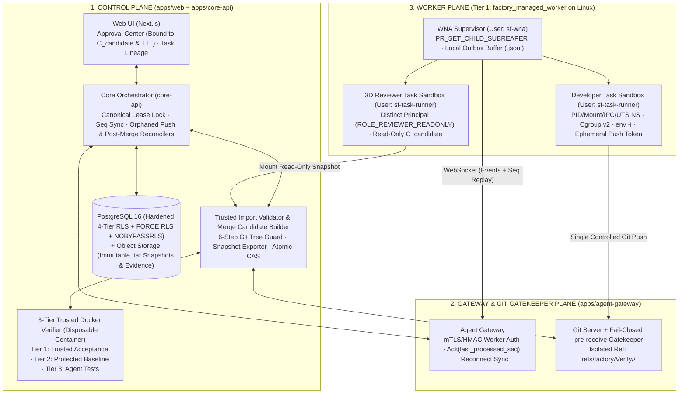

# Software Factory — Đặc tả Phạm vi MVP & Kiến trúc Hệ thống (`MVP_SCOPE_AND_ARCHITECTURE.md`)

- **Mã tài liệu:** `MVP-SPEC-01` ([`MVP_SCOPE_AND_ARCHITECTURE.md`](./mvp_scope_and_architecture_specification_v1_5.md))
- **Phiên bản:** 1.5
- **Ngày cập nhật:** 2026-11-09
- **Trạng thái:** Ready for Milestone `M1` Implementation (`M0` Gate Locked)
- **Tài liệu liên kết trong bộ Core Specs `M0.2`:**
  1. [`MVP_SCOPE_AND_ARCHITECTURE.md`](./mvp_scope_and_architecture_specification_v1_5.md) (Tài liệu này)
  2. [`MVP_DATABASE_AND_RLS_SPEC.md`](./mvp_database_schema_and_rls_specification_v1_5.md)
  3. [`MVP_LEASE_EVENT_AND_SANDBOX_SPEC.md`](./mvp_lease_event_protocol_sandbox_and_git_import_specification_v1_5.md)
  4. [`MVP_VERIFIER_REVIEWER_AND_RECOVERY_SPEC.md`](./mvp_verifier_3d_reviewer_approval_and_recovery_specification_v1_5.md)

---

## 1. Mục tiêu Tài liệu & 10 Nguyên tắc Kiến trúc Bất biến

Tài liệu này khóa chặt ranh giới kỹ thuật giữa **Phạm vi MVP (`M0` $\rightarrow$ `M5`)** và **Kiến trúc Mở rộng Sau MVP (`M6`)**, định nghĩa cấu trúc phân vùng hệ thống, ranh giới bảo mật và chuẩn hóa toàn bộ **11 Quyết định Kiến trúc Cốt lõi (`P-001` $\rightarrow$ `P-011`)**.

### 1.1. Mười Nguyên tắc Kiến trúc Bất biến (Architecture Invariants)

1. **Pragmatic Single-Path MVP First (`P0-1`, `P1-5`):** Trong suốt giai đoạn `M0` $\rightarrow$ `M5`, hệ thống chỉ triển khai **1 đường thực thi duy nhất được kiểm soát chặt từ đầu đến cuối**: `1 Execution Target` (`factory_managed_worker` trên Linux) $+$ `1 Runtime Adapter` (`P-010`) $+$ `1 Git Push Import Path` $+$ `Chạy tuần tự từng Task (Single-Task Serial Flow)`.
2. **Zero-Trust đối với Báo cáo, Mã nguồn và Bài Test của Agent:** Không bao giờ tin tưởng bản tin `task.completed` từ Worker; coi cả mã nguồn lẫn `Agent-Generated Tests` là **Untrusted Code**. Nghiệm thu bắt buộc dựa trên **Trusted Acceptance Tests** và **Protected Project Baseline Tests**.
3. **Canonical Lock & Real-Time Lease Fencing (`clock_timestamp()`):** Mọi giao dịch nhận sự kiện, gia hạn, thu hồi hoặc cấp mới Lease đều phải khóa độc quyền theo thứ tự cố định: `task_leases` trước, `tasks` sau (`FOR UPDATE OF l, t`) và kiểm tra thời hạn bằng `clock_timestamp()`.
4. **Strict Sequential Event Stream & Deterministic Gap Recovery (`P0-4`):** Sự kiện trong mỗi `lease_epoch` phải tuân thủ $\text{sequence\_no} = \text{last\_processed\_seq} + 1$. Khi rớt mạng hoặc lệch thứ tự, Worker tự động phát bù từ **Worker Local Outbox Buffer** dựa trên trường `last_processed_seq` do Server phản hồi.
5. **Controlled Code Import & Git Tree Validation (`P1-5`):** Mọi commit từ Agent phải đẩy qua `Fail-Closed Git Gatekeeper` vào nhánh cách ly `refs/factory/Verify/<task_id>/<epoch>` và vượt qua 6 bước kiểm tra của `Trusted Import Validator`.
6. **Pragmatic Linux Task Sandbox & Subreaper Cgroup Cleanup (`P1-6`):** Mỗi `(task_id, lease_epoch)` chạy dưới tài khoản hệ điều hành riêng (`sf-task-runner`), cô lập bằng Linux namespaces + `cgroups v2`, kết hợp `PR_SET_CHILD_SUBREAPER` để thu gom và chứng minh dọn sạch 100% tiến trình con/cháu mồ côi (`populated == 0`).
7. **Three-Dimensional Reviewer Independence (`P1-7`):** Reviewer Agent bắt buộc độc lập với Developer Agent trên cả 3 chiều: **Identity Independence** (khác principal/credential), **Execution Independence** (sandbox sạch, chỉ đọc bản chụp `C_candidate`), và **Decision Independence** (chỉ xuất `ReviewArtifact`, tự động hủy hiệu lực nếu `C_candidate` thay đổi).
8. **Candidate-Bound Approval, TTL & Idempotent Atomic CAS Merge (`P0-3`, `P1-7`):** Quyết định phê duyệt của con người khóa cứng vào bộ 8 trường của `C_candidate` kèm thời hạn `expires_at` (`Approval TTL`); hợp nhất vào `main` bằng `git update-ref` (Atomic CAS) có **Idempotent Post-Merge Reconciler** chống lỗi lặp khi đứt mạng sau merge.
9. **Hardened Multi-Tier RLS Verified by Matrix (`P1-6`):** Cô lập dữ liệu ở tầng PostgreSQL bằng `FORCE ROW LEVEL SECURITY`, tài khoản `app_runtime` (`NOBYPASSRLS`), biến giao dịch `SET LOCAL` và kiểm chứng tự động qua **Ma trận 8 Kịch bản Kiểm thử Đọc/Ghi (`RLS-T1` $\rightarrow$ `RLS-T8`)**.
10. **Built-in Adversarial & Recovery Testability:** Toàn bộ 10 kịch bản đối kháng và lỗi mạng đều được kiểm thử tự động qua **Fake Agent Harness** trước khi ghép nối với Coding Agent thật.

---

## 2. Phân định Ranh giới Cứng: Phạm vi MVP (`M0`–`M5`) vs. Sau MVP (`M6`) (`P0-1`)

| Hạng mục Kiến trúc | Phạm vi MVP Bắt buộc (`M0` $\rightarrow$ `M5` — Triển khai Trước) | Phạm vi Mở rộng Sau MVP (`M6` — Chỉ mở khóa khi PASS `M5`) |
| :--- | :--- | :--- |
| **Luồng nghiệp vụ trọng tâm** | **Stage 8 Core Execution Loop:** `Task Ready` $\rightarrow$ `Agent chạy trong Linux Sandbox` $\rightarrow$ `Controlled Git Push Import` $\rightarrow$ `Merge Candidate (C_candidate)` $\rightarrow$ `3-Tier Docker Verifier` $\rightarrow$ `3D Independent Reviewer` $\rightarrow$ `Human Approval (TTL)` $\rightarrow$ `Idempotent Atomic CAS Merge`. | **Full Product Pipeline (Stages 1–7 & Stage 9):** Idea Clarification, PRD/SRS, Architecture Generator, Spec Freeze, Project Bootstrapper, Auto Task Breakdown, Change Request & Full Traceability (`AC-11b`). |
| **Execution Target** | **Chỉ 1 loại duy nhất:** `factory_managed_worker` (**Tier 1** trên máy chủ Linux hoặc Linux VM tiêu chuẩn). | Mở rộng thêm `user_managed_worker` (Tier 2), `provider_managed_vm` (Tier 3) và `remote_agent_session` (Tier 4). |
| **Cơ chế Sandbox (`P1-6`)** | **1 lớp Linux Sandbox chuẩn (`LinuxSandboxBackend`):** Dedicated OS user (`sf-task-runner`) + `mount/pid/ipc/uts` namespaces + `cgroups v2` + `PR_SET_CHILD_SUBREAPER` + `env -i`. | Bổ sung runtime cô lập nhân (`gVisor` / `Kata` / Firecracker microVM) cho các tác vụ từ External/Untrusted Targets (Tier 3/4). |
| **Đường nhập Code (`P1-5`)** | **Chỉ 1 đường duy nhất:** `Git Push` qua `Fail-Closed Git Gatekeeper` vào `refs/factory/Verify/<task_id>/<epoch>` $\rightarrow$ `Trusted Import Validator` (6 bước kiểm tra Git tree). | Mở rộng thêm 3 đường phụ: `Git Bundle Upload`, `Unified Diff / Patch Upload` và `Artifact API Code Submission`. |
| **Runtime Adapter & Lập lịch** | **1 Coding Agent Runtime Adapter chính (`P-010`)** + **Fake Agent Harness**; thực thi **tuần tự từng Task (Single-Task Serial Flow)**. | Tích hợp Runtime Adapter thứ hai, `Model Provider Adapter` (OpenAI/Anthropic/Gemini), lập lịch song song đa worktree (DAG Scheduler) và `Budget Auto-Pause (AC-12c)`. |
| **Tài liệu Đặc tả tại `M0` (`P1-8`)** | **Chỉ khóa 4 đặc tả kỹ thuật lõi của MVP:** [`MVP_SCOPE_AND_ARCHITECTURE.md`](./mvp_scope_and_architecture_specification_v1_5.md), [`MVP_DATABASE_AND_RLS_SPEC.md`](./mvp_database_schema_and_rls_specification_v1_5.md), [`MVP_LEASE_EVENT_AND_SANDBOX_SPEC.md`](./mvp_lease_event_protocol_sandbox_and_git_import_specification_v1_5.md), [`MVP_VERIFIER_REVIEWER_AND_RECOVERY_SPEC.md`](./mvp_verifier_3d_reviewer_approval_and_recovery_specification_v1_5.md). | Đặc tả chi tiết cho Stages 1–7, Multi-Target Orchestration và Cost Governance được hoàn thiện ở đầu `M6A`. |

---

## 3. Kiến trúc Logic Tổng thể & Cấu trúc Monorepo trong MVP

### 3.1. Sơ đồ Kiến trúc Phân vùng MVP (`M0` $\rightarrow$ `M5`)



### 3.2. Cấu trúc Thư mục Monorepo Chuẩn của MVP

```text
software-factory/
├── apps/
│   ├── web/                    # Giao diện Next.js (Approval Center, Task Monitor, Lineage Viewer)
│   ├── core-api/               # Dịch vụ điều phối trung tâm, State Machine, Import Validator, Verifier & CAS Merge
│   └── agent-gateway/          # Cổng WebSocket giữ kết nối với WNA, xác thực Principal, đồng bộ sequence_no
├── packages/
│   ├── shared-types/           # Định nghĩa TypeScript/JSON Schema dùng chung (Events, Payloads, Errors)
│   ├── database/               # Migrations (db_migrator), RLS Policies, Query Builder cho app_runtime
│   ├── task-contract/          # Trình phân tích & kiểm tra Path Policy Precedence, TaskContract Validator
│   ├── adapter-sdk/            # Giao diện chuẩn cho Coding Agent Runtime Adapter (P-010)
│   ├── wna/                    # Worker Node Agent Supervisor, Local Outbox Buffer, LinuxSandboxBackend
│   └── test-harness/           # Fake Agent Harness (10 kịch bản đối kháng & tiêm lỗi mạng) + RLS Test Suite
└── scripts/
    └── git-hooks/
        └── pre-receive         # Fail-Closed Git Gatekeeper gọi đồng bộ tới core-api Import Validator
```

### 3.3. Ma trận Phân tách Ranh giới Định danh & Credential (`P1-6`)

| Thành phần | Tài khoản OS / DB | Credential được phép giữ | Ranh giới Cô lập Bắt buộc trong MVP |
| :--- | :--- | :--- | :--- |
| **`core-api`** | DB Role: `app_runtime` (`NOBYPASSRLS`) | Kết nối DB `app_runtime`, khóa ký `ephemeral_git_push_token`, khóa gọi Object Storage. | Bắt buộc gọi `SET LOCAL app.current_org_id` & `app.current_project_id` trong mọi transaction; không chạy trực tiếp code của người dùng. |
| **`agent-gateway`** | Service User: `sf-gateway` | Khóa xác thực mTLS CA / HMAC của Worker Node và token nội bộ gọi `core-api`. | Trích xuất `worker_id` và `principal_id` từ tầng kết nối xác thực; không cho phép payload của Worker tự ghi đè định danh. |
| **`WNA Supervisor`** | OS User: `sf-wna` | `worker_node_credential` (kết nối `agent-gateway`), quyền quản trị nhánh cgroup `/sys/fs/cgroup/software-factory/`. | **Tuyệt đối không truyền `worker_node_credential` hoặc biến môi trường của `sf-wna` vào bên trong `Task Sandbox`**. |
| **`Linux Task Sandbox` (Developer)** | OS User: `sf-task-runner` | (1) Worktree riêng của `(task_id, lease_epoch)`, (2) `ephemeral_git_push_token` chỉ ghi được vào `refs/factory/Verify/<task_id>/<epoch>`, (3) API key phạm vi hẹp của Coding Agent. | Khởi chạy bằng `env -i` + `mount/pid/ipc/uts` namespaces riêng; không đọc được `/etc/sf-wna`, `/var/lib/sf-wna/outbox` hay worktree của Task khác. |
| **`Linux Task Sandbox` (Reviewer)** | OS User: `sf-task-runner` | `reviewer_session_token` (`ROLE_REVIEWER_READONLY`), bản chụp chỉ đọc của `C_candidate`. | Không có `ephemeral_git_push_token`, không nhận lịch sử hội thoại nội bộ (scratchpad) của Developer. |
| **`Docker Verifier`** | Container `uid=10001` (`--cap-drop=ALL`) | **Không giữ bất kỳ credential nào** của DB, Control Plane, Git hay AI Provider. | Chạy trong container dùng một lần (`--rm`, `--security-opt=no-new-privileges`, `--network=none` ở chế độ Hermetic) trên bản chụp bất biến của `C_candidate`. |

---

## 4. Máy Trạng thái Vòng đời Task trong MVP (Stage 8 Core State Machine)

Bảng chuyển trạng thái hợp lệ (`State Transition Matrix`) được cưỡng chế trực tiếp trong giao dịch PostgreSQL của `core-api`:

| Trạng thái Hiện tại (`from_status`) | Sự kiện / Điều kiện Kích hoạt | Trạng thái Đích (`to_status`) | Hành động Nguyên tử Đi kèm |
| :--- | :--- | :--- | :--- |
| `Ready` | Cấp phát Lease mới cho Worker | `Leased` | Tăng `current_lease_epoch + 1`, tạo bản ghi `task_leases (status = 'ACTIVE', last_processed_seq = 0)`. |
| `Leased` | Nhận sự kiện `task.started` ($\text{seq} = 1$) | `ExecutingInTarget` | Cập nhật `last_processed_seq = 1`, `last_heartbeat_at = clock_timestamp()`. |
| `Leased` / `ExecutingInTarget` | Lease hết hạn hoặc bị Revoke **và chưa có** bản ghi trong `verified_code_imports` | `Ready` | Đánh dấu Lease `EXPIRED`/`REVOKED`, gửi lệnh `killAndVerifyClean` tới WNA để thu hồi Sandbox. |
| `ExecutingInTarget` | Nhận `task.completed` **hoặc** `Orphaned Push Reconciler` tìm thấy commit hợp lệ trong `verified_code_imports` | `BuildingMergeCandidate` | Khóa commit `C_agent` tại `refs/factory/Verify/<task_id>/<epoch>`, đóng Lease `COMPLETED`. |
| `BuildingMergeCandidate` | Tích hợp `C_agent` lên `B_base` (`HEAD` của `main`) bị xung đột Git | `ReworkRequired` | Ghi nhận lỗi xung đột Git để Agent rebase/sửa ở vòng tiếp theo. |
| `BuildingMergeCandidate` | Tạo thành công `C_candidate` (`verified_tree_hash`) & xuất `.tar` snapshot | `VerifyingInDocker` | Tạo bản ghi `merge_candidates` và khởi chạy `3-Tier Docker Verifier`. |
| `VerifyingInDocker` | Docker Verifier `FAIL` và $\text{rework\_count} < \text{max\_rework\_cycles}$ | `ReworkRequired` | Lưu báo cáo lỗi Verifier để đính kèm vào Task Context của vòng sửa lỗi. |
| `VerifyingInDocker` | Docker Verifier `FAIL` và $\text{rework\_count} \ge \text{max\_rework\_cycles}$ | `ManualIntervention` | Ngắt tự động hóa, gửi cảnh báo cho con người xử lý. |
| `VerifyingInDocker` | Docker Verifier `PASS` cả 3 tầng kiểm thử | `UnderIndependentReview` | Khởi tạo phiên `3D Independent Reviewer` trên snapshot `C_candidate`. |
| `UnderIndependentReview` | Reviewer xuất `ReviewArtifact = REJECT` ($\text{rework\_count} < \text{max}$) | `ReworkRequired` | Lưu nhận xét của Reviewer cho vòng sửa lỗi tiếp theo. |
| `UnderIndependentReview` | Reviewer xuất `ReviewArtifact = REJECT` ($\text{rework\_count} \ge \text{max}$) | `ManualIntervention` | Ngắt tự động hóa, chuyển con người xử lý. |
| `UnderIndependentReview` | Reviewer xuất `ReviewArtifact = APPROVE` | `AwaitingHumanApproval` | Tạo `ApprovalRequest` gắn chặt với `C_candidate` và thiết lập `expires_at` (`Approval TTL`). |
| `AwaitingHumanApproval` | Con người chọn `REQUEST_CHANGES` | `ReworkRequired` | Hủy `ApprovalRequest` hiện hành, ghi nhận yêu cầu sửa của người duyệt. |
| `AwaitingHumanApproval` | `ApprovalRequest` quá hạn `expires_at` hoặc nhánh `main` đã đổi commit | `BuildingMergeCandidate` | Đánh dấu `INVALIDATED_STALE_BASE`, tạo lại `C_candidate` mới trên `HEAD` mới của `main`. |
| `AwaitingHumanApproval` | Con người bấm `APPROVE` (còn hạn `TTL` & khớp 8 trường của `C_candidate`) | `AtomicCasMerge` | Ghi bản ghi bất biến `approval_decisions` và `merge_operations`. |
| `AtomicCasMerge` | `git update-ref refs/heads/main <C_candidate> <B_base>` thành công (hoặc `Post-Merge Reconciler` xác nhận đã merge) | `MergedAndCompleted` | Hoàn tất Task, lưu dấu vết truy xuất `AC-11a`. |
| `AtomicCasMerge` | True CAS Conflict (`main` đang ở `<B_new>` $\neq$ `<B_base>` và $\neq$ `<C_candidate>`) | `BuildingMergeCandidate` | Hủy hiệu lực `ApprovalDecision` & `ReviewArtifact` cũ (`INVALIDATED_STALE_BASE`), tạo lại Candidate trên `<B_new>`. |
| `ReworkRequired` | Bộ lập lịch cấp phát vòng sửa lỗi mới | `Leased` | Tăng `rework_count = rework_count + 1` và cấp `lease_epoch` mới. |

---

## 5. Hồ sơ 11 Quyết định Kiến trúc Cốt lõi (`P-001` $\rightarrow$ `P-011`)

| Mã ADR | Hạng mục Quyết định | Quyết định Khóa cho MVP (`M0` $\rightarrow$ `M5`) | Cơ chế Kiểm chứng Nghiệm thu |
| :--- | :--- | :--- | :--- |
| **`P-001`** | **Mô hình Triển khai Tổng thể** | **Control Plane** triển khai dạng Modular Monolith (`core-api` + `web`), tách rời dịch vụ giữ kết nối dài hạn **Agent Gateway** (`agent-gateway`) và **Worker Plane** (`WNA`). | Kiểm tra cấu trúc monorepo và giao tiếp nội bộ tại `M1` & `M2`. |
| **`P-002`** | **Cơ sở Dữ liệu & Lưu trữ** | **PostgreSQL 16+** là Source of Truth duy nhất (kèm **Transactional Outbox** và **Hardened 4-Tier RLS** với `FORCE RLS` & `NOBYPASSRLS`); Object Storage lưu trữ immutable `.tar` snapshots và logs. | Kiểm chứng qua `RLS-T1` $\rightarrow$ `RLS-T8` tại `M1`. |
| **`P-003`** | **Tích hợp AI & Execution Target** | Khóa chặt **1 Execution Target (`factory_managed_worker` trên Linux)** và **1 Coding Agent Runtime Adapter (`P-010`)** trong MVP; hoãn đa Target (Tier 2/3/4) và đa Adapter sang `M6`. | Kiểm chứng qua `Adapter Contract Test Suite` tại `M2`. |
| **`P-004`** | **Linux Task Sandbox & 3-Tier Docker Verifier** | Trên Worker dùng `LinuxSandboxBackend` (`sf-task-runner` + `namespaces` + `cgroups v2` + `subreaper`); tại Control Plane dùng **Docker Verifier** tách 3 tầng test và cấm hardlink cache. | Kiểm chứng tại `M2` (`populated == 0`) và `M3` (3-Tier Verifier). |
| **`P-005`** | **Lựa chọn Workflow Engine** | **Transactional State Machine trên PostgreSQL** (lưu nguyên tử trạng thái Task cùng `task_leases`, `last_processed_seq`, `processed_events` và `outbox_events` trong đúng 1 giao dịch ACID). | Kiểm chứng qua giao dịch State Machine tại `M1` & `M4`. |
| **`P-006`** | **Canonical Lease Lock, Sequential Events & Gap Recovery** | Khóa độc quyền `task_leases FOR UPDATE` với `clock_timestamp()`; cưỡng chế $\text{sequence\_no} = \text{last\_processed\_seq} + 1$; đồng bộ bù qua **WNA Local Outbox Buffer** và **Orphaned Push Reconciler**. | Kiểm chứng qua Kịch bản 2, 3, 4, 5 của Fake Agent Harness tại `M1` & `M2`. |
| **`P-007`** | **Single Git Import (MVP), Candidate-First & Idempotent CAS Merge** | MVP chỉ mở 1 đường `Git Push` $\rightarrow$ `Trusted Import Validator` (6 bước); tạo `C_candidate` trước khi kiểm định/duyệt; hợp nhất bằng `git update-ref` kết hợp **Idempotent Post-Merge Reconciler**. | Kiểm chứng tại `M2`, `M3`, `M4` (Kịch bản 6, 9, 10). |
| **`P-008`** | **Kiểm định 3 Lớp & Độc lập 3 Chiều (3D Reviewer)** | Kết hợp **3-Tier Docker Verifier** $\rightarrow$ **3D Independent Reviewer** (*Identity*, *Execution*, *Decision*) $\rightarrow$ **Human Approval Gate** có `Approval TTL`. | Kiểm chứng tại `M3` & `M4` (Kịch bản 1 & 8). |
| **`P-009`** | **Hardened 4-Tier RLS & Ma trận Kiểm thử Quyền** | Phân loại bảng thành 4 tầng (*Global*, *Org*, *Project Root/Child*, *Execution*); tách rõ policy bảng `projects` (`id`) và bảng con (`project_id`); vượt qua đủ 8 bài test `RLS-T1` $\rightarrow$ `RLS-T8`. | CI chạy tự động bộ test RLS tại `M1`. |
| **`P-010`** | **Lựa chọn Coding Agent Đầu tiên** | Giao diện chuẩn `AgentRuntimeAdapter` (`packages/adapter-sdk`) chạy headless trong `LinuxSandboxBackend`, tuân thủ ToS/License, thu được commit/diff/exit code chuẩn. | Kiểm chứng tại `M2` & `M5-AC1`. |
| **`P-011`** | **Lộ trình Theo 7 Milestone Gates (`M0` $\rightarrow$ `M6`)** | Xây dựng tuần tự từ `M0` $\rightarrow$ `M5`; đặt **cổng chặn cứng Vertical Slice tại `M5`** (đạt 8/8 tiêu chí `M5-AC1` $\rightarrow$ `M5-AC8` trên dự án thật) trước khi mở khóa `M6`. | Hồ sơ nghiệm thu `M5_EVIDENCE_BUNDLE.json` tại cuối Phase 5. |

---

## 6. Khung Đóng 5 Câu hỏi Mở (`OQ-01` $\rightarrow$ `OQ-05`) tại Gate `G2` (`M0`)

Để hoàn tất Milestone `M0` và mở khóa viết code cho `M1`, 5 câu hỏi mở dưới đây đã được giải quyết dứt điểm và khóa vào 4 tài liệu đặc tả này:

| Mã OQ | Nội dung Câu hỏi Mở | Quyết định Chuẩn hóa trong Bộ Đặc tả `M0.2` | Tài liệu Đặc tả Quy định Chi tiết |
| :--- | :--- | :--- | :--- |
| **`OQ-01`** | Giao thức Lease/Event, Gap Replay (`P0-4`) & Ranh giới Linux Sandbox (`P1-6`) | Sử dụng kết nối outbound WebSocket từ `WNA` tới `agent-gateway`; khóa `task_leases FOR UPDATE` với `clock_timestamp()`; mọi ACK/NACK trả về `last_processed_seq`; `WNA` lưu Local Outbox `.jsonl` để tự replay; cô lập bằng `LinuxSandboxBackend` (`cgroups v2` + `PR_SET_CHILD_SUBREAPER`). | [`MVP_LEASE_EVENT_AND_SANDBOX_SPEC.md`](./mvp_lease_event_protocol_sandbox_and_git_import_specification_v1_5.md) (Mục 1, 2, 4) |
| **`OQ-02`** | Lựa chọn Coding Agent đầu tiên (`P-010`) & Kiểm tra License/ToS | Chốt thông qua giao diện chuẩn `AgentRuntimeAdapter` trong `packages/adapter-sdk` (cho phép hoán đổi giữa `FakeAgentAdapter`, `ClaudeCodeCliAdapter`, `CodexCliAdapter`, `AiderAdapter`, `OpenHandsAdapter` bằng cấu hình mà không sửa lõi `WNA`). | [`MVP_LEASE_EVENT_AND_SANDBOX_SPEC.md`](./mvp_lease_event_protocol_sandbox_and_git_import_specification_v1_5.md) (Mục 4.3, 4.4) |
| **`OQ-03`** | Kiến trúc 3-Tier Test Verification & No-Hardlink Cache của Docker Verifier | Tạo `C_candidate` trước khi kiểm định; xuất `.tar` snapshot bất biến; gắn Dependency Cache qua `OverlayFS` (`lowerdir` chỉ đọc, `upperdir` trên `tmpfs`) kèm `fs.protected_hardlinks = 1`; tách 3 tầng test riêng biệt. | [`MVP_VERIFIER_REVIEWER_AND_RECOVERY_SPEC.md`](./mvp_verifier_3d_reviewer_approval_and_recovery_specification_v1_5.md) (Mục 1, 2) |
| **`OQ-04`** | Đường Import Duy nhất (`P1-5`), Candidate-First Approval & Post-Merge Reconciler (`P0-3`) | MVP chỉ mở đường `Git Push` $\rightarrow$ `pre-receive` Fail-Closed Gatekeeper $\rightarrow$ `Trusted Import Validator` (6 bước); khóa `ApprovalDecision` vào 8 trường của `C_candidate` + `TTL`; dùng `git update-ref` kèm `Idempotent Post-Merge Reconciler`. | [`MVP_LEASE_EVENT_AND_SANDBOX_SPEC.md`](./mvp_lease_event_protocol_sandbox_and_git_import_specification_v1_5.md) (Mục 5) & [`MVP_VERIFIER_REVIEWER_AND_RECOVERY_SPEC.md`](./mvp_verifier_3d_reviewer_approval_and_recovery_specification_v1_5.md) (Mục 4, 5) |
| **`OQ-05`** | Lựa chọn Workflow Engine (`P-005`) & Lộ trình `M0` $\rightarrow$ `M6` (`P-011`) | Sử dụng **Transactional State Machine trên PostgreSQL** để đảm bảo cập nhật trạng thái Task, `task_leases`, `processed_events` và `outbox_events` trong đúng 1 giao dịch ACID; áp dụng lộ trình 7 mốc `M0` $\rightarrow$ `M6`. | [`MVP_SCOPE_AND_ARCHITECTURE.md`](./mvp_scope_and_architecture_specification_v1_5.md) (Mục 4) & [`MVP_DATABASE_AND_RLS_SPEC.md`](./mvp_database_schema_and_rls_specification_v1_5.md) (Mục 2, 4) |