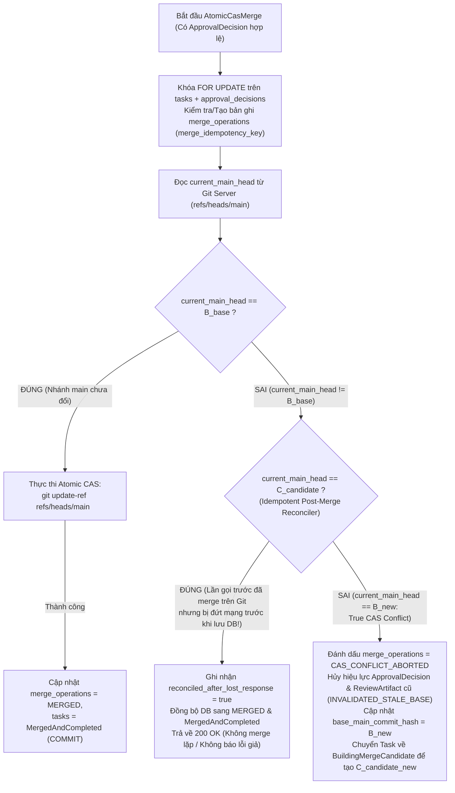

# Software Factory — Đặc tả Merge Candidate, 3-Tier Docker Verifier, 3D Independent Reviewer & Phục hồi Sau Merge (`MVP_VERIFIER_REVIEWER_AND_RECOVERY_SPEC.md`)

- **Mã tài liệu:** `MVP-SPEC-04` ([`MVP_VERIFIER_REVIEWER_AND_RECOVERY_SPEC.md`](./mvp_verifier_3d_reviewer_approval_and_recovery_specification_v1_5.md))
- **Phiên bản:** 1.5
- **Ngày cập nhật:** 2026-11-09
- **Trạng thái:** Ready for Milestone `M3`–`M5` Implementation (`M0` Gate Locked)
- **Bộ tài liệu Core Specs `M0.2`:** [MVP-SPEC-01](./mvp_scope_and_architecture_specification_v1_5.md) · [MVP-SPEC-02](./mvp_database_schema_and_rls_specification_v1_5.md) · [MVP-SPEC-03](./mvp_lease_event_protocol_sandbox_and_git_import_specification_v1_5.md) · [MVP-SPEC-04](./mvp_verifier_3d_reviewer_approval_and_recovery_specification_v1_5.md)
- **Phạm vi:** Định nghĩa quy trình tạo **Merge Candidate (`C_candidate`) trước khi kiểm định**, kiến trúc **3-Tier Trusted Docker Verifier** cấm hardlink cache, cơ chế cưỡng chế **Độc lập 3 Chiều của Reviewer (`P1-7`)**, **Human Approval gắn chặt `C_candidate` kèm `Approval TTL`**, **Idempotent Post-Merge Reconciler (`P0-3`)** và bảng kiểm nghiệm thu **Milestone `M5` (`M5-AC1` $\rightarrow$ `M5-AC8`)**.

---

## 1. Merge Candidate Builder: Tạo `C_candidate` Trước Khi Kiểm định (`Candidate-First Principle`)

Mọi bước kiểm thử tự động, đánh giá của Reviewer và phê duyệt của con người **tuyệt đối không chạy trên commit riêng lẻ `C_agent` của Worker**, mà bắt buộc chạy trên chính xác **Merge Candidate Commit (`C_candidate`)** dự kiến sẽ được cập nhật vào nhánh `main`.

### 1.1. Quy trình Tạo `C_candidate` & Bản chụp Bất biến (`.tar` Snapshot)
1. **Đọc Đầu nhánh Chính Hiện tại (`B_base`):** Lấy mã băm commit hiện hành của `refs/heads/main` là `B_base` (`base_main_commit_hash`).
2. **Tích hợp trong Worktree Tạm của Control Plane:**
   - Tạo commit ứng viên hợp nhất `C_candidate` (`merge_candidate_hash`) bằng cách tích hợp `C_agent` (từ `refs/factory/Verify/<task_id>/<epoch>`) lên trên `B_base` (`git merge-tree --write-tree <B_base> <C_agent>` + `git commit-tree`).
   - Nếu quá trình tích hợp xảy ra xung đột mã nguồn (Git merge conflict), hệ thống không tạo `C_candidate` mà chuyển ngay Task sang trạng thái `ReworkRequired` kèm danh sách các tệp xung đột.
3. **Xuất Bản chụp Mã nguồn Bất biến (`Immutable Source Snapshot`):**
   - Thu thập mã băm cây thư mục gốc `T_verified` (`verified_tree_hash = git rev-parse <C_candidate>^{tree}`).
   - Đóng gói toàn bộ cây mã nguồn của `C_candidate` (không kèm thư mục `.git`) thành tệp lưu trữ tất định:
     `git archive --format=tar <T_verified> > snapshot-<T_verified>.tar`
   - Tính mã băm SHA-256 (`snapshot_sha256`), tải lên Object Storage ở chế độ bất biến (Write-Once-Read-Many) và ghi bản ghi vào bảng `merge_candidates`.
4. **Chính sách Dọn dẹp Bản chụp (`Snapshot Garbage Collection`):**
   - Các bản chụp `.tar` gắn với `merge_candidates` có trạng thái `MERGED` được giữ lại vĩnh viễn cùng hồ sơ kiểm toán (`M5_EVIDENCE_BUNDLE`).
   - Các bản chụp của những ứng viên bị thay thế (`INVALIDATED_STALE_BASE` hoặc `SUPERSEDED`) được giữ lại trong $14\text{ ngày}$ để phục vụ điều tra lỗi trước khi trình dọn dẹp Object Storage tự động thu hồi.

---

## 2. Kiến trúc 3-Tier Trusted Docker Verifier & Cô lập Bộ nhớ Đệm (`M3`)

### 2.1. Cấu hình Bảo mật Container Dùng Một lần & Cấm Hardlink Cache
Mỗi lần chạy `VerificationRun` khởi tạo một Docker container hoàn toàn mới từ image kiểm định chuẩn với các tham số:
- `--rm --read-only --cap-drop=ALL --security-opt=no-new-privileges:true --pids-limit=512 --memory=4g --memory-swap=4g --cpus=2`
- **Chế độ mạng:** Mặc định chạy `--network=none` (Hermetic Verification).
- **Cấu trúc Mount Hệ thống Tệp & Cấm Hardlink Dependency Cache:**
  - `/workspace/baseline:ro`: Mount chỉ đọc bản chụp đã giải nén của `C_candidate`.
  - `/workspace/run`: Mount trên `tmpfs` (hoặc `upperdir` dùng một lần) để thực thi kiểm thử.
  - `/workspace/deps-cache`: Để ngăn chặn một container bị nhiễm mã độc tạo hardlink vào tệp trong bộ nhớ đệm phụ thuộc nhằm đầu độc các lần chạy sau, hệ thống **cấm tuyệt đối việc chia sẻ thư mục cache qua hardlink**:
    - Trên máy chủ chạy Verifier, bật `sysctl fs.protected_hardlinks = 1` và `fs.protected_symlinks = 1`.
    - Gắn bộ nhớ đệm thông qua **OverlayFS** với `lowerdir=/var/cache/sf-verifier/deps:ro` (chỉ đọc) và `upperdir` + `workdir` nằm hoàn toàn trên `tmpfs` dùng một lần của container đó (tự hủy 100% khi container tắt).

### 2.2. Thực thi Tách biệt 3 Tầng Kiểm thử (`3-Tier Test Verification`)

| Thứ tự Thực thi | Tên Tầng Kiểm thử | Nguồn Nạp & Cơ chế Xác thực Trước Khi Chạy | Điều kiện Đạt (`PASS`) / Trượt (`FAIL`) |
| :--- | :--- | :--- | :--- |
| **Tầng 1** | **`Trusted Acceptance Tests`** | Nạp từ volume chỉ đọc `/trusted-policy/acceptance-tests:ro` (lưu tách biệt khỏi nhánh của Agent). Trước khi chạy, Verifier đối chiếu mã băm SHA-256 của bộ test với cột `trusted_policy_sha256` trong `task_contracts`. | Nếu bất kỳ bài kiểm thử chấp nhận nào trượt $\rightarrow$ Dừng và trả về `FAILED_ACCEPTANCE`. |
| **Tầng 2** | **`Protected Project Baseline Tests`** | Nằm trong danh sách `protected_paths` của dự án. Trước khi chạy test, Verifier tính SHA-256 của toàn bộ các tệp trong `protected_paths` trên `C_candidate` và so sánh với bản gốc tại `B_base`. | • Nếu bất kỳ tệp test cơ sở nào bị sửa/xóa trái phép $\rightarrow$ Đánh trượt ngay lập tức với mã **`TEST_TAMPERING_DETECTED`**.<br>• Nếu test chạy trượt $\rightarrow$ Trả về `FAILED_ACCEPTANCE`. |
| **Tầng 3** | **`Agent-Generated Tests`** | Các bài kiểm thử mới do Developer Agent viết thêm trong phạm vi `allowed_files`. | Chạy không có bất kỳ biến môi trường nhạy cảm nào; thu thập kết quả pass/fail cùng nội dung mã nguồn của các câu lệnh `assert`/`expect` để chuyển cho **3D Independent Reviewer** kiểm tra. |

### 2.3. Phân loại Lỗi Timeout của Code Agent vs. Lỗi Hạ tầng Docker (`P0-3`)
- **`TEST_TIMEOUT` (Lỗi do mã nguồn hoặc bài test của Agent bị treo/lặp vô hạn):** Khi container vẫn đang chạy bình thường nhưng một bước kiểm thử vượt quá `step_timeout_seconds` (mặc định $300\text{ giây}$), Verifier hủy container, ghi nhận `overall_status = 'TEST_TIMEOUT'` và chuyển Task sang `ReworkRequired` (tăng `rework_count + 1`).
- **`INFRA_ERROR` (Lỗi do Docker daemon, ổ đĩa host hoặc lỗi nạp image):** Nếu container không thể khởi tạo hoặc bị nhân hệ điều hành hủy bất thường ngoài nguyên nhân OOM của bài test, hệ thống ghi nhận `INFRA_ERROR` và **tự động chạy lại (retry) tối đa $2\text{ lần}$ trên cùng `C_candidate` mà không làm tăng `rework_count` của Agent**.

---

## 3. Đảm bảo Reviewer Độc lập Thực sự trên 3 Chiều (`3D Reviewer Independence` — `P1-7`)

### 3.1. Cơ chế Cưỡng chế Kỹ thuật cho 3 Chiều Độc lập

1. **Chiều 1 — Độc lập về Định danh (`Identity Independence`):**
   - `agent-gateway` xác thực kết nối của Reviewer và cấp chứng chỉ phiên riêng với vai trò `ROLE_REVIEWER_READONLY`.
   - Khi lưu kết quả vào bảng `review_artifacts`, PostgreSQL kiểm tra ràng buộc cứng `CONSTRAINT chk_3d_reviewer_distinct_principal CHECK (reviewer_principal_id <> developer_principal_id)` và `core-api` xác nhận `reviewer_session_id != developer_session_id`.
2. **Chiều 2 — Độc lập về Thực thi (`Execution Independence`):**
   - Reviewer được khởi chạy trong một `LinuxSandboxBackend` hoàn toàn mới (`clean session`), không có quyền mạng ghi Git.
   - Đầu vào cung cấp cho Reviewer **chỉ bao gồm**:
     1. `TaskContract` (yêu cầu nghiệp vụ và phạm vi tệp).
     2. Bản chụp chỉ đọc (`read-only snapshot`) của `C_candidate` kèm bản `git diff <B_base>..<C_candidate>`.
     3. Báo cáo kết quả thực thi của `3-Tier Docker Verifier`.
   - **Cấm truyền lịch sử hội thoại nội bộ (scratchpad / chain-of-thought) của Developer Agent sang cho Reviewer** để loại bỏ hoàn toàn thiên kiến dẫn dắt (*anchoring bias*).
3. **Chiều 3 — Độc lập về Quyết định & Tự động Hủy hiệu lực (`Decision Independence & Auto-Invalidation`):**
   - Reviewer chỉ có quyền xuất `ReviewArtifact` (`verdict: APPROVE | REJECT`) gắn chặt với bộ ba `(merge_candidate_hash, verified_tree_hash, verification_run_id)`.
   - **Quy tắc Kiểm tra Bắt buộc đối với `Agent-Generated Tests`:** Reviewer phải phân tích cây cú pháp/nội dung các bài test ở Tầng 3 và đánh trượt (`REJECT`) nếu phát hiện bài test rỗng (`expect(true).toBe(true)`), bài test bị vô hiệu hóa (`it.skip`, `@Disabled`) hoặc bài test không kiểm tra nhánh logic vừa sửa.
   - **Quy tắc Tự động Hủy hiệu lực (`Auto-Invalidation Rule`):** Bất cứ khi nào một `C_candidate` mới được tạo ra cho Task hoặc nhánh `main` tiến lên commit mới, câu lệnh SQL sau sẽ tự động vô hiệu hóa toàn bộ kết quả đánh giá cũ:
     ```sql
     UPDATE review_artifacts
     SET status = 'INVALIDATED_STALE_CANDIDATE'
     WHERE project_id = $1 AND task_id = $2
       AND merge_candidate_hash <> $3
       AND status = 'VALID';
     ```

---

## 4. Phê duyệt của Con người Gắn chặt với `C_candidate` & Thời hạn `Approval TTL` (`P0-3`, `P1-7`)

Khi `ReviewArtifact` đạt trạng thái `APPROVE`, hệ thống tạo bản ghi `approval_requests` với thời hạn hiệu lực:
$$\text{expires\_at} = \text{clock\_timestamp()} + \text{project.approval\_ttl\_seconds}$$

Khi người có thẩm quyền (`PROJECT_APPROVER` / `ORG_ADMIN`) bấm nút phê duyệt trên Web UI, `core-api` thực thi giao dịch kiểm tra nguyên tử:
1. Khóa dòng `tasks` và `approval_requests` bằng `SELECT ... FOR UPDATE`.
2. Kiểm tra tại đúng thời điểm thực thi:
   - `approval_requests.status = 'PENDING'`
   - `approval_requests.expires_at > clock_timestamp()` (Nếu đã quá hạn, cập nhật trạng thái thành `INVALIDATED_EXPIRED` và trả về lỗi `409 ERR_APPROVAL_EXPIRED_OR_STALE`).
   - Toàn bộ **8 trường định danh** gửi từ giao diện người dùng phải khớp 100% với trạng thái hiện hành của Task và nhánh `main`:
     1. `project_id`
     2. `task_id`
     3. `agent_commit_hash` (`C_agent`)
     4. `base_main_commit_hash` (`B_base` — phải bằng đúng `HEAD` hiện tại của `refs/heads/main`)
     5. `merge_candidate_hash` (`C_candidate`)
     6. `verified_tree_hash` (`T_verified`)
     7. `verification_run_id` (có `overall_status = 'PASSED'`)
     8. `review_artifact_id` (có `verdict = 'APPROVE'` và `status = 'VALID'`)
3. Ghi bản ghi bất biến vào `approval_decisions` và chuyển Task sang trạng thái `AtomicCasMerge`.

---

## 5. Hợp nhất Nguyên tử `CAS`, Bộ Đối chiếu Sau Merge (`Post-Merge Reconciler`) & Xử lý Xung đột (`P0-3`)

### 5.1. Sơ đồ Luồng Hợp nhất Nguyên tử & Tự Phục hồi khi Mất Phản hồi Sau Merge (`P0-3`)



### 5.2. Thuật toán Chi tiết của `Idempotent Post-Merge Reconciler` (`P0-3`)

```typescript
export async function executeAtomicCasMergeOrReconcile(
  tx: DbTransaction,
  params: {
    projectId: string;
    taskId: string;
    approvalDecisionId: string;
    baseMainCommitHash: string;   // B_base
    mergeCandidateHash: string;   // C_candidate
    verifiedTreeHash: string;     // T_verified
  }
): Promise<'MERGED_NOW' | 'RECONCILED_ALREADY_MERGED' | 'TRUE_CAS_CONFLICT_REBUILD'> {
  const currentMainHead = await gitServer.getRefCommitHash(params.projectId, 'refs/heads/main');

  // TRƯỜNG HỢP 1: Mất phản hồi mạng ở lần chạy trước sau khi git update-ref đã thành công
  if (currentMainHead === params.mergeCandidateHash) {
    await tx.markMergeOperationReconciled(params.projectId, params.taskId, params.mergeCandidateHash);
    await tx.completeTaskAfterMerge(params.projectId, params.taskId, params.mergeCandidateHash);
    return 'RECONCILED_ALREADY_MERGED';
  }

  // TRƯỜNG HỢP 2: Nhánh main vẫn đang ở B_base -> Thực hiện lệnh Atomic CAS git update-ref
  if (currentMainHead === params.baseMainCommitHash) {
    const casSucceeded = await gitServer.atomicCompareAndSwapRef(
      params.projectId,
      'refs/heads/main',
      params.mergeCandidateHash, // newvalue
      params.baseMainCommitHash  // oldvalue (CAS guard)
    );
    if (casSucceeded) {
      await tx.markMergeOperationCompleted(params.projectId, params.taskId, params.mergeCandidateHash);
      await tx.completeTaskAfterMerge(params.projectId, params.taskId, params.mergeCandidateHash);
      return 'MERGED_NOW';
    }
  }

  // TRƯỜNG HỢP 3: True CAS Conflict (Nhánh main đã tiến lên commit B_new khác cả B_base và C_candidate)
  const latestMainHead = await gitServer.getRefCommitHash(params.projectId, 'refs/heads/main');
  await tx.invalidateStaleCandidateAndApproval({
    projectId: params.projectId,
    taskId: params.taskId,
    newBaseMainCommitHash: latestMainHead
  });
  return 'TRUE_CAS_CONFLICT_REBUILD';
}
```

---

## 6. Bảng Kiểm Nghiệm thu Nhị phân tại Cổng Chặn `M5` (`M5-AC1` $\rightarrow$ `M5-AC8` — `P0-2`)

Trước khi được phép mở khóa giai đoạn `M6`, hệ thống bắt buộc chạy một **Task kỹ thuật thật trên dự án thật** và xuất hồ sơ bằng chứng `M5_EVIDENCE_BUNDLE.json` vượt qua đủ 8 tiêu chí nhị phân dưới đây:

| Mã TC | Hạng mục Kiểm chứng | Điều kiện `PASS` Bắt buộc | Truy vấn / Bằng chứng Kiểm toán trong `M5_EVIDENCE_BUNDLE.json` |
| :--- | :--- | :--- | :--- |
| **`M5-AC1`** | **Thực thi Agent thật trong Linux Sandbox & Dọn sạch Tiến trình** | Coding Agent thật (`P-010`) hoàn thành sửa code trong `LinuxSandboxBackend`; sau khi kết thúc, `cgroup.events (populated == 0)`, `cgroup.procs` rỗng và `rmdir(cgroup)` thành công. | Bản ghi `task_leases`, `processed_events` ($\text{seq} = 1..N$) và log xác nhận của `killAndVerifyClean`. |
| **`M5-AC2`** | **Nhập Code qua Đường `Git Push` Duy nhất & `Trusted Import Validator`** | Commit `C_agent` đi qua `pre-receive` hook vào `refs/factory/Verify/<task_id>/<epoch>`, vượt qua 6 bước kiểm tra; đồng thời chặn đứng 100% khi thử đẩy tệp vi phạm `protected_paths`/symlink hoặc khi ngắt DB (`Fail-Closed`). | Bản ghi `verified_code_imports` + biên bản test chặn push trái phép. |
| **`M5-AC3`** | **Tạo `Merge Candidate (C_candidate)` & Chạy `3-Tier Docker Verifier`** | Tạo `C_candidate` trên `B_base`, xuất `.tar` snapshot và chạy pass cả 3 tầng test (`Trusted Acceptance`, `Protected Baseline` có kiểm tra SHA-256, `Agent Tests`) với `OverlayFS` không dùng hardlink cache. | Bản ghi `merge_candidates`, `verification_runs` + mã băm `snapshot_sha256`. |
| **`M5-AC4`** | **Đánh giá Độc lập trên 3 Chiều (`3D Independent Reviewer`)** | Reviewer chạy với `reviewer_principal_id != developer_principal_id` (`ROLE_REVIEWER_READONLY`), trong Sandbox sạch chỉ đọc snapshot `C_candidate`, xuất `ReviewArtifact` hợp lệ. | Bản ghi `review_artifacts` chứng minh khác principal, khác session và gắn đúng `merge_candidate_hash`. |
| **`M5-AC5`** | **Human Approval Gắn chặt `C_candidate` (`TTL`) & Hợp nhất `CAS`** | Con người ký duyệt trong hạn `expires_at` khóa đủ 8 trường; lệnh `git update-ref refs/heads/main <C_candidate> <B_base>` cập nhật nhánh `main` nguyên tử. | Bản ghi `approval_decisions`, `merge_operations` và `git log -1 refs/heads/main`. |
| **`M5-AC6`** | **Vòng lặp Sửa lỗi Có Giới hạn (`Bounded Rework Loop`)** | Thực nghiệm Task bị đánh trượt ở vòng đầu ($\text{rework\_count}: 0 \rightarrow 1$), cấp `lease_epoch` mới sửa lại thành công; và kiểm chứng tự động chuyển sang `ManualIntervention` khi chạm `max_rework_cycles`. | Chuỗi lịch sử nhiều `lease_epoch` và bản ghi `resource_usage_metrics` (`AC-12a`). |
| **`M5-AC7`** | **Tiêm lỗi & Phục hồi Toàn trình (`End-to-End Fault Injection`)** | Vượt qua 4 bài tiêm lỗi trực tiếp: (a) Rơi gói tin event $\rightarrow$ tự replay từ Local Outbox; (b) Mất `task.completed` sau khi push $\rightarrow$ `Orphaned Push Reconciler` cứu commit; (c) Mất phản hồi sau `git update-ref` $\rightarrow$ `Post-Merge Reconciler` hoàn tất không double-merge; (d) Nhánh `main` đổi sang `B_new` $\rightarrow$ CAS chặn lại, hủy Approval cũ và tạo lại Candidate mới. | Biên bản thực nghiệm 4 bài tiêm lỗi kèm trạng thái DB và Git trước/sau phục hồi. |
| **`M5-AC8`** | **Truy xuất Nguồn gốc Đầu-Cuối Cấp Task (`Candidate-Bound Lineage` — `AC-11a`)** | Truy vấn ngược từ commit trên `main` ra đầy đủ chuỗi liên kết khóa ngoại không đứt gãy: `Main Commit == C_candidate` $\leftarrow$ `ApprovalDecision` $\leftarrow$ `ReviewArtifact` $\leftarrow$ `VerificationRun` $\leftarrow$ `VerifiedCodeImport (C_agent)` $\leftarrow$ `TaskLease` $\leftarrow$ `TaskContract`. | Kết quả truy vấn Lineage đầy đủ được xuất trong `M5_EVIDENCE_BUNDLE.json`. |