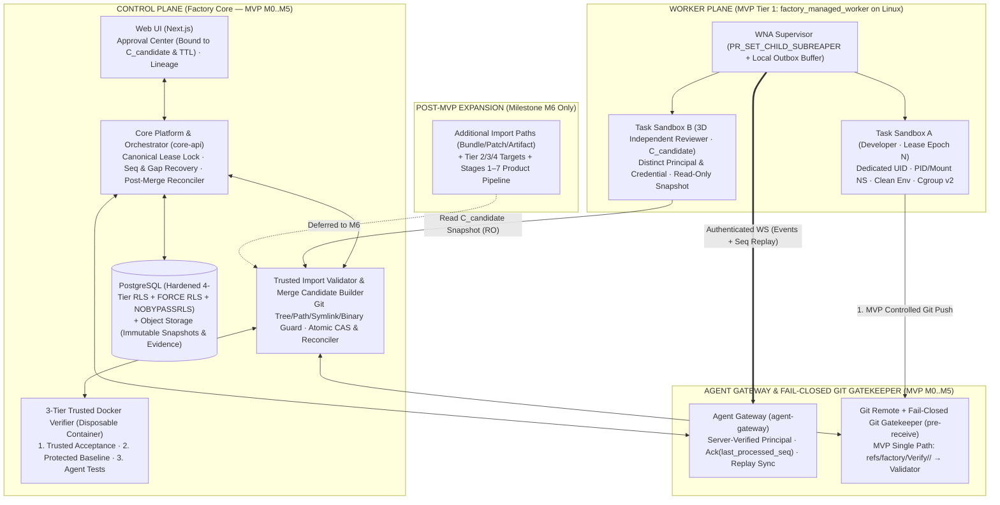
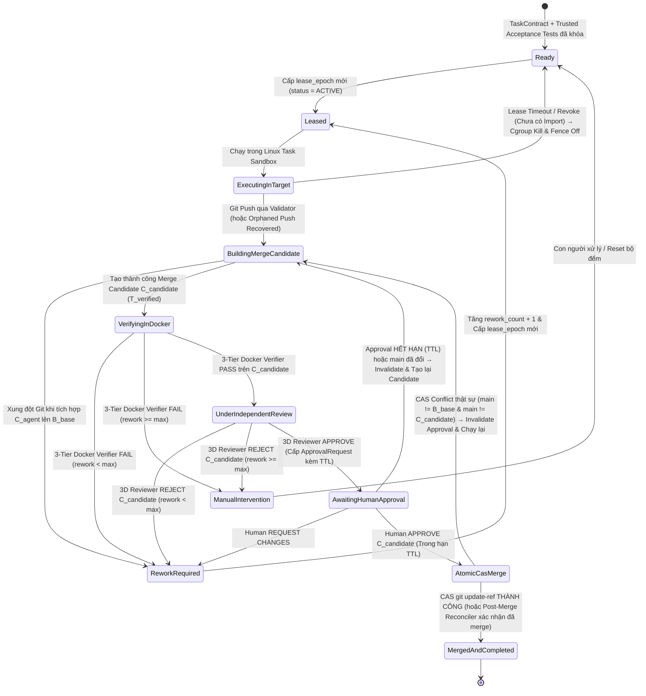

# Software Factory — Kế hoạch Thiết kế Hệ thống (System Design Plan v1.5)

## Nền tảng điều phối phát triển phần mềm bằng AI Agents theo kiến trúc Control Plane / Worker Plane, MVP Single-Path & End-to-End Recovery

- **Loại tài liệu:** Product & System Architecture Specification
- **Phiên bản:** 1.5 (Cập nhật xử lý toàn bộ 8 nhóm cải thiện `P0-1`→`P0-4` và `P1-5`→`P1-8` từ đợt Review v1.4)
- **Tài liệu lộ trình đi kèm:** [Software Factory — Development Roadmap v1.5](./software-factory-development-roadmap.md)
- **Bộ tài liệu Core Specs `M0.2`:** [`MVP_SCOPE_AND_ARCHITECTURE.md`](./mvp_scope_and_architecture_specification_v1_5.md) · [`MVP_DATABASE_AND_RLS_SPEC.md`](./mvp_database_schema_and_rls_specification_v1_5.md) · [`MVP_LEASE_EVENT_AND_SANDBOX_SPEC.md`](./mvp_lease_event_protocol_sandbox_and_git_import_specification_v1_5.md) · [`MVP_VERIFIER_REVIEWER_AND_RECOVERY_SPEC.md`](./mvp_verifier_3d_reviewer_approval_and_recovery_specification_v1_5.md)
- **Ngày cập nhật:** 2026-11-09
- **Trạng thái:** Milestone `M0` Gate Locked — Ready for Milestone `M1` Implementation
- **Định hướng cốt lõi:** Pragmatic MVP Scope (`M0`–`M5`) vs. Target Architecture (`M6`) · Single Controlled Git Import Path in MVP · Canonical Lock & `clock_timestamp()` Lease Fencing · Lease/Event Gap Recovery & Outbox Replay · Idempotent Post-Merge Reconciler · 3D Independent Review · Candidate-Bound Approval & Atomic CAS Merge

---

## 1. Tầm nhìn Sản phẩm & Phân tách Ranh giới "Phạm vi MVP (`M0`–`M5`)" vs. "Kiến trúc Đích (`M6`)" (`P0-1`, `P1-5`, `P1-8`)

**Software Factory** là nền tảng điều phối vòng đời phát triển phần mềm bằng các AI Agent theo nguyên tắc **kiểm chứng độc lập tại điểm thực thi (Zero-Trust Verification)** và **con người nắm quyền phê duyệt hợp nhất cuối cùng**.

Để tránh rủi ro triển khai dàn trải quá nhiều thành phần phức tạp cùng lúc trước khi chứng minh được luồng cốt lõi (`P0-1`), kiến trúc v1.5 **tách bạch tuyệt đối giữa Phạm vi MVP (`Milestones M0 → M5`) và Kiến trúc Mở rộng Sau MVP (`Milestone M6`)**:

### 1.1. Bảng Phân định Ranh giới: MVP Scope (`M0`–`M5`) vs. Post-MVP Target Architecture (`M6`) (`P0-1`)

| Hạng mục Kiến trúc | Phạm vi MVP Bắt buộc (`M0` → `M5` — Ưu tiên Triển khai Trước) | Phạm vi Mở rộng Sau MVP (`M6` — Chỉ mở khóa sau khi PASS `M5`) |
| :--- | :--- | :--- |
| **Luồng nghiệp vụ trọng tâm** | **Vòng thực thi kỹ thuật cốt lõi (Stage 8 Core Loop):** `Task Ready → Agent chạy trong Worker Sandbox → Git Push Import → Merge Candidate (C_candidate) → 3-Tier Docker Verifier → Independent Review → Human Approval → Idempotent Atomic CAS Merge`. | Toàn bộ **Product Pipeline (Stages 1–7 & Stage 9)**: Idea Clarification, PRD/SRS, Architecture Generator, Auto Task Breakdown, Change Request & Full Traceability (`AC-11b`). |
| **Execution Target** | **Chỉ 1 loại duy nhất:** `factory_managed_worker` (**Tier 1** trên máy chủ Linux hoặc Linux VM tiêu chuẩn). | Mở rộng thêm `user_managed_worker` (Tier 2), `provider_managed_vm` (Tier 3) và `remote_agent_session` (Tier 4). |
| **Cơ chế Sandbox (`P1-6`)** | **1 lớp Linux Sandbox thực dụng, rõ ràng (`LinuxSandboxBackend`):** Dedicated OS user + `mount/pid/ipc/uts` namespaces + `cgroups v2` + `PR_SET_CHILD_SUBREAPER` + `env -i`. Chưa chồng ghép nhiều lớp microVM trên Worker ở MVP. | Bổ sung runtime cô lập nhân (`gVisor` / `Kata` / Firecracker microVM) cho các tác vụ từ External/Untrusted Targets (Tier 3/4). |
| **Đường nhập Code (`P1-5`)** | **Chỉ 1 đường duy nhất được kiểm soát chặt:** `Git Push` qua `Fail-Closed Git Gatekeeper` vào nhánh cách ly `refs/factory/Verify/<task_id>/<epoch>` $\rightarrow$ `Trusted Import Validator`. | Mở rộng thêm 3 đường phụ: `Git Bundle Upload`, `Unified Diff / Patch Upload` và `Artifact API Code Submission`. |
| **Runtime Adapter & Chế độ chạy** | **1 Coding Agent Runtime Adapter chính (`P-010`)** + **Fake Agent Harness**; thực thi **tuần tự từng Task (Single-Task Serial Flow)**. | Tích hợp Runtime Adapter thứ hai, `Model Provider Adapter` (LLM API), lập lịch song song đa worktree (DAG Scheduler) và `Budget Auto-Pause (AC-12c)`. |
| **Tài liệu thiết kế ở `M0` (`P1-8`)** | **Chỉ khóa 4 đặc tả cốt lõi phục vụ trực tiếp cho `M1`–`M5`:** [`MVP_SCOPE_AND_ARCHITECTURE.md`](./mvp_scope_and_architecture_specification_v1_5.md), [`MVP_DATABASE_AND_RLS_SPEC.md`](./mvp_database_schema_and_rls_specification_v1_5.md), [`MVP_LEASE_EVENT_AND_SANDBOX_SPEC.md`](./mvp_lease_event_protocol_sandbox_and_git_import_specification_v1_5.md), [`MVP_VERIFIER_REVIEWER_AND_RECOVERY_SPEC.md`](./mvp_verifier_3d_reviewer_approval_and_recovery_specification_v1_5.md). | Đặc tả chi tiết cho Stages 1–7, Multi-Target Orchestration và Cost Governance được hoàn thiện ngay trước `M6`. |

### 1.2. Chín Giai đoạn (9 Stages) của Kiến trúc Đích Tổng thể
*(Trong đó **Stage 8** là lõi thực thi được xây dựng và chứng minh hoàn chỉnh tại **MVP `M0`–`M5`**, còn **Stages 1–7 và Stage 9** được lắp ghép vào ở **`M6`**)*:
1. **Stage 1 (Idea & Discovery Clarification):** Bóc tách *Fact / Assumption / Recommendation* và hỏi đáp làm rõ.
2. **Stage 2 (Requirements & Scope Specification):** Chốt đặc tả `PRD`, `SRS` và tiêu chí nghiệm thu cấp sản phẩm.
3. **Stage 3 (Technology & Architecture Design):** Thiết kế Architecture, Database Schema (ERD), API Spec, Security Design và ADRs.
4. **Stage 4 (Cross-Artifact Validation & Spec Freeze):** Kiểm tra tính nhất quán chéo và khóa baseline qua **Project Approval Gates**.
5. **Stage 5 (User Project Bootstrap):** Khởi tạo repository dự án người dùng, khóa `protected_paths`, thiết lập **Trusted Verification Policy** và **Trusted Acceptance Tests**.
6. **Stage 6 (Agent Organization & Target Binding):** Định nghĩa vai trò Agent và ghép nối với **Execution Target** theo **Trust Level**.
7. **Stage 7 (Automated Development Planning):** Phân rã hồ sơ thiết kế thành `Milestone → Epic → User Story → Task` kèm **Task Contract**.
8. **Stage 8 (Iterative Execution, Verification, Review, Approval & Merge — Lõi MVP `M1`–`M5`):** Cấp phát **Lease (`lease_epoch`)** $\rightarrow$ Thực thi trong **Linux Task Sandbox** $\rightarrow$ Nhập code qua **Git Gatekeeper & Trusted Import Validator** $\rightarrow$ Tạo **Merge Candidate (`C_candidate`)** $\rightarrow$ Xác minh 3 tầng test bằng **Docker Verifier** $\rightarrow$ Đánh giá bởi **3D Independent Reviewer** $\rightarrow$ **Human Approval** gắn chặt với `C_candidate` $\rightarrow$ **Idempotent Atomic CAS Merge** vào `main` (kèm cơ chế tự phục hồi lỗi toàn trình).
9. **Stage 9 (Change Request & Release Acceptance):** Quản lý `Change Request (CR)`, truy xuất nguồn gốc 100% (`AC-11b`) và bàn giao `Acceptance Package`.

---

## 2. Danh mục 11 Quyết định Kiến trúc Nền tảng (`P-001` → `P-011`)

| Mã | Hạng mục quyết định | Quyết định Thiết kế trong v1.5 (Phân định rõ MVP vs. Mở rộng) |
| :--- | :--- | :--- |
| **P-001** | **Mô hình Triển khai Tổng thể** | **Control Plane** theo mô hình Modular Monolith (`core-api` + `web`), tách rời dịch vụ **Agent Gateway** (`agent-gateway` giữ kết nối dài hạn) và **Worker Plane** (`WNA`). |
| **P-002** | **Cơ sở Dữ liệu & Lưu trữ** | **PostgreSQL** là Source of Truth duy nhất (tích hợp **Transactional Outbox** và **Hardened 4-Tier RLS** với `FORCE ROW LEVEL SECURITY` & `NOBYPASSRLS`); Object Storage lưu trữ immutable snapshots, artifacts và logs. |
| **P-003** | **Tích hợp AI & Execution Target** | Kiến trúc hỗ trợ **Dual Adapter** và 4 loại **Execution Target**; **trong MVP (`M0`–`M5`) khóa chặt 1 Target (`factory_managed_worker` trên Linux) và 1 Runtime Adapter (`P-010`)**, mở rộng đa Target/Adapter ở `M6`. |
| **P-004** | **Linux Task Sandbox & 3-Tier Docker Verifier** | Trên Worker, Agent chạy qua `LinuxSandboxBackend` (`dedicated user` + `namespaces` + `cgroups v2` + `subreaper`); tại Control Plane, **Docker Verifier** chạy trên **Immutable Snapshot**, tách **3 tầng kiểm thử** và cấm hardlink cache. |
| **P-005** | **Lựa chọn Workflow Engine** | **Transactional State Machine trên PostgreSQL** (lưu nguyên tử trạng thái Task cùng `task_leases`, `last_processed_seq`, `processed_events` và `outbox_events` trong đúng 1 giao dịch ACID). |
| **P-006** | **Canonical Lease Lock, Sequential Events & Gap Recovery** | Khóa độc quyền `task_leases FOR UPDATE` với **`clock_timestamp()`**; cưỡng chế **`sequence_no == last_processed_seq + 1`**; bổ sung **Giao thức Phục hồi & Replay Sự kiện (`last_processed_seq` sync + Worker Local Outbox Buffer — `P0-4`)**. |
| **P-007** | **Single-Path Import (MVP), Candidate-First & Idempotent CAS Merge** | **MVP chỉ mở 1 đường nhận code (`Git Push` $\rightarrow$ `Git Gatekeeper` $\rightarrow$ `Trusted Import Validator` — `P1-5`)**; tạo **`Merge Candidate (C_candidate)` trước khi kiểm định/duyệt**; cập nhật `main` bằng **Atomic CAS (`git update-ref`)** kết hợp **Post-Merge Reconciler (`P0-3`)**. |
| **P-008** | **Kiểm định 3 Lớp & Độc lập 3 Chiều (3D Reviewer Independence)** | Kết hợp **3-Tier Docker Verifier** $\rightarrow$ **Independent Reviewer Agent** (đảm bảo độc lập cả 3 chiều: *Identity*, *Execution*, *Decision* — `P1-7`) $\rightarrow$ **Human Approval Gate** có thời hạn (`Approval TTL`). |
| **P-009** | **Hardened 4-Tier RLS & Ma trận Kiểm thử Quyền (`P1-6`)** | Phân loại bảng dữ liệu thành 4 tầng (*Global*, *Org*, *Project Root/Child*, *Execution*); kiểm chứng bằng **Ma trận Test RLS Đọc/Ghi bắt buộc** tại `M1`. |
| **P-010** | **Lựa chọn Coding Agent đầu tiên** | Xác minh thực nghiệm qua **Spike 1 & Spike 2** ở `M0` (chạy headless trong `LinuxSandboxBackend`, tuân thủ License/ToS và thu thập được commit/log chuẩn). |
| **P-011** | **Lộ trình Theo Các Mốc Nghiệm thu Thực nghiệm (`M0` → `M6`)** | Chia lộ trình thành 6 mốc nhỏ cho MVP (`M0` $\rightarrow$ `M5`), trong đó **`M5` là cổng nghiệm thu Vertical Slice trên dự án thật** (tương ứng `M1` cũ); chỉ mở khóa `M6` sau khi vượt qua `M5` (`P0-2`, `P1-8`). |

---

## 3. Mười Nguyên tắc Kiến trúc Bất biến

1. **Pragmatic Single-Path MVP First (`P0-1`, `P1-5`):** Hoàn thiện trọn vẹn một đường thực thi duy nhất, kiểm soát chặt từ đầu đến cuối (`1 Target` + `1 Runtime Adapter` + `1 Git Push Import Path` + `Serial Execution`) và chứng minh bằng Task thật tại `M5` trước khi mở rộng.
2. **Zero-Trust đối với Báo cáo, Mã nguồn và Test của Agent:** Không tin bản tin `task.completed` từ Worker; coi cả mã nguồn lẫn `Agent-Generated Tests` là **Untrusted Code**; nghiệm thu bắt buộc dựa trên **Trusted Acceptance Tests** và **Protected Project Baseline Tests**.
3. **Canonical Lock & Real-Time Lease Fencing (`clock_timestamp()`):** Mọi thao tác nhận event, gia hạn, thu hồi hoặc cấp mới Lease đều tuân theo thứ tự khóa `FOR UPDATE` trên `task_leases` trước `tasks` và kiểm tra thời hạn bằng `clock_timestamp()`.
4. **Strict Sequential Event Stream & Deterministic Gap Recovery (`P0-4`):** Sự kiện của từng Lease phải tăng tuần tự `sequence_no == last_processed_seq + 1`; khi đứt mạng hoặc lệch sequence, hệ thống tự động đồng bộ lại từ `last_processed_seq` qua **Worker Local Outbox Buffer**.
5. **Controlled Code Import & Git Tree Validation (`P1-5`):** Mọi commit từ Worker đều đẩy vào ref cách ly `refs/factory/Verify/<task_id>/<epoch>` và bị `Trusted Import Validator` kiểm tra Git tree, `Path Policy Precedence`, symlink, binary, submodule và quy mô thay đổi bất thường.
6. **Pragmatic OS Task Sandbox & Subreaper Cgroup Cleanup (`P1-6`):** Mỗi `lease_epoch` chạy dưới dedicated OS user + Linux namespaces + `cgroups v2`; `WNA` dùng `PR_SET_CHILD_SUBREAPER` + `cgroup.kill` và chứng minh dọn sạch tiến trình qua `cgroup.events (populated == 0)`.
7. **Three-Dimensional Reviewer Independence (`P1-7`):** Reviewer phải độc lập với Developer trên cả 3 chiều: **Identity Independence** (khác principal/credential do server cấp), **Execution Independence** (sandbox/context sạch chỉ đọc `C_candidate`), và **Decision Independence** (tách biệt quyền đánh giá và quyền merge).
8. **Candidate-Bound Approval, TTL & Idempotent Atomic CAS Merge (`P0-3`, `P1-7`):** Phê duyệt khóa chặt vào bộ 8 trường của `C_candidate` kèm thời hạn `expires_at`; hợp nhất bằng `git update-ref` (Atomic CAS) có **Post-Merge Reconciler** chống lỗi lặp khi mất kết nối sau merge.
9. **Hardened Multi-Tier RLS Verified by Matrix (`P1-6`):** Cô lập dữ liệu ở tầng PostgreSQL với `FORCE ROW LEVEL SECURITY`, `NOBYPASSRLS`, `SET LOCAL` và kiểm chứng tự động qua ma trận quyền Đọc/Ghi.
10. **Built-in Adversarial & Recovery Testability:** Mọi cơ chế bảo vệ về concurrency, mất kết nối, retry, duplicate event, mất response sau merge, CAS conflict và sandbox escape đều được kiểm thử tự động bằng **Fake Agent Harness**.

---

## 4. Execution Targets, Ranh giới Bảo mật Thực dụng (`P1-6`) & Sandbox Backend

### 4.1. Phân cấp 4 Loại Execution Target (Triển khai `Tier 1` ở MVP `M0`–`M5`, Mở rộng `Tier 2–4` ở `M6`)

| Loại Execution Target | Phạm vi Lộ trình | Trust Level | Cưỡng chế trong khi chạy (Pre/In-Execution) | Kiểm chứng sau khi nhận kết quả (Post-Execution) |
| :--- | :--- | :--- | :--- | :--- |
| **1. `factory_managed_worker`**<br>*(Máy Linux do Factory quản lý, chạy WNA)* | **MVP (`M0`–`M5`)** | **Tier 1 (High Control)** | Kiểm soát toàn diện OS user, `LinuxSandboxBackend`, mount filesystem, biến môi trường sạch (`env -i`), giới hạn tài nguyên qua `cgroups v2` và tiêu diệt process tree tức thời khi hết Lease. | Kiểm tra qua Fail-Closed Git Gatekeeper + Trusted Import Validator, 3-Tier Docker Verifier, 3D Independent Reviewer và Idempotent Atomic CAS Merge. |
| **2. `user_managed_worker`**<br>*(Máy của người dùng/team, chạy WNA)* | **Post-MVP (`M6`)** | **Tier 2 (Medium-High)** | Cưỡng chế qua `WNA` tương tự Tier 1 nhưng phụ thuộc quyền quản trị máy của người dùng. | Kiểm tra lại 100% qua Trusted Import Validator, Docker Verifier và Independent Reviewer. |
| **3. `provider_managed_vm`**<br>*(VM do vendor của Agent quản lý)* | **Post-MVP (`M6`)** | **Tier 3 (Bounded External)** | Không giả định cài được `WNA`; chỉ điều khiển theo `Capability Contract` của API vendor. | Phụ thuộc hoàn toàn vào lớp phòng vệ phía Factory: Trusted Import Validator + Docker Verifier cô lập nhân (`gVisor`/microVM) + Reviewer độc lập. |
| **4. `remote_agent_session`**<br>*(Phiên Agent qua API từ xa / Untrusted)* | **Post-MVP (`M6`)** | **Tier 4 (Lowest Trust)** | Không kiểm soát runtime; không cấp credential nội bộ; chỉ gửi ngữ cảnh đã lọc sạch. | Chỉ nhận kết quả qua Trusted Import Validator; xác minh trong Docker Verifier (`gVisor`/microVM) cho các Task không nhạy cảm. |

### 4.2. Ranh giới Bảo mật Thực dụng giữa Gateway, Worker, Linux Sandbox & Credentials (`P1-6`)

Để hệ thống vừa an toàn vừa không bị phức tạp hóa quá mức trong giai đoạn MVP (`P1-6`), ranh giới bảo mật và luồng cấp phát credential được quy định rõ như sau:

| Thành phần | Quyền hạn & Credential được giữ | Ranh giới Cô lập Bắt buộc trong MVP (`M0`–`M5`) |
| :--- | :--- | :--- |
| **`Agent Gateway` (`apps/agent-gateway`)** | Giữ khóa xác thực kết nối Worker (mTLS CA / HMAC Verification Key) và quyền gọi nội bộ tới `core-api`. | Không chạy bất kỳ mã nguồn hay tiến trình nào của dự án người dùng; mọi sự kiện từ Worker gửi lên đều bị gắn nhãn `principal_id` và `worker_id` trích xuất từ kết nối đã xác thực. |
| **`WNA Supervisor` (trên Worker Node)** | Giữ `worker_node_credential` để duy trì kết nối WebSocket với `Agent Gateway`; có quyền tạo thư mục worktree, cgroup con và khởi tạo `LinuxSandboxBackend`. | Chạy dưới tài khoản dịch vụ `sf-wna`; **tuyệt đối không truyền `worker_node_credential` hoặc biến môi trường của `WNA` vào bên trong `Task Sandbox`**. |
| **`Linux Task Sandbox` (Môi trường chạy Agent)** | Chỉ nhận: (1) Thư mục worktree của đúng `(task_id, lease_epoch)` được mount riêng, (2) `ephemeral_git_push_token` chỉ có quyền push vào `refs/factory/Verify/<task_id>/<epoch>` trong thời hạn Lease, và (3) API key/token của Coding Agent (nếu cần) có phạm vi hẹp. | Chạy dưới UID/GID riêng (`sf-task-runner`), bên trong `mount`, `pid`, `ipc`, `uts` namespaces riêng, khởi tạo bằng `env -i` (chỉ whitelist biến môi trường an toàn), không có quyền đọc `/etc/sf-wna`, không nhìn thấy worktree của Task khác và bị đóng khung trong `/sys/fs/cgroup/software-factory/task-<id>-epoch-<n>`. |
| **`Docker Verifier` (tại Control Plane)** | Không giữ bất kỳ credential nào của Control Plane, Database, Object Storage hay AI Provider. | Chạy trong container dùng một lần (`--rm`, `--cap-drop=ALL`, `--security-opt=no-new-privileges`) trên bản chụp bất biến của `C_candidate` với `--network=none` (Hermetic) hoặc mạng nội bộ cô lập `--internal` (Integration). |

---

## 5. Kiến trúc Logic Tổng thể (v1.5 — Làm rõ Luồng MVP và Phần Mở rộng `M6`)



---

## 6. Giao thức Lease/Event, Phục hồi Mất Kết nối (`P0-4`), Task Sandbox & Đơn giản hóa Đường Import (`P1-5`)

### 6.1. Task Sandbox & Cơ chế Dọn dẹp Tiến trình bằng `Subreaper` + `cgroups v2` (`P1-6`)

1. **Thiết lập `PID Namespace` và `PR_SET_CHILD_SUBREAPER`:**
   - `WNA Supervisor` gọi `prctl(PR_SET_CHILD_SUBREAPER, 1)` và khởi chạy tiến trình gốc của Sandbox trong `PID namespace` mới (`CLONE_NEWPID`) để mọi tiến trình con/cháu mồ côi (double-forked orphans) đều bị giữ lại dưới quyền thu gom của Supervisor.
2. **Quy trình Hủy và Bằng chứng Nghiệm thu (`killAndVerifyClean`):**
   - Bước 1: Ghi `"1"` vào `cgroup.kill` để nhân Linux gửi `SIGKILL` nguyên tử tới toàn bộ tiến trình/luồng trong cgroup của Lease đó.
   - Bước 2: Đợi `cgroup.events` chuyển trường `populated` về `0`.
   - Bước 3: Thực hiện vòng lặp `waitpid(-1, &status, WNOHANG)` cho đến khi nhận `-ECHILD`.
   - Bước 4: Xác nhận `cgroup.procs` và `cgroup.threads` rỗng (`0 PIDs`) và gọi `rmdir()` xóa thư mục cgroup thành công.

### 6.2. Đồng bộ hóa Cạnh tranh Lease bằng Khóa `FOR UPDATE` & `clock_timestamp()`

1. **Sử dụng `clock_timestamp()` thay cho `NOW()`:** Mọi phép kiểm tra thời hạn Lease đều dùng `clock_timestamp()` (thời gian thực tại thời điểm thực thi câu lệnh SQL).
2. **Thứ tự Khóa Độc quyền Chuẩn (Canonical Lock Ordering) & Điểm Tuyến tính hóa (Linearization Point):**
   - Mọi thao tác (`Submit Event`, `Renew Heartbeat`, `Revoke Lease`, `Expire Lease`, `Grant New Lease`) đều bắt buộc giành khóa độc quyền `SELECT ... FOR UPDATE` theo thứ tự cố định: **`task_leases` trước, `tasks` sau**.
   - Nếu `Revoke Lease` giành được khóa trước, nó cập nhật `status = 'REVOKED', revoked_at = clock_timestamp()` và commit; mọi sự kiện của Worker đang chờ khóa sẽ đọc lại trạng thái `REVOKED` và bị từ chối 100%.

### 6.3. Giao thức Sự kiện Tuần tự, Heartbeat & Phục hồi khi Đứt Mạng / Mất Sự kiện (`P0-4`)

Để giải quyết triệt để bài toán **event đến sai thứ tự, mất gói tin trên mạng, mất ACK hoặc Worker rớt mạng giữa chừng (`P0-4`)**, giao thức Lease/Event được quy định khép kín từ Worker đến Database:

#### 1. Cấu trúc Bản tin Event & Phản hồi Đồng bộ (`Event ACK / NACK Contract`):
- Mỗi sự kiện gửi từ `WNA` có bộ định danh đầy đủ:
  - `project_id`, `task_id`, `lease_epoch`, `worker_id`, `session_id`
  - `sequence_no` (số nguyên tăng tuần tự `1, 2, 3...` cho mỗi `lease_epoch`, bắt đầu từ `1: task.started`)
  - `event_id` (UUID) & `event_idempotency_key` (`"<project_id>:<task_id>:epoch-<lease_epoch>:seq-<sequence_no>"`)
  - `event_type` (`task.started`, `task.progress`, `task.code_pushed`, `task.completed`, `task.failed`)
  - `payload` & `payload_sha256`
- **Mọi phản hồi từ Control Plane / Agent Gateway** (`200 OK`, `409 Conflict`, `Heartbeat ACK`, `Reconnect Handshake`) **đều bắt buộc trả về trạng thái đồng bộ hiện tại của Server**:
  ```json
  {
    "status": "ACK_OK | RETRY_IDEMPOTENT_OK | ERR_SEQUENCE_GAP | ERR_STALE_LEASE | ERR_PAYLOAD_CONFLICT",
    "task_id": "task-2026-0102",
    "lease_epoch": 2,
    "lease_status": "ACTIVE",
    "last_processed_seq": 3,
    "expected_next_seq": 4,
    "server_clock": "2026-11-09T11:30:00.123Z"
  }
  ```

#### 2. Cơ chế Lưu đệm Cục bộ tại Worker (`WNA Local Outbox Buffer`) & Tự động Phát lại (`Gap Replay`):
- Trước khi gửi bất kỳ sự kiện nào qua WebSocket lên `Agent Gateway`, `WNA` ghi sự kiện đó vào **Local Outbox Journal** trên đĩa cục bộ của Worker (`/var/lib/sf-wna/outbox/<project_id>_<task_id>_epoch_<n>.jsonl`).
- **Xử lý khi mất ACK (Duplicate Retry):** Nếu hết thời gian chờ `ack_timeout` (ví dụ `3s`) mà chưa nhận được phản hồi, `WNA` gửi lại sự kiện đó với nguyên vẹn `event_idempotency_key` và `sequence_no`. Server đối chiếu `processed_events` thấy trùng `event_idempotency_key` + `payload_sha256` thì trả về ngay `200 RETRY_IDEMPOTENT_OK` kèm `last_processed_seq` mà không thực thi lặp.
- **Xử lý khi Sự kiện đến sai thứ tự hoặc bị rơi gói tin (`Out-of-Order / Sequence Gap`):**
  - Nếu Server đang ở `last_processed_seq = 2` mà nhận được `sequence_no = 4`, câu lệnh SQL từ chối cập nhật và Server trả về `409 ERR_SEQUENCE_GAP` kèm `"last_processed_seq": 2, "expected_next_seq": 3`.
  - Ngay khi nhận `ERR_SEQUENCE_GAP`, `WNA` đọc **Local Outbox Buffer** và phát lại tuần tự từ `sequence_no = 3` rồi tới `sequence_no = 4`.
- **Xử lý khi Worker mất kết nối rồi kết nối lại (`Worker Disconnect & Reconnect Handshake`):**
  - **Trường hợp 1 (Kết nối lại khi Lease vẫn còn hạn `expires_at > clock_timestamp()`):** `WNA` gửi bản tin `session.reconnect` kèm `(task_id, lease_epoch, local_last_seq)`. Server kiểm tra Lease còn `ACTIVE`, gia hạn `last_heartbeat_at` và trả về `last_processed_seq` hiện tại của DB. `WNA` tự động phát bù (replay) toàn bộ các sự kiện từ `last_processed_seq + 1` đến `local_last_seq`.
  - **Trường hợp 2 (Mất kết nối quá `lease_ttl` — Lease đã hết hạn hoặc bị Revoke):** Server trả về `ERR_STALE_LEASE (lease_status = EXPIRED/REVOKED)`. `WNA` lập tức kích hoạt `killAndVerifyClean` hủy Task Sandbox và xóa Local Outbox của epoch cũ.

#### 3. Phục hồi khi Mất Sự kiện Kết thúc sau khi Đã Push Code (`Orphaned Push Reconciler` — `P0-4`):
- **Tình huống:** Agent đã chạy xong và `git push` thành công commit `C_agent` lên `refs/factory/Verify/<task_id>/<epoch>` (đã vượt qua `Trusted Import Validator`), nhưng đúng lúc đó Worker bị sập nguồn hoặc đứt mạng vĩnh viễn trước khi bản tin `task.completed` đến được Control Plane.
- **Cơ chế Phục hồi:**
  1. Ngay khi `Git Gatekeeper` và `Trusted Import Validator` chấp nhận commit `C_agent` trên `refs/factory/Verify/<task_id>/<epoch>`, chính Control Plane ghi nhận nguyên tử bản ghi `verified_code_imports (project_id, task_id, lease_epoch, agent_commit_hash, imported_at)` vào PostgreSQL.
  2. Nếu Lease hết hạn (`EXPIRED`) mà chưa nhận được `task.completed`, **Lease Expiry Reconciler** gọi `list_expired_active_lease_scopes()`, thiết lập ngữ cảnh RLS bằng `set_config` và kiểm tra bảng `verified_code_imports` của `(task_id, lease_epoch)`:
     - Nếu chưa có commit nào được import hợp lệ: hủy nhánh tạm (nếu có) và đưa Task về `Ready` để cấp phát `lease_epoch + 1`.
     - Nếu **đã có `agent_commit_hash` hợp lệ** và thỏa mãn đầy đủ manifest đầu ra: Reconciler tự động ghi nhận sự kiện hệ thống `system.orphaned_import_recovered`, chuyển Task sang `BuildingMergeCandidate` để tiếp tục tạo `C_candidate` và chạy `3-Tier Docker Verifier` mà **không làm mất kết quả công việc đã hoàn thành của Worker**.

#### 4. Giao dịch SQL Nguyên tử Xử lý Sự kiện tại Control Plane (`P0-4`):

```sql
BEGIN;
SELECT set_config('app.current_org_id', $12::text, true);
SELECT set_config('app.current_project_id', $1::text, true);

-- Bước 1: Kiểm tra Idempotent Retry trên processed_events
SELECT event_id, lease_epoch, sequence_no, event_type, payload_sha256
FROM processed_events
WHERE project_id = $1 AND event_idempotency_key = $7;
-- Nếu đã tồn tại và khớp hoàn toàn (lease_epoch, sequence_no, event_type, payload_sha256):
--   Đọc last_processed_seq hiện tại từ task_leases, COMMIT và trả về 200 RETRY_IDEMPOTENT_OK.
-- Nếu đã tồn tại nhưng lệch payload_sha256 hoặc sequence_no:
--   ROLLBACK và trả về 422 ERR_PAYLOAD_CONFLICT.

-- Bước 2: Khóa độc quyền Canonical Lock trên task_leases trước, tasks sau tại clock_timestamp()
SELECT l.lease_epoch, l.status AS lease_status, l.expires_at, l.revoked_at,
       l.last_processed_seq, t.status AS current_task_status
FROM task_leases l
JOIN tasks t
  ON t.project_id = l.project_id AND t.task_id = l.task_id
WHERE l.project_id = $1 AND l.task_id = $2 AND l.lease_epoch = $3
FOR UPDATE OF l, t;

-- Kiểm tra rõ từng điều kiện để trả mã lỗi phục hồi chính xác cho Worker:
-- a) Nếu lease_status != 'ACTIVE' OR revoked_at IS NOT NULL OR expires_at <= clock_timestamp()
--    OR current_lease_epoch != $3 OR worker_id != $4 OR session_id != $5:
--    ROLLBACK và trả về 409 ERR_STALE_LEASE (kèm lease_status).
-- b) Nếu $6 != l.last_processed_seq + 1:
--    ROLLBACK và trả về 409 ERR_SEQUENCE_GAP (kèm last_processed_seq và expected_next_seq = last_processed_seq + 1).
-- c) Nếu chuyển trạng thái current_task_status -> $10 vi phạm State Transition Matrix:
--    ROLLBACK và trả về 409 ERR_INVALID_STATE_TRANSITION.

-- Bước 3: Ghi nhận sự kiện mới, nâng last_processed_seq và đẩy vào Transactional Outbox
INSERT INTO processed_events (
  project_id, task_id, lease_epoch, sequence_no, event_idempotency_key, event_type, payload_sha256, processed_at
) VALUES ($1, $2, $3, $6, $7, $8, $9, clock_timestamp());

UPDATE task_leases
SET last_processed_seq = $6,
    last_heartbeat_at = clock_timestamp()
WHERE project_id = $1 AND task_id = $2 AND lease_epoch = $3;

UPDATE tasks
SET status = $10,
    updated_at = clock_timestamp()
WHERE project_id = $1 AND task_id = $2 AND current_lease_epoch = $3;

INSERT INTO outbox_events (project_id, task_id, lease_epoch, sequence_no, event_type, payload, created_at)
VALUES ($1, $2, $3, $6, $8, $11, clock_timestamp());

COMMIT;
```

### 6.4. Đơn giản hóa Đường Import trong MVP (`Single Controlled Import Path` — `P1-5`)

Theo nguyên tắc thu gọn MVP (`P0-1`, `P1-5`), **giai đoạn MVP (`M0`–`M5`) chỉ triển khai duy nhất 1 đường nhập code được kiểm soát chặt**:

```text
[MVP Single Controlled Import Path (M0–M5)]
Developer Sandbox ──(git push)──> Fail-Closed Git Gatekeeper (pre-receive)
                                        │
                                        ▼
                            refs/factory/Verify/<task_id>/<epoch>
                                        │
                                        ▼
                             [ Trusted Import Validator ]
                             1. Lease Active Check (clock_timestamp)
                             2. Git Tree & Ancestor Check (fast-forward from B_base)
                             3. Path Policy Precedence (forbidden > protected > allowed > Deny)
                             4. Symlink (mode 120000) & Path Traversal (..) Guard
                             5. Submodule (mode 160000), Git Hooks & Binary Size Guard
                             6. Abnormal Diff Threshold Guard (max files / max lines)

[Post-MVP Deferred Import Paths (Chỉ mở ở M6 sau khi M5 ổn định)]
• Git Bundle Upload  • Unified Diff / Patch Upload  • Artifact API Submission
```

**Sáu quy tắc kiểm tra bắt buộc của `Trusted Import Validator` trên Git Tree (`P1-5`):**
1. **Kiểm tra Hiệu lực Lease (`Fail-Closed`):** Xác nhận `ephemeral_git_push_token` khớp với `(task_id, lease_epoch)` đang `ACTIVE` và `expires_at > clock_timestamp()`. Nếu mất kết nối DB/Control Plane hoặc timeout (`> 2s`), Git `pre-receive` hook **bắt buộc từ chối (`Fail-Closed`)**.
2. **Kiểm tra Cấu trúc Git Tree & Ancestor:** Commit nộp lên (`C_agent`) phải có ancestor là `base_main_commit_hash` của Task, không chứa merge commit ngầm ngoài phạm vi.
3. **Kiểm tra `Path Policy Precedence` (Chặn file ngoài phạm vi):** Duyệt toàn bộ `git diff-tree -r -M -C` giữa `base_main_commit_hash` và `C_agent` (bao gồm cả nguồn và đích của thao tác `Rename/Copy`). Áp dụng thứ tự ưu tiên tuyệt đối: `forbidden_paths` (luôn cấm) $\succ$ `protected_paths` (luôn cấm sửa trong phạm vi Task) $\succ$ `allowed_files` $\succ$ `Default Deny` (mọi file ngoài `allowed_files` đều bị từ chối).
4. **Kiểm tra Symlink (`mode 120000`) & Path Traversal:** Phân tích từng entry trong `git ls-tree -r`; từ chối ngay mọi đối tượng có mode `120000` (Symbolic Link), đường dẫn chứa `..`, ký tự điều khiển, hoặc xung đột tên file không phân biệt hoa thường (case-folding collision).
5. **Kiểm tra Binary, Submodule & Git Metadata:** Từ chối mọi gitlink/submodule (`mode 160000` / `.gitmodules`), thay đổi trái phép trên `.gitattributes`, `.gitignore` gốc, hoặc bất kỳ file nhị phân (binary blob) nào không nằm trong danh sách cho phép hoặc vượt ngưỡng kích thước (mặc định `> 1 MB`).
6. **Kiểm tra Thay đổi Bất thường (`Abnormal Change Guard`):** Từ chối commit nếu tổng số file thay đổi vượt `max_changed_files` hoặc tổng số dòng xóa/sửa vượt ngưỡng bảo vệ đã khai báo trong `TaskContract` (ngăn chặn hành vi Agent xóa trắng hàng loạt mã nguồn).

---

## 7. Merge Candidate, 3-Tier Verifier, Độc lập 3 Chiều của Reviewer (`P1-7`) & Xử lý Lỗi / Phục hồi Toàn trình (`P0-3`)



### 7.1. Phân tách 3 Tầng Kiểm thử & Cô lập Cache trong Docker Verifier

| Tầng kiểm thử | Nguồn quản lý | Mức độ tin cậy | Cách thức nạp & Cơ chế bảo vệ trong Docker Verifier |
| :--- | :--- | :--- | :--- |
| **1. `Trusted Acceptance Tests`** | Do Factory hoặc Product Owner tạo/phê duyệt (lưu tách biệt khỏi nhánh của Agent) | **Trusted** | Nạp từ volume chỉ đọc `/trusted-policy/acceptance-tests:ro` sau khi kiểm tra mã băm SHA-256. **Agent hoàn toàn không có quyền sửa đổi.** |
| **2. `Project Baseline Regression Tests`** | Các bài test đã tồn tại trong repository tại thời điểm `base_main_commit_hash` (`B_base`) | **Protected Baseline** | Nằm trong `protected_paths`. Trước khi chạy, Verifier đối chiếu SHA-256 của toàn bộ các file này trong `C_candidate` với bản gốc tại `B_base` — nếu bị sửa/xóa trái phép, đánh trượt ngay (`TEST_TAMPERING_DETECTED`). |
| **3. `Agent-Generated Tests`** | Do Developer Agent viết mới trong phạm vi `allowed_files` | **Untrusted Code** | Chạy trong container sandbox không có secret; kết quả pass của tầng này không thể thay thế cho Tầng 1 & Tầng 2, và nội dung assertion bắt buộc được **Independent Reviewer** kiểm tra. |

- **Bảo vệ Dependency Cache (Cấm Hardlink):** Gắn `/workspace/deps-cache:ro` thông qua copy có kiểm chứng digest hoặc `OverlayFS` (`upperdir` trên `tmpfs` dùng một lần), kết hợp `fs.protected_hardlinks = 1` và `fs.protected_symlinks = 1`.

### 7.2. Đảm bảo Reviewer và Approval Thực sự Độc lập trên 3 Chiều (`P1-7`)

Để ngăn chặn triệt để việc Reviewer bị ảnh hưởng bởi Developer hoặc việc dùng lại kết quả đánh giá/phê duyệt cũ khi mã nguồn ứng viên đã thay đổi (`P1-7`), hệ thống cưỡng chế **3 chiều độc lập bắt buộc**:

| Chiều độc lập | Định nghĩa Kỹ thuật | Cơ chế Cưỡng chế tại Điểm Thực thi |
| :--- | :--- | :--- |
| **1. Độc lập về Định danh (`Identity Independence`)** | Reviewer và Developer phải là hai chủ thể xác thực tách biệt. | `Agent Gateway` trích xuất `principal_id` và `server_issued_credential_id` từ tầng kết nối mTLS/Token; cấp riêng token `ROLE_REVIEWER_READONLY`. Cấm tuyệt đối cùng `session_id`, cùng `credential_id` hoặc cùng `agent_profile_id` vừa viết code vừa duyệt code (`CHECK (reviewer_principal_id != developer_principal_id)`). |
| **2. Độc lập về Thực thi (`Execution Independence`)** | Reviewer không dùng chung môi trường chạy, bộ nhớ tạm hay lịch sử hội thoại nội bộ với Developer. | Reviewer khởi chạy trong một **Task Sandbox mới hoàn toàn (`clean session`)**, chỉ nhận đầu vào gồm: (1) `TaskContract`, (2) Bản chụp bất biến chỉ đọc (`read-only snapshot`) của `C_candidate`, và (3) Báo cáo kết quả của `3-Tier Docker Verifier`. Không được truyền chuỗi suy luận (scratchpad/thought history) của Developer sang để tránh hiệu ứng thiên kiến xác nhận (*anchoring bias*). |
| **3. Độc lập về Quyết định & Gắn chặt Candidate (`Decision Independence & Candidate Binding`)** | Quyền Đánh giá (Reviewer), quyền Phê duyệt (Human) và quyền Thực thi Merge (Control Plane CAS) tách rời nhau và khóa chặt vào đúng `C_candidate`. | • Reviewer chỉ có quyền xuất `ReviewArtifact` (`APPROVE / REJECT`), không có quyền ghi Git.<br>• `ApprovalDecision` của con người khóa cứng vào bộ mã băm: `(base_main_commit_hash, merge_candidate_hash, verified_tree_hash, verification_run_id, review_artifact_id)` kèm thời hạn `expires_at`.<br>• **Quy tắc Tự động Hủy hiệu lực (`Auto-Invalidation Rule`):** Nếu `C_candidate` thay đổi dù chỉ 1 byte, hoặc `main` tiến lên commit mới (`HEAD != base_main_commit_hash`), hoặc `VerificationRun` / `ReviewArtifact` chạy lại, thì mọi `ReviewArtifact` và `ApprovalDecision` trước đó tự động chuyển sang trạng thái `INVALIDATED_STALE_CANDIDATE` — bắt buộc đánh giá và phê duyệt lại từ đầu. |

### 7.3. Quy trình Xử lý Lỗi & Phục hồi Toàn trình ở Giai đoạn Merge & Approval (`P0-3`)

Bảng dưới đây quy định chi tiết cách hệ thống xử lý và phục hồi an toàn cho mọi kịch bản lỗi ở chặng cuối (`Verification → Review → Approval → Atomic CAS Merge` — đảm bảo **retry không bao giờ tạo merge trùng lặp hoặc làm hỏng nhánh `main`**):

| Kịch bản Lỗi / Sự cố (`P0-3`) | Hiện tượng Kỹ thuật | Quy trình Xử lý & Phục hồi Nguyên tử (Idempotent Recovery) |
| :--- | :--- | :--- |
| **1. Mất phản hồi sau khi Merge đã thành công trên Git (`Lost Response After Merge`)** | Lệnh `git update-ref refs/heads/main <C_candidate> <B_base>` đã thành công trên Git Server, nhưng mạng đứt hoặc `core-api` crash trước khi kịp lưu trạng thái `MergedAndCompleted` vào PostgreSQL. Khi worker/orchestrator retry, `HEAD` của `main` không còn là `<B_base>` nữa. | **Idempotent Post-Merge Reconciler:** Trước khi kết luận `CAS Conflict`, bộ Reconciler đọc `current_main_head` từ Git Server và đối chiếu với bản ghi `merge_operations (task_id, merge_candidate_hash, base_main_commit_hash, approval_decision_id)`:<br>• **Nếu `current_main_head == <C_candidate>`** (hoặc `<C_candidate>` đã là ancestor trên `refs/heads/main` gắn với đúng `task_id` và `approval_decision_id`): Hệ thống xác nhận merge đã hoàn tất từ lần gọi trước $\rightarrow$ cập nhật idempotent trạng thái DB sang `MergedAndCompleted` và trả về `200 OK (Already Merged)` **mà không thực hiện merge lần hai hay báo lỗi giả**. |
| **2. Xung đột CAS thật sự (`True CAS Conflict` khi `main` đã thay đổi)** | Trong lúc chờ kiểm định hoặc chờ con người duyệt, một Task khác đã merge vào `main` khiến `current_main_head == <B_new>` (khác cả `<B_base>` và `<C_candidate>`). | 1. Lệnh `git update-ref refs/heads/main <C_candidate> <B_base>` thất bại nguyên tử (nhánh `main` giữ nguyên `<B_new>`).<br>2. Trong cùng DB transaction, hệ thống chuyển `ApprovalDecision` và `ReviewArtifact` cũ sang `INVALIDATED_STALE_BASE`.<br>3. Tự động chuyển Task về trạng thái `BuildingMergeCandidate` với `base_main_commit_hash = <B_new>`, tích hợp lại `C_agent` lên `<B_new>` để tạo `<C_candidate_new>` (không bắt Developer Agent phải code lại nếu không có xung đột code), sau đó **bắt buộc chạy lại 3-Tier Docker Verifier + 3D Independent Reviewer + Human Approval** trên `<C_candidate_new>`. |
| **3. Phê duyệt hết thời hạn hiệu lực (`Approval Expiration / Stale Approval`)** | Mỗi `ApprovalRequest` khi tạo ra đều gắn thời hạn `expires_at` (mặc định `24h` hoặc theo cấu hình Project). Người duyệt bấm `Approve` sau khi đã quá `expires_at` hoặc sau khi `C_candidate` đã bị thay thế. | API Phê duyệt kiểm tra tại `clock_timestamp()`:<br>`WHERE approval_request_id = $1 AND status = 'PENDING' AND expires_at > clock_timestamp() AND merge_candidate_hash = current_candidate_hash`<br>Nếu không thỏa mãn, từ chối ngay với mã `409 ERR_APPROVAL_EXPIRED_OR_STALE` và yêu cầu làm mới Candidate/Verification trước khi duyệt. |
| **4. Retry lệnh Merge đồng thời (`Concurrent / Duplicate Merge Request`)** | Người dùng bấm nút `Approve & Merge` hai lần liên tiếp hoặc job xử lý Outbox chạy retry đồng thời. | Khóa độc quyền dòng `tasks` và `approval_decisions` bằng `SELECT ... FOR UPDATE` kết hợp `merge_idempotency_key = "merge:<project_id>:<task_id>:<merge_candidate_hash>"`. Lần gọi thứ hai thấy trạng thái đang `AtomicCasMerge` hoặc đã `MergedAndCompleted` sẽ trả về kết quả hiện hành mà không gọi xuống Git Server lần nữa. |
| **5. Container Docker Verifier bị treo hoặc crash giữa chừng (`Verifier Timeout / Crash`)** | Tiến trình test bị lặp vô hạn (infinite loop) hoặc Docker daemon gặp sự cố. | `Verifier Supervisor` áp đặt `hard_timeout` cho từng tầng test; khi quá hạn sẽ hủy container (`docker rm -f`), thu thập log cuối cùng và phân loại rõ: nếu lỗi do code/test của Agent treo (`TEST_TIMEOUT`) thì tính vào vòng `ReworkRequired`; nếu lỗi hạ tầng Docker (`INFRA_ERROR`) thì tự động retry tối đa `2 lần` trên cùng `C_candidate` mà không làm tăng `rework_count` của Agent. |

---

## 8. Kiến trúc Cơ sở Dữ liệu, Hardened 4-Tier RLS & Ma trận Kiểm thử RLS (`P1-6`)

### 8.1. Bảng Phân loại 4 Tầng Sở hữu Dữ liệu & Biểu thức RLS Chính xác

| Tầng sở hữu (Ownership Tier) | Các bảng dữ liệu thuộc tầng | Khóa định danh | Biểu thức PostgreSQL RLS Chính xác (`USING` & `WITH CHECK`) |
| :--- | :--- | :--- | :--- |
| **1. Global / System-Owned** | `model_providers`, `models`, `runtime_adapters`, `system_workflow_templates` | `id` (Không có `org_id` / `project_id`) | `SELECT`: `is_enabled = true`<br>`INSERT/UPDATE/DELETE`: Chỉ cho phép `system_admin_role`. |
| **2. Organization-Owned** | `organizations` *(bảng gốc)*<br>`users`, `memberships`, `service_identities`, `worker_nodes`, `worker_credentials` *(bảng con)* | Bảng `organizations`: `id`<br>Bảng con: `organization_id` | • Bảng `organizations`: `id = current_setting('app.current_org_id', true)::uuid`<br>• Các bảng con: `organization_id = current_setting('app.current_org_id', true)::uuid` |
| **3A. Project Root Table** | `projects` *(bảng gốc của Project)* | Khóa chính `id` + khóa ngoại `organization_id` | **`id = current_setting('app.current_project_id', true)::uuid AND organization_id = current_setting('app.current_org_id', true)::uuid`** |
| **3B. Project-Owned Child Tables** | `project_settings`, `project_repositories`, `tasks`, `task_contracts`, `trusted_verification_policies`, `merge_candidates`, `review_artifacts`, `approval_requests`, `approval_decisions`, ... | Khóa ngoại `project_id` tham chiếu tới `projects(id)` | **`project_id = current_setting('app.current_project_id', true)::uuid`** |
| **4. Execution-Owned Tables** | `task_leases`, `task_attempts`, `verified_code_imports`, `processed_events`, `outbox_events`, `verification_runs`, `review_sessions`, `merge_operations`, `resource_usage_metrics` | Khóa ngoại kép `(project_id, task_id)` tham chiếu tới `tasks(project_id, task_id)` | **`project_id = current_setting('app.current_project_id', true)::uuid`** *(kết hợp FK composite đảm bảo bản ghi con không bao giờ lệch `project_id` so với `task_id` cha)*. |

### 8.2. Năm Điều kiện Cưỡng chế Hạ tầng Database để Không Thể Vượt Rào RLS
1. **Tách biệt Database Roles:** Dịch vụ chạy bằng role `app_runtime` có **`NOSUPERUSER NOCREATEDB NOCREATEROLE NOBYPASSRLS`** và **không phải là owner của bảng** (bảng do `db_migrator` sở hữu).
2. **Bật `FORCE ROW LEVEL SECURITY`:** Áp dụng trên 100% bảng thuộc Tầng 2, 3A, 3B và 4.
3. **Thiết lập Ngữ cảnh qua `SET LOCAL` trong Transaction:** Chỉ thiết lập `SET LOCAL app.current_org_id` và `SET LOCAL app.current_project_id` từ thông tin xác thực của server bên trong khối `BEGIN ... COMMIT`.
4. **Làm sạch Connection Pool:** Chạy `DISCARD ALL` / `RESET ALL` khi trả kết nối về pool.
5. **Chế độ `Fail-Closed` khi Thiếu Ngữ cảnh:** Dùng `current_setting(..., true)`; nếu thiếu `SET LOCAL` thì trả về `NULL` và tự động chặn `0 rows`.

### 8.3. Ma trận Kiểm thử RLS Bắt buộc theo Quyền Đọc/Ghi và Project (`RLS Verification Matrix` — `P1-6`)

Bộ kiểm thử tự động tại Milestone `M1` bắt buộc phải chạy qua toàn bộ **Ma trận 8 Kịch bản Kiểm thử Đọc/Ghi RLS** dưới đây với kết nối của `app_runtime`:

| Mã Test | Ngữ cảnh Kết nối (`SET LOCAL`) | Tầng Bảng Dữ liệu Mục tiêu | Thao tác Kiểm thử (`SELECT` / `INSERT` / `UPDATE` / `DELETE`) | Kết quả Kỳ vọng Bắt buộc (`PASS` Condition) |
| :--- | :--- | :--- | :--- | :--- |
| **`RLS-T1`** | **Thiếu ngữ cảnh** (Không gọi `SET LOCAL`) | Tầng 2 (`organizations`), 3A (`projects`), 3B (`tasks`), 4 (`task_leases`) | `SELECT *`, `UPDATE`, `DELETE` | **Fail-Closed:** `SELECT` trả về `0 rows`; `INSERT/UPDATE/DELETE` bị từ chối bởi RLS policy (`0 rows` / lỗi `new row violates RLS`). |
| **`RLS-T2`** | `org = Org_A`, `project = Proj_A1` | Tầng 3A (`projects`), 3B (`tasks`), 4 (`task_leases`, `processed_events`) của **`Proj_A1` (Cùng Project)** | `SELECT`, `INSERT`, `UPDATE`, `DELETE` với `project_id = Proj_A1` | **Cho phép 100%:** Đọc và ghi thành công các bản ghi thuộc đúng `Proj_A1`. |
| **`RLS-T3`** | `org = Org_A`, `project = Proj_A1` | Tầng 3A (`projects`), 3B (`tasks`), 4 (`task_leases`, `review_artifacts`) của **`Proj_A2` (Khác Project trong cùng `Org_A`)** | `SELECT`, `UPDATE`, `DELETE` bản ghi của `Proj_A2` | **Chặn tuyệt đối (Cross-Project Read/Write Isolation):** `SELECT` trả về `0 rows`; `UPDATE` và `DELETE` tác động `0 rows`. |
| **`RLS-T4`** | `org = Org_A`, `project = Proj_A1` | Tầng 3B (`tasks`) hoặc Tầng 4 (`task_leases`) | `INSERT` bản ghi mới nhưng cố tình truyền cột `project_id = Proj_A2` | **Chặn Ghi Chéo (`WITH CHECK` Violation):** PostgreSQL từ chối lệnh `INSERT` ngay lập tức với lỗi `new row violates row-level security policy`. |
| **`RLS-T5`** | `org = Org_A`, `project = Proj_A1` | Tầng 4 (`task_leases`) | `INSERT` với `project_id = Proj_A1` nhưng `task_id` lại thuộc về `Proj_A2` | **Chặn Gắn Chéo Cha-Con (Composite FK Violation):** Khóa ngoại kép `(project_id, task_id) REFERENCES tasks(project_id, task_id)` chặn đứng 100%. |
| **`RLS-T6`** | `org = Org_A`, `project = Proj_B1` *(Project thuộc `Org_B`)* | Tầng 3A (`projects`) của `Proj_B1` | `SELECT * FROM projects WHERE id = Proj_B1` | **Chặn Vượt Rào Tổ chức (Cross-Org Isolation):** Nhờ điều kiện kép `id = current_project_id AND organization_id = current_org_id` trên bảng `projects`, kết quả trả về `0 rows`. |
| **`RLS-T7`** | `org = Org_A`, `project = Proj_A1` (`app_runtime`) | Tầng 1 (`model_providers`, `runtime_adapters`) | `SELECT` vs. `INSERT / UPDATE / DELETE` | `SELECT` đọc được các bản ghi `is_enabled = true`; mọi thao tác `INSERT / UPDATE / DELETE` bằng `app_runtime` đều bị từ chối. |
| **`RLS-T8`** | Tái sử dụng cùng kết nối từ Pool sau giao dịch của `Proj_A1` | Tầng 3B (`tasks`) của `Proj_A1` | Thực hiện `SELECT` ở giao dịch mới mà không gọi lại `SET LOCAL` | **Chống Rò rỉ Qua Connection Pool:** Nhờ `SET LOCAL` tự hủy khi commit + `DISCARD ALL`, giao dịch mới trả về `0 rows`. |

---

## 9. Lộ trình Triển khai theo Các Milestone Nghiệm thu (`M0` → `M6`) & Tiêu chí Nghiệm thu (`P0-2`, `P1-8`)

Thay vì gom nhiều thành phần lớn vào cùng một lúc hoặc yêu cầu viết toàn bộ tài liệu của các giai đoạn tương lai trước khi code MVP, lộ trình v1.5 được cấu trúc lại thành **7 Milestone Gates tuần tự (`M0` → `M6`)** đồng bộ hoàn toàn với [Software Factory — Development Roadmap v1.5](./software-factory-development-roadmap.md):

| Milestone | Phases tương ứng | Mục tiêu & Phạm vi Cốt lõi | Điều kiện PASS / FAIL để Mở khóa Mốc Tiếp theo |
| :--- | :--- | :--- | :--- |
| **`M0` · MVP Scope, 4 Spikes & Minimal Core Specs** | **Phase 0** (`0.1` & `0.2`) | Khóa phạm vi MVP (`1 Target`, `1 Adapter`, `1 Git Import Path`); hoàn thành 4 Spikes kỹ thuật; **chỉ viết bộ đặc tả lõi phục vụ trực tiếp cho `M1`–`M5`** (không bắt hoàn thành tài liệu của Stages 1–7 tại `M0`). | **PASS:** Duyệt `G0`; 4 Spikes đạt Go tại `G2`; khóa 4 đặc tả lõi MVP (`Database/RLS`, `Lease/Event/Recovery`, `Sandbox/Git-Import`, `Verifier/Reviewer/CAS`).<br>**FAIL:** Spike không đạt mà chưa có phương án Pivot. |
| **`M1` · Task, Lease, Event Recovery, RLS Matrix & Fake Agent** | **Phase 1 & Phase 2** | Dựng monorepo, **Fake Agent Harness**, giao thức Lease (`FOR UPDATE` + `clock_timestamp()`), thứ tự `sequence_no`, **phục hồi mất event (`last_processed_seq` + replay)** và **Hardened RLS**. | **PASS:** Vượt qua 100% **Ma trận 8 bài test RLS (`RLS-T1`→`RLS-T8`)**, test cạnh tranh Lease đồng thời, test mất gói tin / replay `sequence_no` và Fake Agent Harness.<br>**FAIL:** Rò rỉ RLS hoặc lệch trạng thái khi retry/replay event. |
| **`M2` · Worker Plane, Linux Sandbox & Single Controlled Git Import** | **Phase 3** | Triển khai `Agent Gateway`, `WNA` với **`LinuxSandboxBackend` (`cgroups v2` + `subreaper`)**, cơ chế **Orphaned Push Recovery**, và **1 đường import duy nhất (`Git Push` $\rightarrow$ `Git Gatekeeper` $\rightarrow$ `Trusted Import Validator`)**. | **PASS:** Chứng minh dọn sạch tiến trình (`cgroup.events populated == 0`, `rmdir` thành công); chặn 100% file ngoài phạm vi, symlink, binary, submodule; `Fail-Closed` khi mất kết nối.<br>**FAIL:** Còn tiến trình mồ côi hoặc lọt file vi phạm `Path Policy`. |
| **`M3` · Merge Candidate (`C_candidate`) & 3-Tier Docker Verifier** | **Phase 4A** | Xây dựng **Merge Candidate Builder** (tạo `C_candidate` trên `B_base`) và **3-Tier Trusted Docker Verifier** (`Trusted Acceptance`, `Protected Baseline`, `Agent Tests`) kèm cấm hardlink cache và xử lý timeout Verifier. | **PASS:** Tạo đúng `C_candidate`; đánh trượt ngay khi Fake Agent viết test rỗng hoặc sửa `Baseline Tests`; không thể tạo hardlink vào cache.<br>**FAIL:** Verifier chạy trên commit chưa tích hợp `B_base` hoặc để lọt test gian lận. |
| **`M4` · 3D Independent Reviewer, Approval TTL, Atomic CAS & Recovery** | **Phase 4B** | Triển khai **3D Independent Reviewer**, **Human Approval** gắn chặt với `C_candidate` + `Approval TTL`, **Atomic CAS Merge (`git update-ref`)**, **Post-Merge Reconciler** và **Bounded Rework Loop**. | **PASS:** Chặn giả mạo Reviewer; tự động hủy Approval khi `C_candidate` đổi hoặc quá hạn TTL; vượt qua bài test **mất phản hồi sau khi merge** (không double-merge) và **CAS conflict thật sự**.<br>**FAIL:** Merge nhầm code chưa duyệt hoặc lỗi khi retry sau merge. |
| **`M5` · End-to-End Real Project Vertical Slice Gate** *(Mốc `M1` cũ)* | **Phase 5** | **Cột mốc nghiệm thu MVP quan trọng nhất:** Chạy trọn vòng một Task thật trên dự án thật với Coding Agent thật (`Agent → Worker Sandbox → Git Import → Candidate → 3-Tier Test → 3D Review → Human Approval → CAS Merge`). | **PASS:** Đạt 100% **8 tiêu chí nghiệm thu nhị phân `M5-AC1` → `M5-AC8`** với đầy đủ bằng chứng thực nghiệm. **Mở khóa `M6`.**<br>**FAIL:** Bất kỳ bước nào cần can thiệp sửa tay vào DB/Git hoặc vi phạm ranh giới an toàn. |
| **`M6` · Controlled Autonomy & Full Product Pipeline Expansion** | **Phase 6, 7 & 8** | Mở rộng sau khi MVP đã vững: tích hợp `Model Provider Adapter`, **Stages 1–7 & Stage 9**, các đường import phụ (`Bundle`/`Patch`/`Artifact`), Runtime Adapter thứ hai, chạy song song, External Targets (`gVisor`) và `Budget Auto-Pause`. | **PASS:** Hoàn thành dự án mẫu từ Stage 1 $\rightarrow$ Stage 9 (`AC-11b`), chạy song song an toàn và đạt Gate `G7`. |

### Bảng Tiêu chí Nghiệm thu Cấp Nền tảng (Platform Acceptance Criteria v1.5)

| Mã AC | Tiêu chí nghiệm thu bắt buộc (Cập nhật v1.5) | Kiểm chứng tại |
| :--- | :--- | :--- |
| **AC-01** | Tích hợp chuẩn hóa *Agent Runtime Adapter* (1 adapter ở MVP `M2`–`M5`, mở rộng đa adapter và *Model Provider Adapter* ở `M6`) mà không phải sửa Workflow Engine. | `M2`, `M5`, `M6` |
| **AC-02** | **Hardened 4-Tier RLS & Verification Matrix (`P1-6`):** Cô lập dữ liệu trên cả 4 tầng với `FORCE ROW LEVEL SECURITY`, `NOBYPASSRLS`, `SET LOCAL` và vượt qua 100% **Ma trận 8 kịch bản Đọc/Ghi (`RLS-T1` → `RLS-T8`)**. | `M1`, `M5` |
| **AC-03** | **Canonical Lease Concurrency & Fail-Closed Fencing:** Khóa độc quyền `task_leases FOR UPDATE` và kiểm tra `expires_at > clock_timestamp()`; vượt qua bài test cạnh tranh đồng thời giữa `Submit Event` và `Revoke Lease`; Git Gatekeeper bắt buộc **Fail-Closed**. | `M1`, `M2`, `M5` |
| **AC-04** | **Sequential Event Protocol & Gap Recovery (`P0-4`):** Cưỡng chế `sequence_no == last_processed_seq + 1`; mọi ACK/NACK đều trả về `last_processed_seq`; `WNA` tự động replay sự kiện từ **Local Outbox Buffer** khi mất gói tin hoặc rớt mạng kết nối lại; có **Orphaned Push Reconciler**. | `M1`, `M2`, `M5` |
| **AC-05** | **Pragmatic Linux Sandbox & Single Controlled Git Import (`P1-5`, `P1-6`):** `WNA` dùng `PR_SET_CHILD_SUBREAPER` + `cgroup.kill` đảm bảo `cgroup.events (populated == 0)` và `rmdir(cgroup)` thành công; đường `Git Push` đi qua `Trusted Import Validator` chặn file ngoài phạm vi, symlink, binary, submodule và thay đổi bất thường. | `M2`, `M5` |
| **AC-06** | **3-Tier Test Verification & No-Hardlink Cache:** Docker Verifier chạy trên `C_candidate`, tách bạch `Trusted Acceptance Tests`, `Protected Baseline Tests` (kiểm tra SHA-256) và `Agent-Generated Tests`; gắn cache không dùng hardlink; phân biệt rõ `TEST_TIMEOUT` và `INFRA_ERROR`. | `M3`, `M5` |
| **AC-07** | **3D Independent Reviewer (`P1-7`):** Đảm bảo độc lập cả 3 chiều (*Identity*, *Execution*, *Decision*); Reviewer chạy trên sandbox/session sạch ở chế độ `read-only` trên `C_candidate` và tự động hủy kết quả nếu `C_candidate` thay đổi. | `M4`, `M5` |
| **AC-08** | **Bounded Rework Loop (`rework_count`):** Lần chạy đầu tính `rework_count = 0`; mỗi vòng sửa lỗi tăng `rework_count` thêm 1 và tự động ngắt sang `ManualIntervention` khi `rework_count >= max_rework_cycles`. | `M4`, `M5` |
| **AC-09** | **Candidate-Bound Approval, TTL & Idempotent Atomic CAS Merge (`P0-3`, `P1-7`):** `ApprovalDecision` khóa cứng bộ 8 trường của `C_candidate` kèm thời hạn `expires_at`; hợp nhất bằng `git update-ref` (Atomic CAS) có **Post-Merge Reconciler** chống double-merge khi mất phản hồi và tự động hạ trạng thái khi CAS conflict thật sự. | `M4`, `M5` |
| **AC-10** | Phân biệt rõ *Fact / Assumption / Recommendation* ở Stage 1; không tự ý biến Assumption thành Requirement đã duyệt khi người dùng chưa xác nhận. | `M6` (Phase 6) |
| **AC-11a** | **Candidate-Bound Task Lineage (Tại `M5`):** Truy xuất trọn vẹn chuỗi: `TaskContract ↔ TaskLease (lease_epoch, last_processed_seq) ↔ VerifiedImport (C_agent) ↔ Base Main (B_base) ↔ Merge Candidate (C_candidate / T_verified) ↔ VerificationRun ↔ ReviewArtifact ↔ ApprovalDecision ↔ Atomic CAS Main Commit`. | **`M5` (Phase 5)** |
| **AC-11b** | **Full Product Traceability (Tại `M6`):** Truy xuất nguồn gốc hai chiều 100% trên toàn vòng đời sản phẩm từ `Requirement` đến `Main Commit`. | **`M6` (Phase 7)** |
| **AC-12a** | **Baseline Execution Metrics (Tại `M5`):** Ghi nhận chính xác thời gian thực thi của từng `lease_epoch`, `attempt_number`, `rework_count` và tài nguyên tiêu thụ của Task. | **`M5` (Phase 5)** |
| **AC-12b** | **Per-Request Token & Cost Guard (Tại `M6`):** Theo dõi token/chi phí theo từng lời gọi Model Provider API và chặn các request vượt hạn mức phiên. | **`M6` (Phase 6)** |
| **AC-12c** | **Project/Task Budget Enforcement & Auto-Pause (Tại `M6`):** Quản trị ngân sách tổng thể theo Task/Sprint/Project và tự động `Auto-Pause` khi chạm trần. | **`M6` (Phase 8)** |

---

## 10. Bảng Đối chiếu Xử lý Toàn bộ 8 Nhóm Nhận xét của Đợt Review v1.4 → v1.5

| Ưu tiên & Mã | Nội dung cần cải thiện trong Review | Giải pháp Thiết kế & Cơ chế Kiểm chứng trong v1.5 | Vị trí cập nhật |
| :--- | :--- | :--- | :--- |
| **`P0-1`** | **Thu hẹp phạm vi MVP:** Chỉ triển khai 1 luồng hoàn chỉnh trước, chưa làm đa runtime, chạy song song hay nhiều loại Execution Target. | Lập bảng phân tách cứng **MVP Scope (`M0`–`M5`: 1 Target `factory_managed_worker`, 1 Adapter, 1 Git Push Import Path, chạy tuần tự)** và đẩy đa runtime, chạy song song, External Targets, Stages 1–7 sang **`M6`**. | Mục 1.1, Mục 2, Mục 4.1, Mục 5 |
| **`P0-2`** | **Làm rõ tiêu chí nghiệm thu Vertical Slice (`M5` / `M1` cũ):** Chạy được Task thật từ đầu đến cuối với tiêu chí PASS/FAIL và bằng chứng cụ thể. | Định nghĩa chuỗi 8 bước thực thi Task thật từ đầu đến cuối kèm bảng tiêu chí **PASS / FAIL nhị phân (`M5-AC1` → `M5-AC8`)** và bằng chứng nghiệm thu bắt buộc cho từng bước. | Mục 9 & Chi tiết tại Roadmap `M5` |
| **`P0-3`** | **Bổ sung xử lý lỗi và phục hồi:** Làm rõ timeout, mất kết nối, retry, duplicate event, mất response sau khi merge, CAS conflict và approval hết hiệu lực. | Thiết kế bảng **5 quy trình Phục hồi Toàn trình**: (1) **Idempotent Post-Merge Reconciler** chống double-merge khi mất response sau `git update-ref`, (2) Xử lý **True CAS Conflict**, (3) **Approval TTL (`expires_at`)**, (4) Chống **Concurrent Merge Retry**, (5) Phân tách **Verifier Timeout vs Infra Retry**. | Mục 7 (State Diagram), Mục 7.3, `AC-09` |
| **`P0-4`** | **Hoàn thiện giao thức Lease/Event:** Quy định rõ lease, sequence, event ID, idempotency, heartbeat, event đến sai thứ tự, worker mất kết nối và phục hồi khi mất kết quả. | Quy định mọi ACK/NACK trả về `last_processed_seq` & `expected_next_seq`; `WNA` lưu **Local Outbox Buffer** để replay khi gặp `409 ERR_SEQUENCE_GAP` hoặc sau khi reconnect; bổ sung **Orphaned Push Reconciler** cứu kết quả khi mất bản tin `task.completed`. | Mục 6.3 (Giao thức + SQL đầy đủ), `AC-04` |
| **`P1-5`** | **Đơn giản hóa các đường Import:** MVP chỉ cần 1 đường import được kiểm soát; Validator kiểm tra Git tree, file ngoài phạm vi, symlink, binary và thay đổi bất thường. | Khóa MVP chỉ dùng **`Git Push` $\rightarrow$ `Git Gatekeeper` $\rightarrow$ `Trusted Import Validator`** (hoãn `Bundle`/`Patch`/`Artifact` sang `M6`); bổ sung đủ **6 bước kiểm tra Git Tree** (gồm cả giới hạn binary và ngưỡng thay đổi bất thường). | Mục 1.1, Mục 6.4, `AC-05` |
| **`P1-6`** | **Làm rõ ranh giới bảo mật:** Bổ sung ma trận test RLS theo quyền đọc/ghi và project; làm rõ Worker, Gateway, Linux Sandbox, process cleanup và credential. | Bổ sung bảng phân định ranh giới Credential giữa `Gateway / WNA / Task Sandbox / Verifier` (Mục 4.2) và **Ma trận 8 Kịch bản Kiểm thử Đọc/Ghi RLS (`RLS-T1` → `RLS-T8`)** (Mục 8.3). | Mục 4.2, Mục 6.1, Mục 8.3, `AC-02` |
| **`P1-7`** | **Đảm bảo Reviewer và Approval thực sự độc lập:** Phân biệt khác identity, khác execution và khác decision; nếu Candidate thay đổi thì phải đánh giá/approval lại. | Định nghĩa bảng **3 Chiều Độc lập của Reviewer (`Identity`, `Execution`, `Decision`)** và **Quy tắc Tự động Hủy hiệu lực (`Auto-Invalidation Rule`)** khi `C_candidate` hoặc `main` thay đổi. | Mục 7.2, `AC-07`, `AC-09` |
| **`P1-8`** | **Sắp xếp lại Roadmap theo các gate nghiệm thu (`M0` → `M6`):** Chia thành milestone nhỏ có PASS/FAIL, bằng chứng và quyết định tiếp tục/dừng; không bắt viết hết tài liệu tương lai trước khi code MVP. | Cấu trúc lại toàn bộ lộ trình theo **7 Milestone Gates (`M0` → `M6`)**; tại `M0` chỉ yêu cầu khóa 4 đặc tả kỹ thuật lõi của MVP trước khi bắt đầu code `M1`. | Mục 1.1, Mục 9 & Toàn bộ Roadmap v1.5 |
