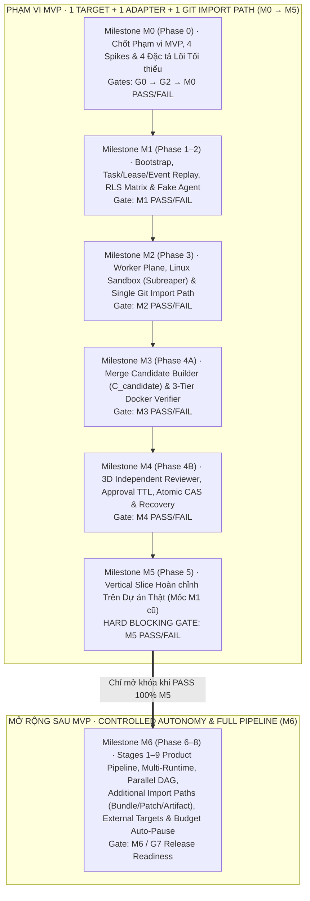

# Software Factory — Development Roadmap v1.5

- **Cập nhật:** 2026-11-13 · @toan-hm
- **Phiên bản:** 1.5 (Cập nhật xử lý toàn bộ 8 nhóm cải thiện `P0-1`→`P0-4` và `P1-5`→`P1-8` từ đợt Review v1.4; tái cấu trúc theo **7 Milestone Gates `M0` → `M6`**)
- **Tài liệu thiết kế đi kèm:** [Software Factory — System Design Plan v1.5](./software-factory-design-plan.md)
- **Bộ tài liệu Core Specs `M0.2`:** [`MVP_SCOPE_AND_ARCHITECTURE.md`](./mvp_scope_and_architecture_specification_v1_5.md) · [`MVP_DATABASE_AND_RLS_SPEC.md`](./mvp_database_schema_and_rls_specification_v1_5.md) · [`MVP_LEASE_EVENT_AND_SANDBOX_SPEC.md`](./mvp_lease_event_protocol_sandbox_and_git_import_specification_v1_5.md) · [`MVP_VERIFIER_REVIEWER_AND_RECOVERY_SPEC.md`](./mvp_verifier_3d_reviewer_approval_and_recovery_specification_v1_5.md)
- **Trạng thái triển khai:** `M1`–`M5`, `M6A`, `M6B` đã được triển khai theo README/lịch sử Git; `M6C-1` đã triển khai và đạt 8/8 acceptance tests cục bộ trên PostgreSQL 17; `M6C-2` đã triển khai, bằng chứng và giới hạn tại [báo cáo M6C-2](./m6c2-validation-report.md). `M6C-3` đang triển khai phần verifier gVisor, xem [báo cáo M6C-3](./m6c3-validation-report.md). Chưa nghiệm thu `M6C` / `G7`.
- **Định hướng:** Pragmatic Single-Path MVP (`M0`–`M5`) · Post-MVP Expansion (`M6`) · Canonical Lock & `clock_timestamp()` Lease Fencing · Lease/Event Gap Replay & Orphaned Push Recovery · Single Controlled Git Push Import (MVP) · 3-Tier Test Docker Verifier · 3D Independent Review · Candidate-Bound Approval & Idempotent Atomic CAS Merge

---

## 1. Tóm tắt Chiến lược Điều chỉnh Lộ trình trong v1.5 (`P0-1` → `P1-8`)

Thay vì triển khai dàn trải nhiều thành phần phức tạp cùng lúc (đa runtime, đa đường import, đa loại Execution Target, toàn bộ tài liệu tương lai của Stages 1–7) ngay trong giai đoạn đầu, **Roadmap v1.5 thu gọn phạm vi MVP vào một đường thực thi duy nhất được kiểm soát chặt từ đầu đến cuối (`M0` → `M5`)**, chứng minh bằng một Task thật trên dự án thật tại **`M5` (MVP Vertical Slice Gate — tương ứng `M1` cũ)**, rồi mới mở rộng sang **`M6` (Controlled Autonomy & Full Product Pipeline)**.

### Tám điểm cải thiện trọng tâm trong v1.5

1. **Thu hẹp phạm vi MVP vào 1 luồng hoàn chỉnh (`P0-1`):** Trong `M0`–`M5`, hệ thống chỉ làm **1 Execution Target (`factory_managed_worker` trên Linux)**, **1 Coding Agent Runtime Adapter (`P-010`) + Fake Agent Harness**, **1 đường nhập code (`Git Push`)**, và **chạy tuần tự từng Task (Single-Task Serial Flow)**. Chưa làm đa runtime, chạy song song, hay External Targets (Tier 2/3/4) trước khi vượt qua `M5`.
2. **Định nghĩa rõ tiêu chí nghiệm thu PASS/FAIL cho Vertical Slice (`P0-2` — Milestone `M5`):** Xác định rõ chuỗi 8 bước thực thi một Task thật từ đầu đến cuối (`Agent thực hiện → Worker chạy trong Sandbox → Controlled Git Import → Merge Candidate → 3-Tier Test → 3D Review → Human Approval → Idempotent CAS Merge`) kèm điều kiện **PASS / FAIL nhị phân** và bằng chứng nghiệm thu cụ thể.
3. **Bổ sung quy trình xử lý lỗi và phục hồi toàn trình (`P0-3` — Milestone `M4` & `M5`):** Định nghĩa cơ chế phục hồi nguyên tử cho: timeout, mất kết nối, retry, duplicate event, **mất phản hồi sau khi merge thành công trên Git (`Idempotent Post-Merge Reconciler` chống double-merge)**, **CAS conflict thật sự** (tự động hủy Approval cũ và tạo lại Candidate trên `HEAD` mới), và **Approval hết thời hạn (`Approval TTL`)**.
4. **Hoàn thiện giao thức Lease/Event và phục hồi mất gói tin (`P0-4` — Milestone `M1` & `M2`):** Quy định rõ `lease_epoch`, `sequence_no`, `event_id`, `event_idempotency_key`, `heartbeat`, phản hồi đồng bộ `last_processed_seq` trên mọi bản tin ACK/NACK, cơ chế **Worker Local Outbox Buffer & Replay** khi event đến sai thứ tự hoặc rớt mạng, và **Orphaned Push Reconciler** khi mất bản tin `task.completed` sau khi đã push code.
5. **Đơn giản hóa đường Import trong MVP (`P1-5` — Milestone `M2`):** MVP chỉ mở **1 đường import duy nhất (`Git Push` $\rightarrow$ `Fail-Closed Git Gatekeeper` $\rightarrow$ `Trusted Import Validator`)**. Bộ Validator kiểm tra cấu trúc Git tree, chặn file ngoài phạm vi (`Path Policy Precedence`), symlink (`mode 120000`), submodule (`mode 160000`), binary vượt cỡ và thay đổi bất thường. Các đường `Bundle`, `Patch`, `Artifact API` được chuyển sang `M6`.
6. **Làm rõ ranh giới bảo mật thực dụng & Ma trận Test RLS (`P1-6` — Milestone `M1` & `M2`):** Bổ sung **Ma trận 8 Kịch bản Kiểm thử Đọc/Ghi RLS (`RLS-T1` → `RLS-T8`)** theo role/project/tier; làm rõ ranh giới credential giữa `Gateway`, `WNA`, `Linux Task Sandbox` và `Docker Verifier`; chỉ dùng 1 lớp Linux Sandbox chuẩn (`dedicated user` + `namespaces` + `cgroups v2` + `subreaper`) trong MVP.
7. **Đảm bảo Reviewer và Approval thực sự độc lập trên 3 chiều (`P1-7` — Milestone `M4`):** Phân biệt rõ **Identity Independence** (khác principal/credential do server cấp), **Execution Independence** (sandbox/session sạch chỉ đọc `C_candidate`), và **Decision Independence** (`ApprovalDecision` gắn chặt với bộ mã băm của `C_candidate`, `VerificationRun` và `ReviewArtifact` — nếu `C_candidate` thay đổi thì tự động hủy kết quả cũ và buộc đánh giá/duyệt lại).
8. **Sắp xếp lại Roadmap theo 7 Milestone Gates (`M0` → `M6`) & Tinh gọn tài liệu `M0` (`P1-8`):** Chia lộ trình thành các mốc nghiệm thu nhỏ có mục tiêu, tiêu chí, bằng chứng, điều kiện PASS/FAIL và quyết định **Go / Hold / Pivot**; tại `M0` không yêu cầu viết toàn bộ tài liệu tương lai của Stages 1–7 trước khi bắt đầu code MVP.

---

## 2. Sơ đồ Tổng quan Lộ trình Theo 7 Milestone Gates (`M0` → `M6`)

---

## 3. Chi tiết Từng Milestone Gate (`M0` → `M6`)

---

### Milestone `M0` (Phase 0) — Chốt Phạm vi MVP, 4 Spikes Kỹ thuật & Đặc tả Lõi Tối thiểu (`P0-1`, `P1-8`)

- **Mục tiêu:** Khóa phạm vi tối thiểu của MVP (`1 Target`, `1 Adapter`, `1 Git Import Path`), kiểm chứng thực nghiệm 4 giả định kỹ thuật rủi ro nhất qua 4 Spikes có timebox, và **chỉ viết đúng 4 tài liệu đặc tả kỹ thuật lõi phục vụ trực tiếp cho `M1`–`M5`** (loại bỏ yêu cầu phải hoàn tất toàn bộ 11+ tài liệu của các phase tương lai trước khi viết code MVP — `P1-8`).

#### 1. Công việc Triển khai tại `M0`:
- **Bước `M0.1` — Duyệt Gate `G0` & Chạy 4 Spikes Kỹ thuật (Tối đa 10 ngày):**

| Spike | Timebox | Deliverables bắt buộc | Điều kiện PASS (Go) / FAIL (Pivot) |
| :--- | :--- | :--- | :--- |
| **Spike 1 · Điều khiển Coding Agent đầu tiên (`P-010`) trong `LinuxSandboxBackend`** | **3 ngày** | PoC script + `SPIKE_01_REPORT.md` kèm log, git diff và kết quả kiểm tra `cgroup.events` + `subreaper`. | **PASS:** Điều khiển được Agent qua CLI/SDK hoàn thành $\ge 3$ bài toán sửa code + test trong Sandbox; thu được commit, diff, exit code và xác nhận dọn sạch cả tiến trình con/cháu mồ côi (`populated == 0` & `rmdir(cgroup)` thành công). **FAIL/Pivot:** Chuyển sang Agent dự phòng trong danh sách (Claude Code CLI / Codex CLI / Aider / OpenHands). |
| **Spike 2 · Kiểm tra Pháp lý, License, ToS & Credential Injection** | **2 ngày** | `SPIKE_02_LICENSE_MATRIX.md` cho Coding Agent của MVP. | **PASS:** Xác nhận điều khoản chính thức cho phép chạy headless automation và nạp credential không qua trình duyệt thủ công. **FAIL/Pivot:** Loại bỏ ngay Agent vi phạm ToS tự động hóa. |
| **Spike 3 · Concurrency Lease Lock, Event Gap Replay (`P0-4`) & Fail-Closed Git (`P1-5`)** | **3 ngày** | Prototype `agent-gateway` + `wna` + Git `pre-receive` hook & `SPIKE_03_PROTOCOL.md`. | **PASS:** (1) Vượt qua test cạnh tranh giữa `Submit Event` và `Revoke Lease` với `FOR UPDATE` + `clock_timestamp()`; (2) Tự động replay bù khi giả lập rớt gói tin `sequence_no`; (3) Thu hồi quyền ghi Git `< 2s` và **bắt buộc `Fail-Closed`** khi ngắt DB. |
| **Spike 4 · Đánh giá Workflow Engine (`P-005`: Custom State Machine vs. LangGraph)** | **2 ngày** | Prototype 2 phương án trên vòng lặp Task + Rework + Recovery & `SPIKE_04_WORKFLOW.md`. | **PASS:** Lưu bền trạng thái cùng Outbox và `last_processed_seq` trong 1 transaction PostgreSQL, khôi phục chính xác sau `kill -9` và hỗ trợ Pause/Resume tại Approval Gate. **Pivot:** Chọn **Custom Durable State Machine trên PostgreSQL** nếu LangGraph cản trở giao dịch nguyên tử với `task_leases`. |

- **Bước `M0.2` — Chốt Gate `G2` & Khóa 4 Tài liệu Đặc tả Kỹ thuật Lõi của MVP (`MVP Core Specs` — `P1-8`):**
  1. [`MVP_SCOPE_AND_ARCHITECTURE.md`](./mvp_scope_and_architecture_specification_v1_5.md): Khóa ranh giới MVP (`M0`–`M5`) vs. Post-MVP (`M6`) và ADRs cho `P-001` $\rightarrow$ `P-011`.
  2. [`MVP_DATABASE_AND_RLS_SPEC.md`](./mvp_database_schema_and_rls_specification_v1_5.md): Schema cốt lõi của MVP, giao thức khóa `FOR UPDATE` + `clock_timestamp()`, hàm `list_expired_active_lease_scopes()`, và đặc tả **Ma trận 8 Kịch bản Kiểm thử RLS (`RLS-T1` → `RLS-T8`)**.
  3. [`MVP_LEASE_EVENT_AND_SANDBOX_SPEC.md`](./mvp_lease_event_protocol_sandbox_and_git_import_specification_v1_5.md): Giao thức Lease/Event/Heartbeat, **Worker Local Outbox Buffer & Replay**, **Orphaned Push Reconciler**, `LinuxSandboxBackend` (`cgroups v2` + `subreaper`), giao diện `AgentRuntimeAdapter` và **Single Controlled Git Import Path (`Trusted Import Validator`)**.
  4. [`MVP_VERIFIER_REVIEWER_AND_RECOVERY_SPEC.md`](./mvp_verifier_3d_reviewer_approval_and_recovery_specification_v1_5.md): Quy trình tạo `Merge Candidate (C_candidate)`, **3-Tier Docker Verifier**, **3D Independent Reviewer**, **Approval TTL** và **Idempotent Post-Merge Reconciler**.
  *(Các tài liệu đặc tả của Stages 1–7 Product Pipeline được dời sang đầu `M6` để không làm chậm tiến độ khởi công MVP).*

#### 2. Nghiệm thu Milestone `M0` (Gate Decision):
- **Bằng chứng bắt buộc:** Biên bản duyệt `G0` & `G2`, 4 báo cáo `SPIKE_01..04_REPORT.md` và 4 file đặc tả lõi `MVP_*_SPEC.md`.
- **Điều kiện PASS:** Cả 4 Spikes đạt kết luận Go (hoặc đã hoàn tất Pivot sang phương án dự phòng hợp lệ) và 4 đặc tả lõi MVP không còn câu hỏi mở (`OQ-01` → `OQ-05` đã đóng 100%).
- **Điều kiện FAIL & Quyết định:** Nếu chưa chứng minh được khả năng điều khiển Agent trong Linux Sandbox hoặc chưa chứng minh được `Fail-Closed Git Gatekeeper` $\rightarrow$ **DỪNG (HOLD)**, không được mở khóa `M1`.

---

### Milestone `M1` (Phase 1 & Phase 2) — Bootstrap, Giao thức Lease/Event Replay, Ma trận RLS & Fake Agent Harness (`P0-4`, `P1-6`)

- **Mục tiêu:** Xây dựng nền móng Control Plane (`core-api`, `agent-gateway`, `web`, PostgreSQL), hoàn thiện **giao thức Lease/Event có khả năng tự phục hồi khi mất gói tin hoặc rớt mạng (`P0-4`)**, cưỡng chế **Hardened 4-Tier RLS vượt qua đủ 8 bài test Đọc/Ghi (`P1-6`)**, và dựng bộ **Fake Agent Harness** để kiểm thử tự động toàn bộ các tình huống lỗi và đối kháng.

#### 1. Công việc Triển khai tại `M1`:
- **Bootstrap Monorepo & CI Baseline:**
  - Khởi tạo `apps/web`, `apps/core-api`, `apps/agent-gateway` và `packages/*` (`shared-types`, `database`, `task-contract`, `adapter-sdk`, `wna`, `test-harness`).
  - Thiết lập CI pipeline (lint, typecheck, test, secret scanning) và cấu hình PostgreSQL tách riêng role `db_migrator` (table owner) và `app_runtime` (`NOSUPERUSER NOCREATEDB NOCREATEROLE NOBYPASSRLS`).
- **Hardened 4-Tier RLS & Ma trận Test RLS (`P1-6`):**
  - Triển khai RLS với `FORCE ROW LEVEL SECURITY` trên cả 4 tầng dữ liệu (tách rõ policy của bảng gốc `projects.id` và các bảng con `project_id`), dùng `SET LOCAL` trong từng transaction và `DISCARD ALL` khi trả kết nối về pool.
  - Viết bộ test tự động thực thi đầy đủ **8 kịch bản `RLS-T1` → `RLS-T8`** (Mục 8.3 của Design Plan).
- **Giao thức Lease/Event, Heartbeat & Phục hồi Mất Gói tin (`P0-4`):**
  - Triển khai khóa độc quyền Canonical Lock (`SELECT ... FROM task_leases l JOIN tasks t ... FOR UPDATE OF l, t`) và kiểm tra thời hạn bằng **`clock_timestamp()`**.
  - Cưỡng chế thứ tự tuần tự `sequence_no == last_processed_seq + 1`, chống trùng lặp qua `event_idempotency_key` (`UNIQUE (project_id, event_idempotency_key)`) và chống xung đột sequence qua `UNIQUE (project_id, task_id, lease_epoch, sequence_no)`.
  - Mọi phản hồi từ Server (`200 ACK_OK`, `200 RETRY_IDEMPOTENT_OK`, `409 ERR_SEQUENCE_GAP`, `409 ERR_STALE_LEASE`, `Heartbeat ACK`, `Reconnect Handshake`) đều trả về `last_processed_seq` và `expected_next_seq`.
  - Triển khai **Worker Local Outbox Buffer** trong `packages/wna`: lưu journal sự kiện xuống đĩa cục bộ trước khi gửi; tự động phát lại (replay) từ `last_processed_seq + 1` khi nhận `409 ERR_SEQUENCE_GAP` hoặc khi kết nối lại sau sự cố rớt mạng.
- **Fake Agent Harness (`packages/test-harness` — 10 Kịch bản Đối kháng & Phục hồi):**
  1. *Gian lận kết quả & Viết test rỗng (`Dishonest Completion & Empty Agent Test`).*
  2. *Cạnh tranh đồng thời giữa `Submit Event` và `Revoke Lease` / hết hạn Lease (`Concurrent Lease Race`).*
  3. *Gửi sự kiện sai thứ tự & Tự động Replay bù từ Local Outbox (`Out-of-Order Sequence & Gap Replay` — `P0-4`).*
  4. *Mất kết nối mạng tạm thời (khi Lease còn hạn) vs. Mất kết nối quá hạn Lease (`Disconnect & Reconnect Recovery` — `P0-4`).*
  5. *Phát lại sự kiện trùng (`Idempotent Retry`) vs. Đổi nội dung cùng Idempotency Key (`422 Payload Conflict`).*
  6. *Nộp code chứa file ngoài phạm vi, symlink, submodule, binary quá cỡ hoặc xóa trắng hàng loạt (`Malicious Git Push` — `P1-5`).*
  7. *Tiến trình cháu mồ côi & Đọc trộm Credential (`Double-Fork Orphan & Sandbox Escape` — `P1-6`).*
  8. *Giả mạo danh tính Reviewer hoặc dùng chung ngữ cảnh thực thi (`3D Reviewer Violation` — `P1-7`).*
  9. *Mất phản hồi mạng ngay sau khi `git update-ref` đã merge thành công trên Git (`Lost Response After Merge` — `P0-3`).*
  10. *Nhánh `main` tiến lên commit mới `B_new` hoặc Approval hết hạn `TTL` ngay trước khi merge (`True CAS Conflict & Expired Approval` — `P0-3`).*

#### 2. Nghiệm thu Milestone `M1` (Gate Decision):
- **Bằng chứng bắt buộc:** Báo cáo CI chạy pass 100% **Ma trận `RLS-T1` → `RLS-T8`**, báo cáo test cạnh tranh Lease (`100 luồng song song`), và log chạy pass các kịch bản `2, 3, 4, 5` của Fake Agent Harness.
- **Điều kiện PASS:**
  1. Không một truy vấn nào của `app_runtime` đọc/ghi chéo được sang Project/Org khác hoặc chạy được khi thiếu `SET LOCAL` (`RLS-T1` → `RLS-T8` PASS 100%).
  2. Khi giả lập rớt mạng hoặc mất gói tin `seq = 3` (gửi `seq = 4` trước), Server trả về `409 ERR_SEQUENCE_GAP (last_processed_seq = 2)` và `WNA` tự động replay `seq = 3, 4` thành công mà không mất dữ liệu hay tạo bản ghi trùng.
  3. Sau khi `Revoke Lease` giành được khóa `FOR UPDATE`, 100% sự kiện từ Lease cũ bị từ chối tức thời.
- **Điều kiện FAIL & Quyết định:** Nếu còn bất kỳ lỗ hổng RLS nào hoặc Worker bị kẹt không tự phục hồi được khi rơi gói tin mạng $\rightarrow$ **DỪNG (HOLD)** tại `M1` để sửa dứt điểm trước khi làm `M2`.

---

### Milestone `M2` (Phase 3) — Worker Plane, Linux Task Sandbox (`Subreaper`) & Đường Import Duy nhất (`Git Push`) (`P0-4`, `P1-5`, `P1-6`)

- **Mục tiêu:** Xây dựng tầng thực thi trên `factory_managed_worker` (Linux) với ranh giới bảo mật thực dụng (`LinuxSandboxBackend`), triển khai **1 đường nhập code duy nhất được kiểm soát chặt (`Git Push` $\rightarrow$ `Git Gatekeeper` $\rightarrow$ `Trusted Import Validator` — `P1-5`)**, tích hợp Coding Agent đầu tiên (`P-010`) và cơ chế **Orphaned Push Reconciler (`P0-4`)**.

#### 1. Công việc Triển khai tại `M2`:
- **Ranh giới Bảo mật giữa `Agent Gateway`, `WNA` và `LinuxSandboxBackend` (`P1-6`):**
  - `WNA Supervisor` chạy dưới user `sf-wna`, giữ `worker_node_credential` và bật `prctl(PR_SET_CHILD_SUBREAPER, 1)`.
  - Mỗi `(task_id, lease_epoch)` được khởi chạy trong **`LinuxSandboxBackend`**: chạy dưới UID/GID riêng `sf-task-runner`, bên trong `mount`, `pid`, `ipc`, `uts` namespaces riêng, môi trường sạch `env -i` (tuyệt đối không truyền credential của `WNA` vào Sandbox), chỉ mount thư mục worktree của đúng epoch đó và cấp `ephemeral_git_push_token` chỉ có quyền đẩy vào `refs/factory/Verify/<task_id>/<epoch>`.
  - Quy trình hủy và dọn dẹp (`killAndVerifyClean`): ghi `"1"` vào `cgroup.kill` $\rightarrow$ đợi `cgroup.events (populated == 0)` $\rightarrow$ vòng lặp `waitpid()` thu hồi sạch zombie $\rightarrow$ xác nhận `cgroup.procs` rỗng $\rightarrow$ `rmdir(cgroup)` thành công.
- **Đường Nhập Code Duy nhất trong MVP (`Controlled Git Push` + `Trusted Import Validator` — `P1-5`):**
  - Chỉ mở duy nhất cổng `Git Push` qua `Fail-Closed Git Gatekeeper (pre-receive hook)` đẩy vào nhánh cách ly `refs/factory/Verify/<task_id>/<epoch>`. (Không mở `Bundle`, `Patch` hay `Artifact API` trong MVP).
  - Triển khai **6 bước kiểm tra bắt buộc của `Trusted Import Validator`** (Mục 6.4 của Design Plan):
    1. Kiểm tra nguyên tử Lease đang `ACTIVE` và `expires_at > clock_timestamp()` (**Fail-Closed** nếu mất kết nối DB/Control Plane hoặc timeout `> 2s`).
    2. Kiểm tra Git tree & ancestor (`fast-forward` từ `base_main_commit_hash`, không chứa merge commit lạ).
    3. Kiểm tra `Path Policy Precedence`: `forbidden_paths > protected_paths > allowed_files > Default Deny` (trên cả nguồn và đích khi rename/copy).
    4. Chặn `symlink` (`mode 120000`) trỏ ra ngoài hoặc vào vùng bảo vệ, và chặn `path traversal (..)`.
    5. Chặn `submodule` (`mode 160000` / `.gitmodules`), thay đổi trái phép trên `.gitattributes`/`.githooks` và file `binary` vượt ngưỡng kích thước.
    6. Chặn thay đổi bất thường (`max_changed_files` / `max_deleted_lines` theo `TaskContract`).
- **Phục hồi khi Mất Sự kiện Kết thúc sau khi Đã Push Code (`Orphaned Push Reconciler` — `P0-4`):**
  - Khi `Trusted Import Validator` chấp nhận commit `C_agent`, hệ thống ghi ngay vào bảng `verified_code_imports`. Nếu Worker mất kết nối vĩnh viễn trước khi gửi `task.completed`, bộ **Lease Expiry Reconciler** tự động phát hiện bản ghi trong `verified_code_imports` và cứu kết quả chuyển sang bước tạo `Merge Candidate`.
- **Tích hợp Runtime Adapter đầu tiên (`P-010`) & Task Context Assembler.**

#### 2. Nghiệm thu Milestone `M2` (Gate Decision):
- **Bằng chứng bắt buộc:** Báo cáo pass kịch bản đối kháng số `6` (Malicious Git Push) và số `7` (Double-Fork Orphan & Sandbox Escape), log test **Orphaned Push Recovery**, và kết quả chạy **Adapter Contract Test Suite** cho cả Fake Agent lẫn Coding Agent thật (`P-010`).
- **Điều kiện PASS:**
  1. Tiến trình trong Sandbox không đọc được `/etc/sf-wna` hay worktree của Task khác; sau khi Lease hết hạn/revoke (kể cả khi có double-forked orphan process), `cgroup.events` báo `populated == 0`, `cgroup.procs` rỗng và `rmdir(cgroup)` thành công 100%.
  2. Mọi nỗ lực push file ngoài `allowed_files`, sửa `protected_paths`, thêm symlink độc hại, thêm submodule, đẩy file binary vượt cỡ hoặc xóa trắng mã nguồn đều bị `Trusted Import Validator` chặn đứng ngay tại `pre-receive` hook.
  3. Khi ngắt kết nối giữa Git Server và Control Plane, `git push` bị từ chối 100% (`Fail-Closed`).
  4. Khi giả lập kill Worker ngay sau khi `git push` thành công (trước khi gửi `task.completed`), **Orphaned Push Reconciler** tự động khôi phục được commit `C_agent` mà không cần chạy lại Agent.
- **Điều kiện FAIL & Quyết định:** Nếu lọt tiến trình mồ côi sau khi thu hồi Lease hoặc lọt file vi phạm `Path Policy` qua Git Push $\rightarrow$ **DỪNG (HOLD)** tại `M2`.

---

### Milestone `M3` (Phase 4A) — Merge Candidate Builder (`C_candidate`) & 3-Tier Trusted Docker Verifier (`P0-3`, `P0-4` của v1.4)

- **Mục tiêu:** Đảm bảo mọi bước kiểm định đều diễn ra trên chính xác **Merge Candidate Commit (`C_candidate`)** dự kiến sẽ đưa vào `main`, và xác minh mã nguồn bằng **3-Tier Trusted Docker Verifier** hoàn toàn độc lập với môi trường của Worker.

#### 1. Công việc Triển khai tại `M3`:
- **Merge Candidate Builder (Tạo `C_candidate` TRƯỚC khi Kiểm định):**
  - Lấy `HEAD` hiện tại của `main` là `B_base` (`base_main_commit_hash`), tích hợp commit `C_agent` (từ `refs/factory/Verify/<task_id>/<epoch>`) lên `B_base` để tạo ra **`C_candidate` (`merge_candidate_hash`)** có cây mã nguồn là `verified_tree_hash`.
  - Nếu xảy ra xung đột Git khi tạo `C_candidate`, tự động chuyển Task sang `ReworkRequired` ngay lập tức.
  - Xuất `C_candidate` thành **Immutable Source Snapshot (`snapshot-<verified_tree_hash>.tar`)** lưu vào Object Storage kèm mã băm SHA-256.
- **3-Tier Trusted Docker Verifier & Cô lập Cache:**
  - Chạy trong container dùng một lần (`--rm`, `--cap-drop=ALL`, `--security-opt=no-new-privileges`) trên bản chụp `C_candidate` giải nén vào `/workspace/baseline:ro` và copy sang `/workspace/run` trên `tmpfs`.
  - **Cấm Hardlink Dependency Cache:** Sử dụng copy có kiểm chứng digest hoặc `OverlayFS` (`lowerdir=/workspace/deps-cache:ro`, `upperdir` trên `tmpfs`), bật `fs.protected_hardlinks = 1` và `fs.protected_symlinks = 1`.
  - **Thực thi tách biệt 3 Tầng Kiểm thử:**
    1. *Tầng 1 — `Trusted Acceptance Tests`:* Nạp từ `/trusted-policy/acceptance-tests:ro` (ngoài tầm sửa của Agent, kiểm tra SHA-256 trước khi chạy).
    2. *Tầng 2 — `Protected Project Baseline Tests`:* Đối chiếu SHA-256 của toàn bộ các file test hiện hữu trong `protected_paths` của `C_candidate` với `B_base` — nếu bị sửa/xóa trái phép thì đánh trượt ngay (`TEST_TAMPERING_DETECTED`).
    3. *Tầng 3 — `Agent-Generated Tests`:* Chạy trong container sandbox không secret; thu thập kết quả và chuyển nội dung assertion cho Reviewer kiểm tra.
  - **Xử lý Timeout & Crash của Verifier (`P0-3`):** Áp đặt `hard_timeout` cho từng bước; phân biệt rõ lỗi do code/test của Agent bị treo (`TEST_TIMEOUT` $\rightarrow$ tính vào `ReworkRequired`) và lỗi hạ tầng Docker (`INFRA_ERROR` $\rightarrow$ tự động retry tối đa `2 lần` mà không tăng `rework_count`).

#### 2. Nghiệm thu Milestone `M3` (Gate Decision):
- **Bằng chứng bắt buộc:** Bản ghi `merge_candidates`, `verification_runs`, file snapshot `.tar` và báo cáo chạy pass kịch bản đối kháng số `1` (`Dishonest Completion & Empty Agent Test`).
- **Điều kiện PASS:**
  1. Khi Fake Agent báo cáo hoàn thành kèm bài test tự viết luôn pass (`expect(true).toBe(true)`) nhưng làm sai yêu cầu, tầng **`Trusted Acceptance Tests`** đánh trượt 100%.
  2. Khi Fake Agent sửa đổi một bài test thuộc **`Protected Baseline Tests`**, bộ kiểm tra SHA-256 chặn đứng với mã `TEST_TAMPERING_DETECTED`.
  3. Tiến trình bên trong Docker Verifier không thể sửa đổi hay tạo hardlink vào `/workspace/deps-cache:ro` và không có kết nối mạng ra ngoài ở chế độ Hermetic (`--network=none`).
- **Điều kiện FAIL & Quyết định:** Nếu Verifier chạy trên `C_agent` thay vì `C_candidate` hoặc không phát hiện được hành vi làm giả test của Agent $\rightarrow$ **DỪNG (HOLD)** tại `M3`.

---

### Milestone `M4` (Phase 4B) — 3D Independent Reviewer, Approval TTL, Idempotent Atomic CAS Merge & Phục hồi Lỗi (`P0-3`, `P1-7`)

- **Mục tiêu:** Hoàn thiện chặng cuối của vòng lặp thực thi: **Reviewer độc lập trên cả 3 chiều (`P1-7`)**, **Human Approval** khóa chặt vào `C_candidate` kèm thời hạn hiệu lực (`Approval TTL`), **Hợp nhất nguyên tử bằng `CAS`** và **Quy trình tự phục hồi khi mất phản hồi sau merge hoặc khi xảy ra xung đột CAS (`P0-3`)**.

#### 1. Công việc Triển khai tại `M4`:
- **Độc lập 3 Chiều của Reviewer (`3D Reviewer Independence` — `P1-7`):**
  1. *Identity Independence:* `Agent Gateway` xác thực trực tiếp `principal_id` và cấp credential riêng `ROLE_REVIEWER_READONLY`; cấm tuyệt đối cùng `principal_id`, `session_id`, `credential_id` hay `agent_profile_id` với Developer.
  2. *Execution Independence:* Reviewer chạy trong một `Task Sandbox` mới hoàn toàn (`clean session`), không nhận lịch sử suy luận/hội thoại nội bộ của Developer, chỉ đọc snapshot `C_candidate` (`read-only`) + `TaskContract` + báo cáo `VerificationRun`.
  3. *Decision Independence & Auto-Invalidation:* Reviewer chỉ xuất `ReviewArtifact` (`APPROVE / REJECT`) gắn chặt với `(merge_candidate_hash, verified_tree_hash, verification_run_id)`. Nếu `C_candidate` thay đổi hoặc `VerificationRun` chạy lại, mọi `ReviewArtifact` cũ tự động chuyển sang `INVALIDATED_STALE_CANDIDATE`.
- **Human Approval Gắn chặt với `C_candidate` & Thời hạn `Approval TTL` (`P0-3`, `P1-7`):**
  - Giao diện **Approval Center** trên Web UI hiển thị diff, báo cáo 3-Tier Verifier và `ReviewArtifact` của đúng `C_candidate`.
  - Mỗi `ApprovalRequest` có thời hạn `expires_at` (`Approval TTL`). Khi người dùng phê duyệt, hệ thống kiểm tra `expires_at > clock_timestamp()` và khóa cứng bản ghi `ApprovalDecision` chứa đủ 8 trường: `(project_id, task_id, agent_commit_hash, base_main_commit_hash, merge_candidate_hash, verified_tree_hash, verification_run_id, review_artifact_id)`.
- **Idempotent Atomic CAS Merge & Xử lý Lỗi / Phục hồi Toàn trình (`P0-3`):**
  - Thực hiện merge vào `main` bằng lệnh nguyên tử: `git update-ref refs/heads/main <merge_candidate_hash> <base_main_commit_hash>`.
  - **Idempotent Post-Merge Reconciler (Xử lý mất phản hồi sau khi merge):** Nếu `git update-ref` đã thành công trên Git Server nhưng mất phản hồi trước khi lưu DB, lần retry tiếp theo sẽ kiểm tra `current_main_head == <merge_candidate_hash>` (đối chiếu với bảng `merge_operations`). Nếu khớp, hệ thống tự động đồng bộ trạng thái DB sang `MergedAndCompleted` và trả về `200 OK` **mà không thực hiện merge lặp hay báo lỗi CAS conflict giả**.
  - **Xử lý True CAS Conflict (`main` đã tiến lên `<B_new>`):** Nếu `current_main_head == <B_new>` (khác cả `<B_base>` và `<C_candidate>`), hệ thống tự động chuyển `ApprovalDecision` và `ReviewArtifact` cũ sang `INVALIDATED_STALE_BASE`, lùi Task về `BuildingMergeCandidate` để tạo `<C_candidate_new>` trên nền `<B_new>` và **bắt buộc chạy lại Verifier + Reviewer + Human Approval**.
  - **Bounded Rework Loop (`rework_count`):** Lần chạy đầu `rework_count = 0`; mỗi lần Verifier/Reviewer/Human trả về sửa lỗi thì tăng `rework_count + 1`; khi `rework_count >= max_rework_cycles` thì tự động chuyển sang `ManualIntervention`.

#### 2. Nghiệm thu Milestone `M4` (Gate Decision):
- **Bằng chứng bắt buộc:** Báo cáo chạy pass các kịch bản đối kháng số `8` (`3D Reviewer Violation`), số `9` (`Lost Response After Merge`) và số `10` (`True CAS Conflict & Expired Approval`) của Fake Agent Harness.
- **Điều kiện PASS:**
  1. Mọi hành vi dùng cùng credential/session/principal của Developer để duyệt bài hoặc duyệt trên một `C_candidate` đã bị sửa đổi 1 byte đều bị chặn 100%.
  2. Khi giả lập ngắt kết nối ngay sau khi `git update-ref` vừa cập nhật `refs/heads/main` thành công rồi gọi retry merge 5 lần liên tiếp: **Post-Merge Reconciler** nhận diện chính xác commit đã nằm trên `main`, chuyển DB sang `MergedAndCompleted` và không gây ra bất kỳ commit/tác động dữ liệu trùng lặp nào.
  3. Khi nhánh `main` tiến lên commit khác hoặc khi `ApprovalRequest` quá hạn `expires_at`, lệnh merge bị từ chối an toàn và hệ thống tự động yêu cầu tạo lại Candidate + đánh giá/duyệt lại.
- **Điều kiện FAIL & Quyết định:** Nếu retry sau khi mất mạng gây lỗi kẹt trạng thái hoặc nếu cho phép merge khi `C_candidate` đã lệch với `HEAD` của `main` $\rightarrow$ **DỪNG (HOLD)** tại `M4`.

---

### Milestone `M5` (Phase 5) — Vertical Slice Hoàn chỉnh Trên Dự án Thật (`MVP Vertical Slice Gate` — Tương ứng `M1` cũ) (`P0-2`)

- **Mục tiêu:** Đây là **cột mốc chặn quan trọng nhất của toàn bộ giai đoạn MVP (`P0-2`)**. Hệ thống phải vận hành thành công một **Task kỹ thuật thật trên một repository dự án thật** với **Coding Agent thật (`P-010`)** đi qua trọn vẹn chuỗi 8 bước:
  `1. Task Ready & Lease Issued` $\rightarrow$ `2. Agent Thực hiện trong Linux Worker Sandbox` $\rightarrow$ `3. Controlled Git Push Import & Validation` $\rightarrow$ `4. Tạo Merge Candidate (C_candidate)` $\rightarrow$ `5. Chạy 3-Tier Docker Verifier` $\rightarrow$ `6. Chạy 3D Independent Reviewer` $\rightarrow$ `7. Human Approval trên Web UI` $\rightarrow$ `8. Idempotent Atomic CAS Merge vào main`.

#### Bảng 8 Tiêu chí Nghiệm thu Nhị phân (`PASS / FAIL`) Bắt buộc tại Milestone `M5` (`P0-2`)

| Mã TC | Bước kiểm chứng trong Vertical Slice | Điều kiện Đạt (`PASS` Condition) | Điều kiện Trượt (`FAIL` Condition) | Bằng chứng Nghiệm thu Bắt buộc (Mandatory Evidence) |
| :--- | :--- | :--- | :--- | :--- |
| **`M5-AC1`** | **1. Giao Task, Cấp Lease & Thực thi bằng Agent thật trong Linux Sandbox** | Coding Agent thật (`P-010`) nhận `TaskContract`, chạy trong `LinuxSandboxBackend` (`UID` riêng, `cgroups v2`, `subreaper`), gửi chuỗi sự kiện tuần tự `seq = 1..N` và hoàn thành sửa code đúng yêu cầu. Sau khi kết thúc, `cgroup.events (populated == 0)` và `rmdir(cgroup)` thành công. | Agent không chạy được trong Sandbox, rò rỉ credential của `WNA`, lệch `sequence_no`, hoặc còn sót tiến trình mồ côi sau khi thu hồi Lease. | Bản ghi `task_leases`, `processed_events`, log của `WNA` xác nhận `populated == 0` và `rmdir(cgroup)` thành công. |
| **`M5-AC2`** | **2. Nhập Code qua Đường `Git Push` Duy nhất & `Trusted Import Validator`** | Agent đẩy commit `C_agent` qua `Fail-Closed Git Gatekeeper` vào `refs/factory/Verify/<task_id>/<epoch>`; `Trusted Import Validator` kiểm tra pass cả 6 quy tắc (Lease Active, Git Tree, `Path Policy Precedence`, không symlink/submodule/binary lạ, không vượt ngưỡng diff) và ghi nhận `verified_code_imports`. | Cho phép push trực tiếp vào `main`, bỏ qua bất kỳ quy tắc nào trong 6 quy tắc của Validator, hoặc `Fail-Open` khi mất kết nối DB. | Log của `pre-receive` hook + Bản ghi `verified_code_imports` + Kết quả test chặn push file vi phạm `protected_paths`/symlink. |
| **`M5-AC3`** | **3. Tạo `Merge Candidate (C_candidate)` & Chạy `3-Tier Docker Verifier`** | Hệ thống tích hợp `C_agent` lên `B_base` tạo ra `C_candidate` (`verified_tree_hash`), đóng gói snapshot `.tar` và chạy Docker Verifier vượt qua cả **3 tầng kiểm thử** (`Trusted Acceptance Tests`, `Protected Baseline Tests` có kiểm tra SHA-256, và `Agent-Generated Tests`) mà không dùng hardlink cache. | Chạy test trên `C_agent` thay vì `C_candidate`; không phát hiện được khi cố tình sửa `Baseline Tests` hoặc khi viết test rỗng làm sai `Trusted Acceptance Tests`. | Bản ghi `merge_candidates`, `verification_runs` (log đầy đủ cả 3 tầng test) + Mã băm SHA-256 của snapshot `.tar`. |
| **`M5-AC4`** | **4. Đánh giá Độc lập trên 3 Chiều (`3D Independent Reviewer`)** | Reviewer chạy với principal & credential `ROLE_REVIEWER_READONLY` tách biệt do `Agent Gateway` cấp, trong một Sandbox sạch chỉ gắn `read-only` snapshot của `C_candidate`, kiểm tra cả code diff lẫn chất lượng assertion của test và xuất `ReviewArtifact` bất biến. | Reviewer dùng chung credential/session/context với Developer, có quyền ghi vào repo, hoặc đánh giá khác commit với `C_candidate`. | Bản ghi `review_sessions`, `ReviewArtifact` (JSON + Markdown) gắn đúng `merge_candidate_hash` và `verification_run_id`. |
| **`M5-AC5`** | **5. Human Approval Gắn chặt với `C_candidate` & Hợp nhất Nguyên tử `CAS`** | Con người xem xét bằng chứng trên Web UI và ký duyệt `ApprovalDecision` (khóa đủ 8 trường + còn trong hạn `expires_at`); lệnh `git update-ref refs/heads/main <C_candidate> <B_base>` cập nhật nhánh `main` thành công nguyên tử. | Có bất kỳ commit mới nào được tạo ra sau khi Human đã bấm Approve, hoặc cho phép merge khi `ApprovalRequest` đã hết hạn `TTL`. | Bản ghi `approval_decisions` (8 trường) + Lịch sử `git log` trên `refs/heads/main` trùng khớp 100% với `merge_candidate_hash` và `verified_tree_hash`. |
| **`M5-AC6`** | **6. Kiểm chứng Vòng lặp Sửa lỗi Có Giới hạn (`Bounded Rework Loop`)** | Thực nghiệm 1 Task bị Verifier hoặc Reviewer đánh trượt ở vòng đầu (`rework_count = 0` $\rightarrow$ `1`), hệ thống cấp `lease_epoch` mới kèm phản hồi lỗi, Agent sửa lại đạt yêu cầu và merge thành công; đồng thời kiểm chứng tự động ngắt sang `ManualIntervention` khi chạm `max_rework_cycles`. | Vòng lặp chạy vô hạn không dừng, hoặc không thu hồi/dọn sạch Sandbox của `lease_epoch` cũ trước khi cấp `lease_epoch` mới. | Lịch sử nhiều `lease_epoch` và `rework_count` của Task thực nghiệm + Bản ghi `resource_usage_metrics` (`AC-12a`). |
| **`M5-AC7`** | **7. Kiểm chứng Chịu lỗi & Phục hồi Toàn trình trên Luồng Thực tế (`End-to-End Fault Injection & Recovery`)** | Tiêm lỗi trực tiếp vào luồng chạy để chứng minh hệ thống tự phục hồi không hỏng dữ liệu trong 4 tình huống: (a) Rớt mạng làm rơi gói tin event $\rightarrow$ tự replay bù từ Local Outbox; (b) Mất bản tin `task.completed` sau khi đã push $\rightarrow$ `Orphaned Push Reconciler` cứu kết quả; (c) Mất phản hồi sau khi `git update-ref` đã merge $\rightarrow$ `Post-Merge Reconciler` hoàn tất idempotent không double-merge; (d) Nhánh `main` tiến lên commit mới trước khi merge $\rightarrow$ CAS chặn lại, hủy Approval cũ và tạo lại Candidate mới. | Bất kỳ tình huống nào trong 4 tình huống trên dẫn đến mất dữ liệu, double-merge, treo Task vĩnh viễn phải sửa DB bằng tay, hoặc merge đè làm mất commit trên `main`. | Báo cáo & log thực nghiệm của cả 4 bài test tiêm lỗi (`Fault Injection Recovery Report`). |
| **`M5-AC8`** | **8. Truy xuất Nguồn gốc Đầu-Cuối Cấp Task (`Candidate-Bound Lineage` — `AC-11a`)** | Từ commit cuối cùng trên nhánh `main`, truy xuất ngược lại 100% không đứt gãy toàn bộ chuỗi: `Main Commit == Merge Candidate (C_candidate / T_verified) ← ApprovalDecision ← ReviewArtifact ← VerificationRun (3-Tier) ← VerifiedCodeImport (C_agent) ← TaskLease (epoch, seq) ← TaskContract`. | Thiếu bất kỳ mắt xích nào hoặc mã băm Git giữa các bước không khớp nhau. | Màn hình Lineage trên Web UI + Hồ sơ xuất JSON (`M5_EVIDENCE_BUNDLE.json`). |

#### Quyết định tại Cổng Chặn `M5` (`Hard Blocking Gate Decision`):
- **Thẩm quyền phê duyệt:** Product Owner + Lead Architect.
- **Quyết định GO (Mở khóa `M6`):** Chỉ khi đạt **8/8 tiêu chí `M5-AC1` → `M5-AC8` đều `PASS`** kèm đầy đủ bằng chứng thực nghiệm.
- **Quyết định HOLD (Chặn mở rộng):** Nếu bất kỳ tiêu chí nào `FAIL`, toàn bộ đội ngũ tập trung xử lý dứt điểm trên luồng đơn của MVP; **tuyệt đối không mở rộng sang đa runtime, chạy song song hay Product Pipeline (`M6`) khi luồng đơn tại `M5` chưa ổn định 100%**.

---

### Milestone `M6` (Phase 6, Phase 7 & Phase 8) — Mở rộng Sang Controlled Autonomy & Full Product Pipeline (Sau khi Đạt `M5`) (`P0-1`, `P1-5`, `P1-8`)

Sau khi vòng thực thi cốt lõi đã được chứng minh vững chắc tại `M5`, Milestone `M6` mở rộng nền tảng theo đúng Kiến trúc Đích thông qua 3 chặng tuần tự (**`M6A` $\rightarrow$ `M6B` $\rightarrow$ `M6C`**):

#### Chặng `M6A` (Phase 6) — Model Provider Adapter, Per-Request Cost Guard & Stages 1–4 (Bộ não Phân tích & Thiết kế)
- **Triển khai:**
  - Hoàn thiện đặc tả chi tiết cho Stages 1–4; tích hợp **Model Provider Adapter** (OpenAI, Anthropic, Gemini) với `Prompt Versioning`, `Structured Output Validation` và **Per-Request & Session Cost Guard (`AC-12b`)**.
  - Xây dựng **Stage 1** (bóc tách *Fact / Assumption / Recommendation* — `AC-10`), **Stage 2** (`PRD`/`SRS`), **Stage 3** (`Architecture`, `DB Schema`, `API Spec`, `Security Design`, `ADR`) và **Stage 4** (`Cross-Artifact Consistency Checker` + chuỗi **Project Approval Gates**).
- **Điều kiện PASS `M6A`:** Hoán đổi được $\ge 2$ Model Providers bằng cấu hình; chặn thành công request vượt ngưỡng token/chi phí (`AC-12b`); chạy một dự án mẫu đi trọn từ ý tưởng tự nhiên qua Stage 1 $\rightarrow$ Stage 4 và khóa được Baseline Specs.

#### Chặng `M6B` (Phase 7) — Stages 5–9: Full Software Development Workflow & 100% Traceability (`AC-11b`)
- **Triển khai:**
  - **Stage 5 (User Project Bootstrapper):** Tự động khởi tạo repository dự án từ Spec đã khóa ở Stage 4, sinh `protected_paths`, `TrustedVerificationPolicy` và bộ **`Trusted Acceptance Tests`**.
  - **Stage 6 (Agent Organization) & Stage 7 (Automated Development Planning):** Phân rã Spec thành `Milestone → Epic → User Story → Task` kèm `TaskContract` và ghép nối với vòng thực thi của `M5` (**Stage 8**).
  - **Stage 9 (Change Request & Release Acceptance):** Luồng `Change Request (CR)` bắt buộc cho mọi thay đổi ngoài baseline; xây dựng **Ma trận Truy xuất Nguồn gốc Toàn diện (`AC-11b`)** từ `Requirement ↔ User Story ↔ TaskContract ↔ Merge Candidate ↔ VerificationRun ↔ ReviewArtifact ↔ ApprovalDecision ↔ Main Commit`.
- **Điều kiện PASS `M6B`:** Hoàn thành trọn vẹn một dự án phần mềm mẫu từ **Stage 1 đến Stage 9**; đạt **100% Traceability (`AC-11b`)** và kiểm chứng luồng `Change Request`.

#### Chặng `M6C` (Phase 8) — Thực thi Song song, Đa Runtime, Mở rộng Đường Import, External Targets & Budget Auto-Pause (`AC-12c`)

Tiến độ ngày **2026-11-13**, theo [M6C-SPEC-01](./m6c_parallel_execution_adapters_imports_targets_v1_5.md):

| Slice | Trạng thái |
|---|---|
| `M6C-1` | Đã có DAG persistence, dispatch chống giao cắt file, FIFO CAS queue + crash recovery/rebase, budget auto-pause/resume, HTTP API và telemetry. Acceptance cục bộ: 8/8 trên PostgreSQL 17; CI Linux kiểm tra tiếp trên PG16/17. |
| `M6C-2` | Đã triển khai Codex CLI adapter + chọn runtime qua WNA; Bundle/Patch/Artifact dùng chung validator, receipt bất biến có ràng buộc lease/epoch, replay và phục hồi lỗi COMMIT. Acceptance 9/9 trên PG17; native sandbox/WNA 2/2. Chưa gọi provider Codex thật; kết quả hồi quy và giới hạn tại báo cáo M6C-2. |
| `M6C-3` | Đang triển khai: policy verifier gVisor fail-closed, pin image digest và runtime evidence có ràng buộc DB. Đã thêm HTTP protocol clients Tier 2/3/4, assignment được approver duyệt, durable dispatch và bắt buộc runsc theo provenance của lease; xem [báo cáo external targets](./m6c3-execution-targets-validation.md). Endpoint supervision/provisioning thật, remote accounting/cleanup, Firecracker và Lima/WSL2 còn pending. Đã bổ sung gate approval production có chữ ký, claim bền và chống replay; đã có workflow reconcile có phê duyệt và kiểm chứng terminal fence, xem [báo cáo recovery](./m6c3-reconciliation-validation.md). Cloud executor/provider fencing adapter thật còn pending; không có force-unlock. Xem [báo cáo M6C-3](./m6c3-validation-report.md). |

Vòng sửa issue #8 đã merge `main`, được team review **ĐẠT** và issue đã đóng. Commit `b79df9b` xử lý đủ 14 ghi chú tiếp theo, review **ĐẠT**; [CI #43228644198](https://github.com/shmtoan08/SoftwareFactory/actions/runs/43228644198) đạt **120/120** trên cả PG16/17, native Codex sandbox **2/2**, không skip. Xem [báo cáo ghi chú](./m6c-review-notes-validation.md). Codex production bị chặn theo quyết định của owner cho đến khi có Cost Guard đáng tin cậy; emulator không chứng minh production metering. Review mới có bốn ghi chú nhỏ: vòng đánh giá budget và spawn-error cleanup được chỉnh rõ hơn, assertion journal được bổ sung; giới hạn GC cross-host/PID reuse giữ nguyên có chủ đích. Vòng hardening đã được review **ĐẠT** tại `eaec0cb`, [CI #43328427725](https://github.com/shmtoan08/SoftwareFactory/actions/runs/43328427725) xanh cả ba job. M6C-3 đã bắt đầu ở phần verifier gVisor; chưa nghiệm thu G7.

Issue #12 đã được team review **ĐẠT**, tick 5/5 và đóng cho baseline `923bfc2c`; CI exact commit đạt PG16/17 **137/137** mỗi job và hai runtime jobs **2/2**. Bước kế tiếp được chuẩn bị tại [kế hoạch worker endpoint / Linux supervisor](./m6c3-worker-endpoint-implementation-plan.md): hoàn thiện server-side execution và cleanup trước khi đưa cùng runner vào Lima/WSL2. Bản endpoint/journal/runner bước 5 đang được triển khai và kiểm chứng trên branch riêng; xem [báo cáo worker endpoint](./m6c3-worker-endpoint-validation.md). Chưa nghiệm thu bước 5; M6C/G7 vẫn mở.

Bước 6 / issue #16: đã triển khai WSL2 backend foundation (operator-pinned distro/version 2, scoped lifecycle, diagnostic pre-probe và bounded CLI execution), xem [báo cáo WSL2](./m6c3-vm-wsl2-validation.md). Kiểm thử CLI fixture cục bộ **52/52**, không skip; suite được nối vào npm test/CI. Chưa có bằng chứng native Windows/WSL2 hoặc kernel isolation và chưa nối vào production dispatcher. Đã bổ sung [Lima foundation](./m6c3-vm-lima-validation.md) với parser/schema/state validation và host-env snapshot; native start/diagnostic bị chặn cho đến khi bảo đảm existing-only start và SSH/login boundary. Fixture không chứng minh native VM/kernel isolation; issue #16 và M6C/G7 chưa nghiệm thu.

G7 readiness audit ngày **2026-11-14**: [bảng bằng chứng và phần còn thiếu](./g7-release-readiness.md). Main `78f1b7c` được review **ĐẠT**, CI5/5 xanh, PG16/17 mỗi job287/287 không skip. Tuy nhiên native worker/isolation trong Lima/WSL2 và đường native Lima start/diagnostic vẫn chưa hoàn tất; **G7 = HOLD**, không đồng nhất source review PASS với release acceptance. Firecracker và cloud vendor không tự động trở thành blocker bổ sung nếu là lựa chọn ngoài release profile; scope cần được ghi rõ.

Các trạng thái “Ready for Implementation / M0 Gate Locked” trong core specs ghi nhận thời điểm khóa thiết kế v1.5; không phải bản cập nhật tiến độ triển khai.

- **Triển khai:**
  - **Parallel Execution & Serialized CAS Merge Queue:** Lập lịch chạy song song các Task độc lập (DAG Scheduler) có kiểm tra giao cắt `allowed_files` và đồng bộ hợp nhất qua **Candidate-First Atomic CAS Merge**.
  - **Tích hợp Runtime Adapter thứ hai & Mở rộng các Đường Import phụ (`P1-5`):** Tích hợp coding agent thứ hai; mở thêm các đường nhập code `Git Bundle Upload`, `Unified Diff / Patch Upload` và `Artifact API` đi qua cùng cổng **`Trusted Import Validator`**.
  - **Mở rộng Execution Targets (Tier 2/3/4) & Cô lập Nhân (`gVisor` / microVM):** Hỗ trợ `user_managed_worker`, `provider_managed_vm` và `remote_agent_session` kết hợp chạy Docker Verifier trong runtime cô lập nhân (`gVisor` / Firecracker microVM); hỗ trợ chạy Managed Worker trên macOS/Windows thông qua **Linux VM Backend chuẩn (`Lima VM` / `WSL2`)** vượt qua 100% bộ `SandboxIsolationTestSuite`.
  - **Project/Task Budget Enforcement & Auto-Pause (`AC-12c`) + OpenTelemetry.**
- **Điều kiện PASS `M6C` (Gate `G7` Release Readiness):**
  1. Chạy song song nhiều Task trên nhiều dự án mà không rò rỉ dữ liệu (RLS) hay hỏng nhánh `main` (CAS Merge).
  2. Runtime Adapter thứ hai và cả 3 đường import mở rộng (`Bundle`, `Patch`, `Artifact`) đều vượt qua 100% bộ test bảo mật của `Trusted Import Validator`.
  3. Khi chạm trần ngân sách Task/Project, hệ thống tự động kích hoạt `Auto-Pause (`AC-12c`)` tức thời.
  4. Không có bất kỳ hành động production deployment tự động nào xảy ra nếu thiếu chữ ký phê duyệt của con người.

---

## 4. Hệ thống Gates Kiểm soát & Nghiệm thu trong v1.5 (`M0` → `M6`)

| Gate / Milestone | Thời điểm | Điều kiện PASS Bắt buộc | Hành động khi FAIL |
| :--- | :--- | :--- | :--- |
| **`G0` · Direction Gate** | Đầu `M0` | Duyệt phạm vi MVP (`1 Target`, `1 Adapter`, `1 Git Import Path`), 11 quyết định `P-001`→`P-011` và kế hoạch 4 Spikes. | Chỉnh sửa phạm vi trước khi chạy Spikes. |
| **`G2` · Spike Resolution Gate** | Giữa `M0` | Cả 4 Spikes hoàn thành đúng timebox và chốt phương án cho `OQ-01`→`OQ-05`. | Kích hoạt phương án Pivot của Spike tương ứng. |
| **`M0` · MVP Foundation Gate** | Cuối Phase 0 | Đạt `G0` + `G2` và khóa xong **4 tài liệu đặc tả lõi của MVP (`MVP_*_SPEC.md`)**. | **HOLD:** Không bắt đầu code `M1` nếu giao thức Lease/Recovery hoặc Git Import chưa rõ. |
| **`M1` · Core Control & RLS Gate** | Cuối Phase 2 | Vượt qua 100% **Ma trận `RLS-T1`→`RLS-T8`**, test cạnh tranh Lease (`FOR UPDATE` + `clock_timestamp()`), **Event Gap Replay (`last_processed_seq`)** và Fake Agent Harness. | **HOLD:** Cấm chuyển sang `M2` nếu còn lỗi RLS hoặc kẹt sequence. |
| **`M2` · Worker & Single Import Gate** | Cuối Phase 3 | Chứng minh `LinuxSandboxBackend` (`cgroup.events populated == 0`, `rmdir` thành công), **Single Git Push Import (`Trusted Import Validator` 6 bước)**, `Fail-Closed` và **Orphaned Push Recovery**. | **HOLD:** Cấm chuyển sang `M3` nếu còn tiến trình mồ côi hoặc lọt file vi phạm `Path Policy`. |
| **`M3` · Candidate & Verifier Gate** | Cuối Phase 4A | Tạo đúng `Merge Candidate (C_candidate)`; **3-Tier Docker Verifier** chặn đứng test gian lận/sửa baseline test; cấm hardlink cache; phân biệt `TEST_TIMEOUT` và `INFRA_ERROR`. | **HOLD:** Cấm chuyển sang `M4` nếu Verifier chưa tách đủ 3 tầng test. |
| **`M4` · Review, CAS & Recovery Gate** | Cuối Phase 4B | **3D Independent Reviewer**; `ApprovalDecision` gắn chặt `C_candidate` + `TTL`; vượt qua bài test **Lost Response After Merge (`Post-Merge Reconciler`)** và **True CAS Conflict**. | **HOLD:** Cấm mở `M5` nếu retry gây double-merge hoặc không tự hủy Approval khi `C_candidate` đổi. |
| **`M5` · MVP Vertical Slice Gate** *(Mốc `M1` cũ)* | Cuối Phase 5 | **Cột mốc chặn bắt buộc:** Chạy thành công Task thật trên dự án thật từ đầu đến cuối, đạt **8/8 tiêu chí `M5-AC1` → `M5-AC8`**. | **HARD STOP:** Tuyệt đối không mở khóa `M6` cho đến khi `M5` PASS 100%. |
| **`M6` (`G7`) · Scale & Full Pipeline Gate** | Cuối Phase 8 | Đạt đủ 3 chặng `M6A` (Stages 1–4 + Cost Guard), `M6B` (Stages 5–9 + 100% Traceability `AC-11b`) và `M6C` (Parallel, 2nd Adapter, Extra Imports, External Targets, `AC-12c`). | Chỉ phát hành các module đã vượt qua đầy đủ bộ kiểm định bảo mật. |

---

## 5. Danh mục 5 Câu hỏi Mở Đã Khóa tại `M0` (`OQ-01` → `OQ-05`)

- [x] **`OQ-01` · Giao thức Lease/Event, Gap Replay (`P0-4`) & Ranh giới Linux Sandbox (`P1-6`):**
  - Đã khóa tại [`MVP_LEASE_EVENT_AND_SANDBOX_SPEC.md`](./mvp_lease_event_protocol_sandbox_and_git_import_specification_v1_5.md) (Mục 1, 2, 4): Dùng kết nối outbound **WebSocket** kết hợp khóa độc quyền `task_leases FOR UPDATE` với `clock_timestamp()`, phản hồi `last_processed_seq` trên mọi ACK/NACK, cơ chế **WNA Local Outbox Replay** và `LinuxSandboxBackend` (`cgroups v2` + `PR_SET_CHILD_SUBREAPER`).
- [x] **`OQ-02` · Lựa chọn Coding Agent đầu tiên cho MVP (`P-010`) & Kiểm tra License/ToS:**
  - Đã khóa tại [`MVP_LEASE_EVENT_AND_SANDBOX_SPEC.md`](./mvp_lease_event_protocol_sandbox_and_git_import_specification_v1_5.md) (Mục 4.3, 4.4): Chuẩn hóa giao diện `AgentRuntimeAdapter` trong `packages/adapter-sdk` chạy headless trong `LinuxSandboxBackend`.
- [x] **`OQ-03` · Kiến trúc 3-Tier Test Verification & No-Hardlink Cache của Docker Verifier:**
  - Đã khóa tại [`MVP_VERIFIER_REVIEWER_AND_RECOVERY_SPEC.md`](./mvp_verifier_3d_reviewer_approval_and_recovery_specification_v1_5.md) (Mục 1, 2): Nạp **Immutable Source Snapshot (`.tar`)** của `C_candidate`, gắn Dependency Cache qua `OverlayFS` (`lowerdir` chỉ đọc, `upperdir` trên `tmpfs`) kèm `fs.protected_hardlinks = 1` và phân tách 3 tầng kiểm thử.
- [x] **`OQ-04` · Đường Import Duy nhất trong MVP (`P1-5`), Candidate-First Approval & Post-Merge Reconciler (`P0-3`):**
  - Đã khóa tại [`MVP_LEASE_EVENT_AND_SANDBOX_SPEC.md`](./mvp_lease_event_protocol_sandbox_and_git_import_specification_v1_5.md) (Mục 5) & [`MVP_VERIFIER_REVIEWER_AND_RECOVERY_SPEC.md`](./mvp_verifier_3d_reviewer_approval_and_recovery_specification_v1_5.md) (Mục 4, 5): MVP chỉ mở đường `Git Push` $\rightarrow$ `Fail-Closed Git Gatekeeper` $\rightarrow$ `Trusted Import Validator` (6 bước kiểm tra Git tree); tạo `C_candidate` trước khi kiểm định/duyệt; áp dụng `Approval TTL`, **Atomic CAS Merge (`git update-ref`)** và **Idempotent Post-Merge Reconciler**.
- [x] **`OQ-05` · Lựa chọn Workflow Engine (`P-005`) & Lộ trình Milestone `M0` → `M6` (`P-011`, `P1-8`):**
  - Đã khóa tại [`MVP_SCOPE_AND_ARCHITECTURE.md`](./mvp_scope_and_architecture_specification_v1_5.md) (Mục 4) & [`MVP_DATABASE_AND_RLS_SPEC.md`](./mvp_database_schema_and_rls_specification_v1_5.md) (Mục 2, 4): Sử dụng **Transactional State Machine trên PostgreSQL** để lưu nguyên tử trạng thái Task cùng `task_leases`, `processed_events` và `outbox_events` trong đúng 1 giao dịch ACID; áp dụng lộ trình 7 mốc `M0` $\rightarrow$ `M6`.

---

## 6. Phụ lục Tham chiếu & Checklist Đóng Toàn bộ Nhận xét Review (v1.4 → v1.5)

### 6.1. Danh mục 11 Quyết định Kiến trúc Cốt lõi (`P-001` → `P-011`)

| Mã | Hạng mục quyết định | Nội dung thống nhất trong v1.5 |
| :--- | :--- | :--- |
| **P-001** | **Mô hình Triển khai Tổng thể** | **Control Plane** theo mô hình Modular Monolith (`core-api` + `web`), tách rời dịch vụ **Agent Gateway** (`agent-gateway`) và **Worker Plane** (`WNA`). |
| **P-002** | **Cơ sở Dữ liệu & Lưu trữ** | **PostgreSQL** là Source of Truth duy nhất (tích hợp **Transactional Outbox** và **Hardened 4-Tier RLS** với `FORCE RLS` & `NOBYPASSRLS`); Object Storage lưu trữ immutable snapshots, artifacts và logs. |
| **P-003** | **Tích hợp AI & Execution Target** | **MVP (`M0`–`M5`) khóa chặt 1 Target (`factory_managed_worker` trên Linux) và 1 Runtime Adapter (`P-010`)**; mở rộng đa Target (Tier 2/3/4) và đa Adapter ở `M6` (`P0-1`). |
| **P-004** | **Linux Task Sandbox & 3-Tier Docker Verifier** | Trên Worker, Agent chạy trong `LinuxSandboxBackend` (`dedicated user` + `namespaces` + `cgroups v2` + `subreaper`); tại Control Plane, **Docker Verifier** tách **3 tầng kiểm thử** và cấm hardlink cache. |
| **P-005** | **Lựa chọn Workflow Engine** | **Transactional State Machine trên PostgreSQL** (lưu nguyên tử trạng thái Task cùng `task_leases`, `last_processed_seq`, `processed_events` và `outbox_events` trong đúng 1 giao dịch ACID). |
| **P-006** | **Canonical Lease Lock, Sequential Events & Gap Recovery** | Khóa độc quyền `task_leases FOR UPDATE` + **`clock_timestamp()`**; cưỡng chế **`sequence_no == last_processed_seq + 1`**; tự động đồng bộ và replay sự kiện bị rơi từ **WNA Local Outbox Buffer** + **Orphaned Push Reconciler** (`P0-4`). |
| **P-007** | **Single Git Import (MVP), Candidate-First & Idempotent CAS Merge** | **MVP chỉ mở 1 đường `Git Push` $\rightarrow$ `Trusted Import Validator` (6 bước kiểm tra Git tree — `P1-5`)**; tạo `C_candidate` trước khi kiểm định/duyệt; hợp nhất bằng **Atomic CAS (`git update-ref`)** kết hợp **Post-Merge Reconciler** (`P0-3`). |
| **P-008** | **Kiểm định 3 Lớp & Độc lập 3 Chiều (3D Reviewer Independence)** | Kết hợp **3-Tier Docker Verifier** $\rightarrow$ **3D Independent Reviewer** (độc lập cả *Identity*, *Execution* và *Decision* — `P1-7`) $\rightarrow$ **Human Approval Gate** có `Approval TTL`. |
| **P-009** | **Hardened 4-Tier RLS & Ma trận Kiểm thử Quyền** | Phân loại bảng dữ liệu thành 4 tầng; tách policy bảng gốc `projects.id` và bảng con `project_id`; bắt buộc vượt qua **Ma trận 8 Kịch bản Kiểm thử Đọc/Ghi RLS (`RLS-T1` → `RLS-T8`)** tại `M1` (`P1-6`). |
| **P-010** | **Lựa chọn Coding Agent đầu tiên** | Xác minh thực nghiệm qua **Spike 1 & Spike 2** tại `M0`. |
| **P-011** | **Lộ trình Theo Các Mốc Nghiệm thu (`M0` → `M6`)** | Xây dựng tuần tự qua 6 mốc của MVP (`M0` $\rightarrow$ `M5`), bắt buộc vượt qua **cổng chặn Vertical Slice tại `M5`** trước khi mở rộng sang **`M6`** (`P0-2`, `P1-8`). |

### 6.2. Trạng thái Đóng Toàn bộ 8 Nhóm Nhận xét Review v1.4 → v1.5

- [x] **`P0-1` (Thu hẹp phạm vi MVP):** Tách bảng ranh giới rõ ràng giữa **MVP Scope (`M0`–`M5`: 1 Target `factory_managed_worker`, 1 Adapter, 1 Git Push Import Path, chạy tuần tự)** và **Post-MVP (`M6`: đa runtime, chạy song song, External Targets, Stages 1–7)**.
- [x] **`P0-2` (Làm rõ tiêu chí nghiệm thu Vertical Slice):** Cụ thể hóa chuỗi 8 bước chạy Task thật từ đầu đến cuối tại **Milestone `M5`** kèm bảng **8 tiêu chí PASS/FAIL nhị phân (`M5-AC1` → `M5-AC8`)** và bằng chứng nghiệm thu bắt buộc.
- [x] **`P0-3` (Bổ sung xử lý lỗi và phục hồi):** Thiết kế đầy đủ cơ chế phục hồi cho: timeout, mất kết nối, duplicate event, **mất phản hồi sau khi merge (`Idempotent Post-Merge Reconciler`)**, **True CAS Conflict**, **Approval hết hạn (`Approval TTL`)** và **Verifier Timeout vs. Infra Error**.
- [x] **`P0-4` (Hoàn thiện giao thức Lease/Event & Phục hồi mất kết quả):** Quy định mọi phản hồi ACK/NACK đều trả về `last_processed_seq` & `expected_next_seq`; bổ sung **WNA Local Outbox Buffer & Replay** khi lệch sequence hoặc rớt mạng kết nối lại, cùng **Orphaned Push Reconciler** khi mất bản tin `task.completed`.
- [x] **`P1-5` (Đơn giản hóa các đường Import):** Khóa MVP chỉ dùng **1 đường `Git Push` $\rightarrow$ `Fail-Closed Git Gatekeeper` $\rightarrow$ `Trusted Import Validator`** (6 bước kiểm tra Git tree, file ngoài phạm vi, symlink, submodule, binary quá cỡ, thay đổi bất thường); hoãn `Bundle`, `Patch`, `Artifact API` sang `M6`.
- [x] **`P1-6` (Làm rõ ranh giới bảo mật & Ma trận Test RLS):** Bổ sung bảng phân định ranh giới Credential giữa `Gateway / WNA / Linux Sandbox / Verifier` và **Ma trận 8 Kịch bản Kiểm thử Đọc/Ghi RLS (`RLS-T1` → `RLS-T8`)**; giữ 1 lớp Linux Sandbox chuẩn trong MVP.
- [x] **`P1-7` (Đảm bảo Reviewer và Approval thực sự độc lập):** Định nghĩa **3 chiều độc lập (`Identity`, `Execution`, `Decision`)** và **Quy tắc Tự động Hủy hiệu lực (`Auto-Invalidation Rule`)** khi `C_candidate` hoặc `main` thay đổi.
- [x] **`P1-8` (Sắp xếp lại Roadmap theo các Milestone Gates `M0` → `M6`):** Chia lộ trình thành 7 mốc nghiệm thu `M0` $\rightarrow$ `M6` có mục tiêu, tiêu chí, bằng chứng, điều kiện PASS/FAIL và quyết định tiếp tục/dừng; tại `M0` chỉ yêu cầu hoàn tất 4 đặc tả kỹ thuật lõi của MVP trước khi bắt đầu code `M1`.
