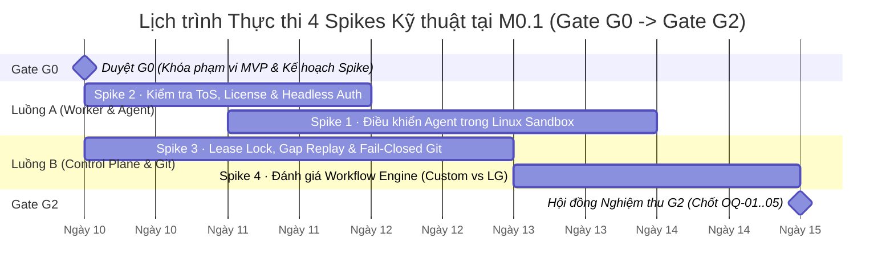

# Software Factory — Tài liệu Hướng dẫn Thực thi & Mẫu Báo cáo 4 Spikes Kỹ thuật tại `M0.1` (`SPIKE_01..04_PLAYBOOK.md`)

- **Dự án:** Software Factory Platform
- **Phiên bản:** 1.5 (Đồng bộ 100% với *System Design Plan v1.5* và *Development Roadmap v1.5*)
- **Giai đoạn áp dụng:** Milestone `M0` — Bước `M0.1` (Từ sau Gate `G0` đến Gate `G2`)
- **Tổng Timebox tối đa:** 10 ngày làm việc (Có thể chạy song song trong 5 ngày lịch với 2 nhóm kỹ sư)
- **Mục tiêu cốt lõi:** Kiểm chứng thực nghiệm bằng code/prototype cho 4 giả định kỹ thuật rủi ro nhất của MVP, đóng toàn bộ 5 câu hỏi mở (`OQ-01` $\rightarrow$ `OQ-05`) và cung cấp bằng chứng nhị phân (`PASS / FAIL`) tại cổng **`G2` (Spike Resolution Gate)** trước khi khóa 4 tài liệu đặc tả lõi của MVP (`MVP_*_SPEC.md`).

---

## 1. Tổng quan Điều hành `M0.1` & Quy tắc Thực thi Spikes

### 1.1. Ma trận Ánh xạ 4 Spikes với Quyết định Kiến trúc (`P-001` $\rightarrow$ `P-011`) và Câu hỏi Mở (`OQ-01` $\rightarrow$ `OQ-05`)

| Mã Spike | Tên Spike Kỹ thuật | Timebox | Phụ trách Gợi ý | Quyết định & Câu hỏi Mở được giải quyết | Đầu ra Nghiệm thu Bắt buộc (Deliverables) |
| :--- | :--- | :--- | :--- | :--- | :--- |
| **Spike 1** | Điều khiển Coding Agent đầu tiên (`P-010`) trong `LinuxSandboxBackend` (`cgroups v2` + `subreaper`) | **3 ngày** | Systems / Worker Engineer | `P-003`, `P-004`, `P-010`<br>`OQ-01`, `OQ-02` | PoC runner script + Báo cáo `SPIKE_01_REPORT.md` |
| **Spike 2** | Kiểm tra Pháp lý, License, ToS & Non-Interactive Credential Injection | **2 ngày** | Tech Lead / Security & Legal | `P-003`, `P-010`<br>`OQ-02` | Ma trận đánh giá `SPIKE_02_LICENSE_MATRIX.md` |
| **Spike 3** | Concurrency Lease Lock, Event Gap Replay (`P0-4`) & Fail-Closed Git (`P1-5`) | **3 ngày** | Backend / Distributed Systems Engineer | `P-006`, `P-007`<br>`OQ-01`, `OQ-04` | Prototype `agent-gateway` + `wna` + Git `pre-receive` hook & Báo cáo `SPIKE_03_PROTOCOL.md` |
| **Spike 4** | Đánh giá Workflow Engine (`P-005`: Custom PostgreSQL State Machine vs. LangGraph) | **2 ngày** | Lead Architect / Core API Engineer | `P-002`, `P-005`, `P-011`<br>`OQ-03`, `OQ-05` | Prototype 2 phương án & Báo cáo `SPIKE_04_WORKFLOW.md` |

### 1.2. Lịch trình Phối hợp Khuyến nghị (5 Ngày Lịch — 2 Luồng Song song)



### 1.3. Nguyên tắc Kỷ luật khi Chạy Spikes
1. **Không viết code sản phẩm khi chưa qua `G2`:** Code của Spike đặt trong thư mục nháp `spikes/spike-01..04/`, tập trung trả lời câu hỏi kỹ thuật với bằng chứng đo đạc thực tế.
2. **Tuân thủ chặt Timebox:** Nếu hết thời gian quy định mà ứng viên chính không vượt qua điều kiện `PASS`, **bắt buộc kích hoạt phương án Pivot ngay lập tức** theo quy định của từng Spike, không kéo dài thời gian vô hạn.
3. **Bằng chứng định lượng và tái lập được:** Mọi kết luận `PASS` trong báo cáo phải đính kèm lệnh chạy, log đầu ra, kết quả truy vấn SQL hoặc mã băm Git thực tế.

---

## 2. SPIKE 01 — Điều khiển Coding Agent Đầu tiên (`P-010`) trong `LinuxSandboxBackend` (`P1-6`)

### 2.1. Mục tiêu & Giả định Cần Kiểm chứng
- **Mục tiêu:** Chứng minh `WNA Supervisor` trên máy Linux (`factory_managed_worker`) có thể khởi chạy Coding Agent ứng viên số 1 ở chế độ tự động hóa hoàn toàn (`headless`), cô lập trong **`LinuxSandboxBackend`** (`dedicated UID/GID` + `Linux namespaces` + `cgroups v2` + `PR_SET_CHILD_SUBREAPER` + `env -i`), giải quyết thành công $\ge 3$ bài toán sửa code thực tế và **dọn sạch 100% tiến trình con/cháu mồ côi (`double-forked orphans`)** khi kết thúc hoặc khi thu hồi Lease.
- **Ứng viên kiểm thử (Ưu tiên theo thứ tự):**
  1. **Ứng viên chính (Primary):** Claude Code CLI *(hoặc Aider CLI gắn với Anthropic/OpenAI API)*
  2. **Ứng viên dự phòng (Fallback 1):** Aider CLI (Headless mode `--yes-always --no-auto-commits`)
  3. **Ứng viên dự phòng (Fallback 2):** OpenAI Codex CLI / OpenHands Headless Runtime

### 2.2. Chuẩn bị Môi trường Thực nghiệm (Prerequisites)
Trên máy Linux chuẩn bị chạy Spike 1 (Ubuntu 22.04/24.04 hoặc Debian 12 với Kernel $\ge 5.15$, đã bật **cgroups v2 unified hierarchy**):

```bash
# 1. Kiểm tra hệ thống đã mount cgroup v2 unified hierarchy
stat -fc %T /sys/fs/cgroup/
# Kỳ vọng đầu ra: cgroup2fs

# 2. Tạo 2 tài khoản OS tách biệt theo đúng Mục 4.2 của Design Plan v1.5
sudo groupadd -r sf-wna && sudo useradd -r -g sf-wna -d /var/lib/sf-wna -m -s /sbin/nologin sf-wna
sudo groupadd -r sf-task-runner && sudo useradd -r -g sf-task-runner -d /nonexistent -s /sbin/nologin sf-task-runner

# 3. Tạo thư mục nhạy cảm của WNA Supervisor (Task Sandbox tuyệt đối không được đọc)
sudo mkdir -p /etc/sf-wna
echo "SECRET_WNA_NODE_CREDENTIAL=wna-live-token-998877" | sudo tee /etc/sf-wna/credentials.env > /dev/null
sudo chown -R sf-wna:sf-wna /etc/sf-wna
sudo chmod 600 /etc/sf-wna/credentials.env

# 4. Tạo nhánh cgroup v2 được ủy quyền (delegated) cho sf-wna
sudo mkdir -p /sys/fs/cgroup/software-factory
echo "+cpu +memory +pids" | sudo tee /sys/fs/cgroup/software-factory/cgroup.subtree_control
sudo chown -R sf-wna:sf-wna /sys/fs/cgroup/software-factory
```

### 2.3. Hướng dẫn Thực thi Từng Bước (Step-by-Step Execution Guide)

#### Bước 1: Xây dựng Prototype `LinuxSandboxBackend` có `PR_SET_CHILD_SUBREAPER` và `cgroups v2`
Viết chương trình nhỏ (bằng C/Rust/Go hoặc Node.js kèm C helper) đóng vai trò `WNA Supervisor` thực hiện đúng quy trình sau cho mỗi `(task_id, lease_epoch)`:
1. Gọi `prctl(PR_SET_CHILD_SUBREAPER, 1, 0, 0, 0)` ngay khi `WNA Supervisor` khởi động.
2. Tạo cgroup riêng: `/sys/fs/cgroup/software-factory/task-<id>-epoch-<n>`, cấu hình giới hạn:
   - `memory.max = 2147483648` ($2\text{ GiB}$)
   - `pids.max = 256`
   - `cpu.max = "200000 100000"` ($2\text{ vCPU}$)
3. Tạo thư mục worktree riêng `/var/lib/sf-wna/worktrees/task-<id>-epoch-<n>` và cấp quyền sở hữu cho `sf-task-runner:sf-task-runner`.
4. Khởi chạy tiến trình con trong `mount`, `pid`, `ipc`, `uts` namespaces riêng, ghi PID vào `cgroup.procs`, hạ quyền xuống UID/GID `sf-task-runner`, xóa sạch môi trường bằng `env -i` và chỉ nạp biến môi trường được phép (`PATH`, `HOME=/tmp`, `GIT_ASKPASS`, API Key phạm vi hẹp của Agent).

#### Bước 2: Chạy 3 Bài toán Thực nghiệm với Coding Agent (`Task B1`, `Task B2`, `Task B3`)
Chuẩn bị một repository TypeScript/Node.js mẫu có sẵn bộ unit test và yêu cầu Agent thực hiện 3 bài toán độc lập:
- **Bài toán `B1` (Bugfix & Unit Test):** Sửa lỗi tính toán làm tròn tiền tệ trong `src/billing/discount.ts` và bổ sung test cho trường hợp biên.
- **Bài toán `B2` (New Feature across Multiple Files):** Thêm hàm kiểm tra chữ ký HMAC trong `src/security/hmac.ts`, tích hợp vào middleware `src/api/auth.ts` và viết unit test đi kèm.
- **Bài toán `B3` (Handling Failing Test & Self-Correction):** Cung cấp một bài toán có sẵn 1 test đang bị lỗi logic tinh vi; kiểm tra xem Agent có tự chạy test trong Sandbox, đọc thông báo lỗi và sửa cho đến khi test pass hay không.

#### Bước 3: Kiểm thử Đối kháng — Rò rỉ Credential & Dọn sạch Tiến trình Cháu Mồ côi (`Double-Forked Orphan`)
1. **Test `S1-SEC1` (Credential Isolation):** Bên trong Sandbox của `sf-task-runner`, cho chạy một script cố tình đọc `/etc/sf-wna/credentials.env`, đọc biến môi trường `env` để tìm `SECRET_WNA_NODE_CREDENTIAL`, và cố đọc thư mục worktree của một Task khác (`/var/lib/sf-wna/worktrees/task-other-epoch-1`).
   - *Kỳ vọng:* Tất cả đều bị chặn với lỗi `Permission denied` và biến môi trường không tồn tại.
2. **Test `S1-SEC2` (Double-Forked Orphan & `killAndVerifyClean`):**
   - Bên trong Sandbox, cho Agent (hoặc script mô phỏng) sinh ra một tiến trình con, tiến trình con này tiếp tục `fork()` ra tiến trình cháu chạy ngầm (`sleep 3600` hoặc vòng lặp vô hạn) rồi tiến trình cha thoát ngay lập tức (biến tiến trình cháu thành *double-forked orphan*).
   - Kích hoạt hàm `killAndVerifyClean(taskId, epoch)` từ `WNA Supervisor`:
     1. Ghi `"1"` vào `/sys/fs/cgroup/software-factory/task-<id>-epoch-<n>/cgroup.kill`.
     2. Theo dõi file `cgroup.events` cho đến khi trường `populated` chuyển từ `1` về `0`.
     3. Chạy vòng lặp `waitpid(-1, &status, WNOHANG)` trong `WNA Supervisor` (nhờ `PR_SET_CHILD_SUBREAPER`) cho đến khi trả về `-ECHILD`.
     4. Kiểm tra `cgroup.procs` và `cgroup.threads` rỗng (`0 dòng`) và gọi `rmdir(/sys/fs/cgroup/software-factory/task-<id>-epoch-<n>)`.

---

### 2.4. Mẫu Báo cáo Nghiệm thu `SPIKE_01_REPORT.md` (Sao chép để điền kết quả)

```markdown
# BÁO CÁO NGHIỆM THU SPIKE 01 (`SPIKE_01_REPORT.md`)
## Điều khiển Coding Agent Đầu tiên (`P-010`) trong `LinuxSandboxBackend`

- **Ngày thực hiện:** YYYY-MM-DD
- **Kỹ sư thực hiện:** @username
- **Môi trường Kernel & OS:** Linux Kernel X.Y.Z · Ubuntu/Debian · cgroup v2 unified
- **Ứng viên Coding Agent kiểm thử:** [Tên Agent & Phiên bản CLI/SDK]
- **Kết luận Đề xuất cho Gate `G2`:** [ PASS (GO) | FAIL (PIVOT SANG ỨNG VIÊN DỰ PHÒNG) ]

### 1. Kết quả Thực thi 3 Bài toán Sửa Code & Chạy Test trong Sandbox

| Mã bài toán | Mô tả yêu cầu | Thời gian chạy (s) | Exit Code | Số file thay đổi | Kết quả Unit Test | Thu được Git Commit & Diff chuẩn? | Kết quả |
| :--- | :--- | :--- | :--- | :--- | :--- | :--- | :--- |
| **`Task B1`** | Sửa lỗi làm tròn tiền tệ + thêm test | ...s | `0` | ... files | PASS (.../...) | Có (`commit_hash: ...`) | **PASS / FAIL** |
| **`Task B2`** | Thêm tính năng xác thực HMAC đa file | ...s | `0` | ... files | PASS (.../...) | Có (`commit_hash: ...`) | **PASS / FAIL** |
| **`Task B3`** | Tự chạy test, phát hiện lỗi và tự sửa | ...s | `0` | ... files | PASS (.../...) | Có (`commit_hash: ...`) | **PASS / FAIL** |

### 2. Kết quả Kiểm chứng Cô lập Bảo mật & Dọn dẹp Tiến trình (`killAndVerifyClean`)

| Mã Kịch bản | Nội dung kiểm chứng | Chỉ số đo đạc / Log thực tế | Tiêu chí Bắt buộc | Đánh giá |
| :--- | :--- | :--- | :--- | :--- |
| **`S1-SEC1`** | Chặn đọc `/etc/sf-wna/credentials.env` & env của `WNA` | `cat: /etc/sf-wna/credentials.env: Permission denied` | Không rò rỉ bất kỳ biến môi trường hay file nào của `sf-wna` | **PASS / FAIL** |
| **`S1-SEC2`** | Chặn đọc worktree của Task/Epoch khác | `ls: Permission denied` | Cô lập tuyệt đối giữa các worktree | **PASS / FAIL** |
| **`S1-SEC3`** | Dọn sạch tiến trình cháu mồ côi (`Double-Forked Orphan`) sau `cgroup.kill` | `cgroup.events`: `populated 0`<br>`cgroup.procs`: `0 PIDs`<br>`waitpid()` reaped: `... PIDs` | `populated == 0`, `cgroup.procs` rỗng và `rmdir(cgroup)` trả về `0` trong $< 500\text{ ms}$ | **PASS / FAIL** |

### 3. Bằng chứng Log & Git Diff Trích xuất
- **Đường dẫn lưu log thô:** `spikes/spike-01/evidence/logs/`
- **Trích đoạn `cgroup.events` trước và sau khi gọi `killAndVerifyClean`:**
  ```text
  # Trước khi kill (có 1 tiến trình cha + 2 tiến trình cháu double-fork):
  populated 1
  frozen 0
  # Sau khi ghi "1" vào cgroup.kill và thu hồi qua subreaper waitpid():
  populated 0
  frozen 0
  rmdir(/sys/fs/cgroup/software-factory/task-b1-epoch-1) => EXIT_CODE=0
  ```

### 4. Quyết định Chốt cho `P-010` và `OQ-01`, `OQ-02`
- **Coding Agent Runtime Adapter chính thức cho MVP (`P-010`):** `........................`
- **Coding Agent Runtime Adapter dự phòng (cho `M6`):** `........................`
```

---

## 3. SPIKE 02 — Kiểm tra Pháp lý, License, ToS & Non-Interactive Credential Injection

### 3.1. Mục tiêu & Bộ Tiêu chí Đánh giá
- **Mục tiêu:** Đảm bảo Coding Agent được chọn cho MVP (`P-010`) hoàn toàn hợp lệ về mặt pháp lý, bản quyền (License), Điều khoản Dịch vụ (Terms of Service — ToS) khi chạy tự động hóa không giao diện (`headless server automation`) trên `factory_managed_worker`, và hỗ trợ nạp thông tin xác thực bằng biến môi trường / file cấu hình tự động mà không cần đăng nhập qua trình duyệt.
- **5 Tiêu chí Kiểm định Bắt buộc (`L1` $\rightarrow$ `L5`):**
  - **`L1` (Headless Server Execution ToS):** Điều khoản dịch vụ có cho phép chạy công cụ CLI/SDK tự động bên trong máy chủ Linux / container do hệ thống điều phối (không phải do lập trình viên gõ lệnh trực tiếp từng bước) hay không?
  - **`L2` (Non-Interactive Credential Injection):** Có hỗ trợ nạp API Key / Service Account Token qua biến môi trường (ví dụ `ANTHROPIC_API_KEY`, `OPENAI_API_KEY`) trong môi trường `env -i` mà **không** bắt buộc mở trình duyệt OAuth (`browser login flow`) hay không?
  - **`L3` (Commercial & Multi-Project Usage):** License của CLI/SDK (MIT / Apache-2.0 / Proprietary Commercial ToS) có cho phép tích hợp vào nền tảng Software Factory để sinh mã nguồn thương mại cho các dự án hay không?
  - **`L4` (Zero Data Training / Privacy Guarantee):** Khi gọi qua Enterprise/Commercial API Key, nhà cung cấp có cam kết không sử dụng mã nguồn của dự án để huấn luyện mô hình công cộng hay không?
  - **`L5` (Structured Output / Exit Code & Token Telemetry):** Công cụ có trả về exit code chuẩn và cho phép trích xuất lượng token/chi phí tiêu thụ của phiên chạy (phục vụ `AC-12a`) hay không?

### 3.2. Hướng dẫn Kiểm tra Thực nghiệm Non-Interactive Auth
Chạy lệnh kiểm thử sau trong một container hoặc namespace hoàn toàn trống (không có thư mục `~/.config`, `~/.claude`, `~/.aider` lưu sẵn từ trước, không có X11/Wayland hay trình duyệt):

```bash
# Kiểm thử chạy hoàn toàn không tương tác (stdin đóng bằng </dev/null, môi trường sạch env -i)
env -i \
  PATH="/usr/local/bin:/usr/bin:/bin" \
  HOME="/tmp/clean-home-test" \
  ANTHROPIC_API_KEY="${TEST_API_KEY}" \
  <agent-cli-command-in-non-interactive-mode> "Add a healthcheck function to src/health.ts" </dev/null
```
- **Điều kiện PASS:** Agent khởi động thành công, xác thực bằng API Key, hoàn thành sửa file và thoát với `exit code 0` mà không bị treo chờ người dùng nhấn phím hay mở URL đăng nhập.

---

### 3.3. Mẫu Báo cáo Nghiệm thu `SPIKE_02_LICENSE_MATRIX.md` (Sao chép để điền kết quả)

```markdown
# BÁO CÁO NGHIỆM THU SPIKE 02 (`SPIKE_02_LICENSE_MATRIX.md`)
## Ma trận Đánh giá Pháp lý, License, ToS & Non-Interactive Credential Injection (`P-010`)

- **Ngày thực hiện:** YYYY-MM-DD
- **Người thực hiện:** @username
- **Kết luận Đề xuất cho Gate `G2`:** [ PASS (GO) | PIVOT ]

### 1. Ma trận So sánh 4 Ứng viên Coding Agent cho MVP

| Tiêu chí Kiểm định | Ứng viên 1: Claude Code CLI (qua API Key) | Ứng viên 2: Aider CLI (`Apache-2.0`) | Ứng viên 3: OpenAI Codex CLI (`Apache-2.0`) | Ứng viên 4: OpenHands CLI (`MIT`) |
| :--- | :--- | :--- | :--- | :--- |
| **1. License Mã nguồn / Công cụ** | Proprietary CLI (Anthropic Commercial Terms) | Open Source (`Apache-2.0`) | Open Source (`Apache-2.0`) | Open Source (`MIT`) |
| **2. `L1`: Cho phép chạy Headless Automation trên Server?** | [ Có / Không + Link mục ToS ] | **Có** (Apache-2.0, chạy tự do trên server) | **Có** (Apache-2.0, dùng qua API Key) | **Có** (MIT License) |
| **3. `L2`: Nạp Credential qua Env (`env -i`) không cần Browser OAuth?** | [ Kiểm chứng `ANTHROPIC_API_KEY` không cần `/login` ] | **Có** (`ANTHROPIC_API_KEY` / `OPENAI_API_KEY`) | **Có** (`OPENAI_API_KEY`) | **Có** (Qua biến môi trường / config TOML) |
| **4. `L3`: Cho phép sử dụng Thương mại / Đa dự án?** | [ Có theo Commercial API Terms / Không nếu dùng gói cá nhân ] | **Có** | **Có** | **Có** |
| **5. `L4`: Cam kết Không huấn luyện trên Code (Zero-Retention API)?** | **Có** (Khi dùng Commercial API Key, không dùng Consumer Pro/Max) | **Có** (Phụ thuộc API Key của LLM Provider) | **Có** (Khi dùng OpenAI API Platform) | **Có** (Phụ thuộc API Key của LLM Provider) |
| **6. `L5`: Hỗ trợ cờ Non-Interactive & Báo cáo Token (`AC-12a`)?** | `--print` / `--output-format json` | `--yes-always --no-pretty` | `--quiet` / `--full-auto` | Headless mode |
| **Kết luận Hợp lệ cho MVP (`PASS / DISQUALIFY`)** | **[ PASS / DISQUALIFY ]** | **[ PASS / DISQUALIFY ]** | **[ PASS / DISQUALIFY ]** | **[ PASS / DISQUALIFY ]** |

### 2. Quy tắc Bắt buộc về Xác thực trong Production (Rút ra từ Spike 2)
1. **Tuyệt đối cấm dùng gói thuê bao cá nhân (Consumer Subscription / OAuth Browser Session) cho Worker tự động:** Mọi lệnh gọi từ `LinuxSandboxBackend` bắt buộc sử dụng **Commercial API Key** nạp qua biến môi trường phạm vi hẹp.
2. **Quyết định chọn Adapter cho `P-010` (`OQ-02`):**
   - **Adapter số 1 (Triển khai tại `M2`–`M5`):** `........................`
   - **Adapter dự phòng (Triển khai tại `M6`):** `........................`
```

---

## 4. SPIKE 03 — Concurrency Lease Lock, Event Gap Replay (`P0-4`) & Fail-Closed Git (`P1-5`)

### 4.1. Mục tiêu & 3 Cụm Kiểm chứng Thực nghiệm
Spike 3 kiểm chứng trực tiếp tính toàn vẹn của luồng điều phối giữa `Control Plane`, `Agent Gateway`, `WNA` và `Git Server`:
- **Cụm A (Canonical Lease Lock & Real-Time Fencing):** Kiểm chứng khóa độc quyền `SELECT ... FROM task_leases l JOIN tasks t ... FOR UPDATE OF l, t` kết hợp **`clock_timestamp()`** dưới tải cạnh tranh cao ($100\text{ luồng}$ đồng thời giữa `Submit Event` và `Revoke Lease`).
- **Cụm B (Sequential Event Protocol, Gap Replay & Orphaned Push Recovery — `P0-4`):** Kiểm chứng cưỡng chế `sequence_no == last_processed_seq + 1`, phản hồi đồng bộ `last_processed_seq` trên mọi bản tin ACK/NACK, cơ chế tự động phát bù từ **WNA Local Outbox Buffer** khi rơi gói tin / rớt mạng, và cơ chế **Orphaned Push Reconciler** khi mất bản tin `task.completed` sau khi đã push code.
- **Cụm C (Single Controlled Git Push Import & Fail-Closed Gatekeeper — `P1-5`):** Kiểm chứng Git `pre-receive` hook chỉ cho phép đẩy vào `refs/factory/Verify/<task_id>/<epoch>`, thu hồi quyền ghi trong $< 2\text{ giây}$, **bắt buộc `Fail-Closed`** khi mất kết nối DB, và chặn đứng 100% các vi phạm qua **6 quy tắc của `Trusted Import Validator`**.

---

### 4.2. Hướng dẫn Thực thi Từng Bước (Step-by-Step Execution Guide)

#### Bước 1: Khởi tạo Schema PostgreSQL Tối thiểu cho Spike 3
Chạy script SQL sau trên PostgreSQL 16+ để dựng các bảng cốt lõi của giao thức Lease/Event/Import:

```sql
CREATE TABLE tasks (
    project_id UUID NOT NULL,
    task_id TEXT NOT NULL,
    status TEXT NOT NULL DEFAULT 'Leased',
    current_lease_epoch INT NOT NULL DEFAULT 1,
    base_main_commit_hash TEXT NOT NULL,
    allowed_files TEXT[] NOT NULL DEFAULT ARRAY['src/**'],
    protected_paths TEXT[] NOT NULL DEFAULT ARRAY['tests/baseline/**', 'package.json'],
    forbidden_paths TEXT[] NOT NULL DEFAULT ARRAY['.github/**', 'infra/**'],
    max_changed_files INT NOT NULL DEFAULT 20,
    max_deleted_lines INT NOT NULL DEFAULT 500,
    updated_at TIMESTAMPTZ NOT NULL DEFAULT clock_timestamp(),
    PRIMARY KEY (project_id, task_id)
);

CREATE TABLE task_leases (
    project_id UUID NOT NULL,
    task_id TEXT NOT NULL,
    lease_epoch INT NOT NULL,
    worker_id TEXT NOT NULL,
    session_id TEXT NOT NULL,
    ephemeral_git_token_hash TEXT NOT NULL,
    status TEXT NOT NULL DEFAULT 'ACTIVE', -- ACTIVE | REVOKED | EXPIRED | COMPLETED
    last_processed_seq INT NOT NULL DEFAULT 0,
    expires_at TIMESTAMPTZ NOT NULL,
    revoked_at TIMESTAMPTZ NULL,
    last_heartbeat_at TIMESTAMPTZ NOT NULL DEFAULT clock_timestamp(),
    PRIMARY KEY (project_id, task_id, lease_epoch),
    FOREIGN KEY (project_id, task_id) REFERENCES tasks(project_id, task_id)
);

CREATE TABLE processed_events (
    project_id UUID NOT NULL,
    task_id TEXT NOT NULL,
    lease_epoch INT NOT NULL,
    sequence_no INT NOT NULL,
    event_idempotency_key TEXT NOT NULL,
    event_type TEXT NOT NULL,
    payload_sha256 TEXT NOT NULL,
    processed_at TIMESTAMPTZ NOT NULL DEFAULT clock_timestamp(),
    PRIMARY KEY (project_id, task_id, lease_epoch, sequence_no),
    UNIQUE (project_id, event_idempotency_key)
);

CREATE TABLE verified_code_imports (
    project_id UUID NOT NULL,
    task_id TEXT NOT NULL,
    lease_epoch INT NOT NULL,
    agent_commit_hash TEXT NOT NULL,
    base_main_commit_hash TEXT NOT NULL,
    changed_files_count INT NOT NULL,
    imported_at TIMESTAMPTZ NOT NULL DEFAULT clock_timestamp(),
    PRIMARY KEY (project_id, task_id, lease_epoch)
);
```

#### Bước 2: Chạy Bài Test Cụm A — Cạnh tranh Khóa `FOR UPDATE` + `clock_timestamp()` (`S3-T1`)
1. Tạo 1 bản ghi `tasks` và `task_leases` đang `ACTIVE` (`lease_epoch = 1`, `last_processed_seq = 0`, `expires_at = clock_timestamp() + interval '60 seconds'`).
2. Dùng công cụ bắn tải đồng thời (`Promise.all` với 100 kết nối song song):
   - 99 luồng gửi sự kiện `Submit Event` (`sequence_no = 1..99`).
   - Đúng tại thời điểm $t = 50\text{ ms}$, luồng thứ 100 gọi giao dịch `Revoke Lease`:
     ```sql
     BEGIN;
     SELECT l.lease_epoch, l.status FROM task_leases l
     JOIN tasks t ON t.project_id = l.project_id AND t.task_id = l.task_id
     WHERE l.project_id = $1 AND l.task_id = $2 AND l.lease_epoch = $3
     FOR UPDATE OF l, t;

     UPDATE task_leases
     SET status = 'REVOKED', revoked_at = clock_timestamp()
     WHERE project_id = $1 AND task_id = $2 AND lease_epoch = $3;

     UPDATE tasks SET status = 'Ready', updated_at = clock_timestamp()
     WHERE project_id = $1 AND task_id = $2;
     COMMIT;
     ```
3. **Kiểm tra điều kiện PASS:** Ngay sau thời điểm `revoked_at`, **0 sự kiện** nào của `lease_epoch = 1` được ghi thêm vào `processed_events` (100% các luồng đến sau điểm tuyến tính hóa đều nhận `409 ERR_STALE_LEASE`).

#### Bước 3: Chạy Bài Test Cụm B — Rơi Gói tin, `Local Outbox Replay` & `Orphaned Push Recovery` (`S3-T2`, `S3-T3`, `S3-T4`)
1. **Test `S3-T2` (Out-of-Order & Sequence Gap Replay):**
   - `WNA` ghi 5 sự kiện (`seq = 1, 2, 3, 4, 5`) vào file `/tmp/wna-outbox-test.jsonl`.
   - Gửi `seq = 1` và `seq = 2` $\rightarrow$ Server trả về `200 ACK_OK (last_processed_seq = 2)`.
   - Giả lập mất gói tin mạng `seq = 3`, gửi thẳng `seq = 4` lên Server.
   - Server trả về `409 ERR_SEQUENCE_GAP` kèm `{"last_processed_seq": 2, "expected_next_seq": 3}`.
   - `WNA` đọc lại `/tmp/wna-outbox-test.jsonl` từ `expected_next_seq = 3`, tự động gửi tuần tự `seq = 3, 4, 5`.
   - **Kiểm tra:** Bảng `processed_events` có đủ `seq = 1..5` không thiếu, không trùng; `last_processed_seq = 5`.
2. **Test `S3-T3` (Idempotent Retry vs. Payload Conflict):**
   - Gửi lại `seq = 5` với cùng `event_idempotency_key` và cùng `payload_sha256` $\rightarrow$ Nhận `200 RETRY_IDEMPOTENT_OK`.
   - Gửi lại `seq = 5` với cùng `event_idempotency_key` nhưng sửa nội dung `payload` $\rightarrow$ Nhận `422 ERR_PAYLOAD_CONFLICT`.
3. **Test `S3-T4` (Orphaned Push Recovery):**
   - Cho Worker thực hiện `git push` thành công tạo bản ghi trong `verified_code_imports`, sau đó `kill -9` Worker trước khi gửi `task.completed`.
   - Đợi Lease hết hạn (`expires_at <= clock_timestamp()`) và chạy hàm `LeaseExpiryReconciler`.
   - **Kiểm tra:** Reconciler phát hiện bản ghi trong `verified_code_imports`, tự động chuyển `tasks.status` sang `'BuildingMergeCandidate'` thay vì hủy bỏ kết quả.

#### Bước 4: Chạy Bài Test Cụm C — `Fail-Closed Git Gatekeeper` & 6 Quy tắc `Trusted Import Validator` (`S3-T5` $\rightarrow$ `S3-T11`)
Cài đặt script `pre-receive` hook trong bare Git repository của Spike 3 để kiểm tra đồng bộ cả 6 quy tắc trong Mục 6.4 của Design Plan v1.5:

```bash
#!/usr/bin/env bash
# Tập tin: hooks/pre-receive (Fail-Closed Git Gatekeeper & Trusted Import Validator)
set -euo pipefail

# Mọi lỗi bất ngờ hoặc timeout đều trả về exit code != 0 (Fail-Closed tuyệt đối)
trap 'echo "[GIT-GATEKEEPER] FAIL-CLOSED: Internal error or validation timeout" >&2; exit 1' ERR

while read -r oldrev newrev refname; do
  # Quy tắc 0: Chỉ cho phép đẩy vào refs/factory/Verify/<task_id>/<epoch>
  if [[ ! "$refname" =~ ^refs/factory/Verify/([^/]+)/([0-9]+)$ ]]; then
    echo "[REJECT] ERR_INVALID_REF: Push only allowed to refs/factory/Verify/<task_id>/<epoch>" >&2
    exit 1
  fi
  TASK_ID="${BASH_REMATCH[1]}"
  LEASE_EPOCH="${BASH_REMATCH[2]}"

  # Gọi đồng bộ tới Validator Service (timeout cứng 2 giây; nếu mất kết nối DB -> exit 1 Fail-Closed)
  node /opt/sf-spike3/trusted-import-validator.js \
    --task-id "$TASK_ID" \
    --epoch "$LEASE_EPOCH" \
    --oldrev "$oldrev" \
    --newrev "$newrev" \
    --refname "$refname"
done
```

Thực hiện 7 bài kiểm thử đẩy code (`git push`) vào `pre-receive` hook:
- **`S3-T5` (Fail-Closed khi mất DB / Control Plane):** Dừng PostgreSQL hoặc chặn cổng mạng tới Validator $\rightarrow$ `git push` bị từ chối 100% trong $< 2\text{ giây}$.
- **`S3-T6` (Thu hồi quyền ghi Git tức thời sau Revoke Lease):** Gọi `Revoke Lease` rồi lập tức `git push` $\rightarrow$ Bị từ chối ngay (`ERR_STALE_LEASE`).
- **`S3-T7` (Đẩy trực tiếp vào `refs/heads/main` hoặc commit không fast-forward từ `B_base`):** Bị từ chối 100%.
- **`S3-T8` (Vi phạm `Path Policy Precedence`):** Đẩy commit sửa file trong `forbidden_paths` (`.github/workflows/ci.yml`), `protected_paths` (`tests/baseline/auth.spec.ts`) hoặc ngoài `allowed_files` $\rightarrow$ Bị từ chối 100%.
- **`S3-T9` (Chứa Symlink `mode 120000` hoặc Path Traversal `..`):** Tạo `ln -s /etc/passwd src/leak.txt` hoặc symlink trỏ vào `protected_paths` rồi commit & push (`git ls-tree -r "$newrev"` phát hiện mode `120000`) $\rightarrow$ Bị từ chối 100%.
- **`S3-T10` (Chứa Submodule `mode 160000` hoặc Binary vượt cỡ $> 1\text{ MB}$):** Thêm submodule hoặc file binary $2\text{ MB}$ $\rightarrow$ Bị từ chối 100%.
- **`S3-T11` (Thay đổi bất thường — Xóa trắng mã nguồn):** Xóa $> 500\text{ dòng}$ hoặc sửa $> 20\text{ files}$ vượt ngưỡng `TaskContract` $\rightarrow$ Bị từ chối 100%.

---

### 4.3. Mẫu Báo cáo Nghiệm thu `SPIKE_03_PROTOCOL.md` (Sao chép để điền kết quả)

```markdown
# BÁO CÁO NGHIỆM THU SPIKE 03 (`SPIKE_03_PROTOCOL.md`)
## Concurrency Lease Lock, Event Gap Replay (`P0-4`) & Fail-Closed Git (`P1-5`)

- **Ngày thực hiện:** YYYY-MM-DD
- **Kỹ sư thực hiện:** @username
- **Kết luận Đề xuất cho Gate `G2`:** [ PASS (GO) | FAIL (HOLD) ]

### 1. Bảng Kết quả 11 Kịch bản Kiểm chứng Thực nghiệm (`S3-T1` -> `S3-T11`)

| Mã Test | Cụm kiểm chứng | Kịch bản kiểm thử | Kết quả Đo đạc Thực tế | Điều kiện PASS Bắt buộc | Đánh giá |
| :--- | :--- | :--- | :--- | :--- | :--- |
| **`S3-T1`** | Cụm A (Lease Lock) | 99 luồng `Submit Event` đua với 1 luồng `Revoke Lease` (`FOR UPDATE` + `clock_timestamp()`) | Số event lọt sau `revoked_at`: `0` | `0` sự kiện lọt qua sau khi Revoke giành được khóa | **PASS / FAIL** |
| **`S3-T2`** | Cụm B (Event Replay) | Giả lập rơi gói tin `seq = 3`, gửi `seq = 4` $\rightarrow$ Nhận `409 ERR_SEQUENCE_GAP` $\rightarrow$ Replay từ Local Outbox | Replay thành công `seq = 3, 4, 5` trong `... ms` | Tự động đồng bộ đủ `seq = 1..5`, không mất/trùng dữ liệu | **PASS / FAIL** |
| **`S3-T3`** | Cụm B (Idempotency) | Gửi lặp cùng `event_idempotency_key` (cùng payload vs. khác payload) | Cùng payload $\rightarrow$ `200`<br>Khác payload $\rightarrow$ `422` | Chống ghi trùng và phát hiện xung đột payload 100% | **PASS / FAIL** |
| **`S3-T4`** | Cụm B (Orphaned Push) | `kill -9` Worker ngay sau khi `git push` thành công (trước khi gửi `task.completed`) | Reconciler cứu commit `...` sang `BuildingMergeCandidate` | Không mất kết quả code đã push hợp lệ | **PASS / FAIL** |
| **`S3-T5`** | Cụm C (Fail-Closed Git) | Ngắt kết nối PostgreSQL / Validator trong lúc Worker gọi `git push` | Hook trả về `exit 1` sau `... ms` | Từ chối `git push` 100% (`Fail-Closed`) trong $< 2\text{ s}$ | **PASS / FAIL** |
| **`S3-T6`** | Cụm C (Revocation Latency) | Thu hồi Lease rồi gọi `git push` ngay lập tức | Bị từ chối sau `... ms` (`ERR_STALE_LEASE`) | Độ trễ thu hồi quyền ghi Git $< 2\text{ s}$ | **PASS / FAIL** |
| **`S3-T7`** | Cụm C (Git Tree & Ref) | Push thẳng vào `refs/heads/main` hoặc commit không fast-forward từ `B_base` | Bị từ chối (`ERR_INVALID_REF` / `ERR_NON_FF`) | Chặn 100% | **PASS / FAIL** |
| **`S3-T8`** | Cụm C (Path Policy) | Push commit sửa `forbidden_paths`, `protected_paths` hoặc file ngoài `allowed_files` | Bị từ chối (`ERR_PATH_POLICY_VIOLATION`) | Chặn 100% (kể cả khi dùng `git mv` / copy) | **PASS / FAIL** |
| **`S3-T9`** | Cụm C (Symlink Guard) | Push commit chứa symlink (`mode 120000`) hoặc đường dẫn chứa `..` | Bị từ chối (`ERR_FORBIDDEN_SYMLINK`) | Chặn 100% mọi symlink bất hợp pháp | **PASS / FAIL** |
| **`S3-T10`** | Cụm C (Submodule/Binary) | Push commit chứa submodule (`mode 160000`) hoặc file binary $> 1\text{ MB}$ | Bị từ chối (`ERR_SUBMODULE_OR_BINARY`) | Chặn 100% | **PASS / FAIL** |
| **`S3-T11`** | Cụm C (Abnormal Diff) | Push commit xóa trắng $> 500\text{ dòng}$ hoặc vượt `max_changed_files` | Bị từ chối (`ERR_ABNORMAL_DIFF_SIZE`) | Chặn 100% | **PASS / FAIL** |

### 2. Kết luận Chốt cho `P-006`, `P-007` và `OQ-01`, `OQ-04`
- Xác nhận khóa giao thức Lease/Event dùng `FOR UPDATE` + `clock_timestamp()` + `last_processed_seq` sync + `WNA Local Outbox Replay` + `Orphaned Push Reconciler`.
- Xác nhận khóa đường Import duy nhất của MVP qua `Fail-Closed Git Gatekeeper` + `Trusted Import Validator` (6 quy tắc).
```

---

## 5. SPIKE 04 — Đánh giá Workflow Engine (`P-005`: Custom PostgreSQL State Machine vs. LangGraph)

### 5.1. Mục tiêu & Bài toán Đối sánh Trực tiếp
- **Mục tiêu:** Quyết định lựa chọn kiến trúc cho `P-005` (`OQ-05`) giữa hai phương án:
  - **Phương án A (`Custom Durable State Machine trên PostgreSQL`):** Cài đặt bảng chuyển trạng thái tường minh (Explicit State Transition Table) chạy trực tiếp bên trong cùng giao dịch SQL (`BEGIN ... COMMIT`) với `task_leases`, `processed_events`, `outbox_events` và `merge_operations`.
  - **Phương án B (`LangGraph PostgresSaver Checkpointer`):** Sử dụng đồ thị trạng thái của thư viện LangGraph lưu checkpoint vào PostgreSQL.
- **Yêu cầu cốt lõi từ Design Plan v1.5 (Mục 6.3, Mục 7 & Mục 8.2):**
  Mọi bước chuyển trạng thái của Task trong vòng lặp Stage 8 (`Ready` $\rightarrow$ `Leased` $\rightarrow$ `ExecutingInTarget` $\rightarrow$ `BuildingMergeCandidate` $\rightarrow$ `VerifyingInDocker` $\rightarrow$ `UnderIndependentReview` $\rightarrow$ `AwaitingHumanApproval` $\rightarrow$ `AtomicCasMerge` $\rightarrow$ `MergedAndCompleted` cùng nhánh `ReworkRequired` / `ManualIntervention`) **bắt buộc phải ghi nguyên tử trong cùng 1 PostgreSQL transaction** với:
  1. Ngữ cảnh RLS `SET LOCAL app.current_org_id` & `SET LOCAL app.current_project_id`.
  2. Khóa `SELECT ... FROM task_leases l JOIN tasks t ... FOR UPDATE OF l, t`.
  3. Cập nhật `task_leases.last_processed_seq` và chèn `processed_events` + `outbox_events`.

### 5.2. Hướng dẫn Thực hiện 4 Bài Kiểm thử Đối sánh (`S4-T1` $\rightarrow$ `S4-T4`)

1. **Bài test `S4-T1` (Single-Transaction Atomicity & RLS `SET LOCAL` Compatibility):**
   - Thử thực hiện trong **1 transaction PostgreSQL duy nhất** (có bật `SET LOCAL` cho RLS): vừa kiểm tra khóa `task_leases FOR UPDATE`, vừa nâng `last_processed_seq`, vừa chuyển trạng thái Workflow, vừa ghi `outbox_events`. Nếu lệnh ghi `outbox_events` lỗi và `ROLLBACK`, trạng thái của Workflow Engine cũng phải được rollback 100%.
   - *Đánh giá:* Kiểm tra xem `LangGraph PostgresSaver` có cho phép truyền `pg.PoolClient` đang mở transaction (đã chạy `SET LOCAL` và đang giữ khóa `FOR UPDATE`) vào hàm lưu checkpoint của nó mà không tự mở kết nối/transaction riêng làm mất `SET LOCAL` hay không.
2. **Bài test `S4-T2` (Crash Recovery — `kill -9` Mid-Execution):**
   - Cho Task đi qua chuỗi trạng thái từ `Ready` đến `UnderIndependentReview`, sau đó bắn tín hiệu `SIGKILL` (`kill -9`) vào tiến trình Orchestrator rồi khởi động lại.
   - *Đánh giá:* Tiến trình mới khởi động lên phải khôi phục chính xác trạng thái `UnderIndependentReview`, `rework_count`, `lease_epoch` và xử lý tiếp `outbox_events` mà không chạy lặp bước trước đó.
3. **Bài test `S4-T3` (Pause/Resume tại `AwaitingHumanApproval` kèm `Approval TTL`):**
   - Dừng workflow ở trạng thái `AwaitingHumanApproval` (không tốn tài nguyên CPU/RAM khi chờ con người duyệt hàng giờ). Kiểm tra cả 2 nhánh: (a) Duyệt trong hạn `expires_at > clock_timestamp()`, và (b) Quá hạn `TTL` $\rightarrow$ tự động hủy Approval và lùi về `BuildingMergeCandidate`.
4. **Bài test `S4-T4` (Phục hồi `Post-Merge Reconciler` & `True CAS Conflict` — `P0-3`):**
   - Kiểm tra khả năng biểu diễn rõ ràng 2 nhánh phục hồi ở bước `AtomicCasMerge`:
     - Nhánh 1: Mất phản hồi sau khi `git update-ref` đã thành công (`current_main_head == C_candidate`) $\rightarrow$ Chuyển idempotent sang `MergedAndCompleted`.
     - Nhánh 2: `True CAS Conflict` (`current_main_head == B_new`) $\rightarrow$ Đánh dấu `INVALIDATED_STALE_BASE` cho `ApprovalDecision` + `ReviewArtifact` và lùi trạng thái Task về `BuildingMergeCandidate` trong 1 transaction.

---

### 5.3. Mẫu Báo cáo Nghiệm thu `SPIKE_04_WORKFLOW.md` (Sao chép để điền kết quả)

```markdown
# BÁO CÁO NGHIỆM THU SPIKE 04 (`SPIKE_04_WORKFLOW.md`)
## Đánh giá & Lựa chọn Workflow Engine (`P-005`: Custom PostgreSQL State Machine vs. LangGraph)

- **Ngày thực hiện:** YYYY-MM-DD
- **Kiến trúc sư thực hiện:** @username
- **Quyết định Chốt cho `P-005` (`OQ-05`):** [ CHỌN PHƯƠNG ÁN A: CUSTOM DURABLE STATE MACHINE TRÊN POSTGRESQL | CHỌN PHƯƠNG ÁN B: LANGGRAPH ]

### 1. Kết quả Thực nghiệm 4 Bài Kiểm thử Bắt buộc (`S4-T1` -> `S4-T4`)

| Mã Test | Tiêu chí Kỹ thuật Kiểm chứng | Trọng số | Phương án A: Custom Durable State Machine (PostgreSQL) | Phương án B: LangGraph (`PostgresSaver`) |
| :--- | :--- | :--- | :--- | :--- |
| **`S4-T1`** | **Giao dịch Nguyên tử 1-TX** cùng `task_leases FOR UPDATE`, `last_processed_seq`, `outbox_events` và `SET LOCAL` (RLS) | **40%** | **[ PASS / FAIL ]**<br>Chia sẻ trực tiếp cùng 1 `pg.PoolClient` transaction; `ROLLBACK` đồng bộ 100%. | **[ PASS / FAIL ]**<br>[Ghi rõ: Checkpointer của LangGraph quản lý connection pool riêng hay có nhận external transaction client có `SET LOCAL`?] |
| **`S4-T2`** | **Phục hồi sau `kill -9`** (Crash Recovery & Idempotent Outbox Relay) | **25%** | **[ PASS / FAIL ]**<br>Đọc trực tiếp từ bảng `tasks` + `outbox_events`; khôi phục tức thì. | **[ PASS / FAIL ]**<br>[Ghi rõ kết quả khi crash giữa lúc ghi state của LangGraph và ghi bảng `tasks`] |
| **`S4-T3`** | **Pause/Resume tại Human Approval Gate** kèm kiểm tra `Approval TTL (clock_timestamp())` | **20%** | **[ PASS / FAIL ]**<br>Hoàn toàn dựa trên trạng thái DB; kiểm tra `expires_at > clock_timestamp()` bằng SQL nguyên tử. | **[ PASS / FAIL ]**<br>[Ghi rõ kết quả] |
| **`S4-T4`** | **Xử lý `Post-Merge Reconciler` & `True CAS Conflict`** (Hủy Approval cũ + Lùi về `BuildingMergeCandidate`) | **15%** | **[ PASS / FAIL ]**<br>Cập nhật nguyên tử `tasks`, `approval_decisions`, `review_artifacts` trong 1 câu giao dịch. | **[ PASS / FAIL ]**<br>[Ghi rõ độ phức tạp khi phải rollback trạng thái đồ thị kèm cập nhật các bảng quan hệ] |
| **Tổng điểm** | *(Thang điểm 100)* | **100%** | **`... / 100`** | **`... / 100`** |

### 2. Kết luận Kiến trúc cho `P-005` và `OQ-05`
- **Phương án được chọn cho Core Execution Loop (Stage 8 — MVP `M1`–`M5`):** `........................`
- **Lý do kỹ thuật cốt lõi:** Đảm bảo tính nguyên tử 100% trong một giao dịch PostgreSQL duy nhất giữa State Transition, Lease Lock (`FOR UPDATE`), Sequential Event (`last_processed_seq`), Transactional Outbox và ngữ cảnh `SET LOCAL` của Hardened 4-Tier RLS mà không bị hiện tượng dual-write giữa hai bộ lưu trữ trạng thái.
```

---

## 6. Biên bản Nghiệm thu Cổng `G2` (`Spike Resolution Gate`) & Đóng 5 Câu hỏi Mở (`OQ-01` $\rightarrow$ `OQ-05`)

Sau khi hoàn thành cả 4 báo cáo trên, Hội đồng Kiến trúc (Product Owner + Lead Architect) sử dụng bảng kiểm dưới đây để ký duyệt cổng **`G2`**, chính thức đóng toàn bộ 5 câu hỏi mở và mở khóa Bước `M0.2` (khóa 4 tài liệu đặc tả lõi của MVP `MVP_*_SPEC.md`):

### 6.1. Bảng Tổng hợp Quyết định tại Gate `G2`

| Hạng mục / Câu hỏi Mở | Báo cáo Tham chiếu | Trạng thái Kiểm chứng | Phương án Chốt Chính thức để Đưa vào 4 Tài liệu `MVP_*_SPEC.md` |
| :--- | :--- | :--- | :--- |
| **`OQ-01`** · Giao thức Lease/Event, Gap Replay (`P0-4`) & Linux Sandbox (`P1-6`) | `SPIKE_01_REPORT.md`<br>`SPIKE_03_PROTOCOL.md` | `[ ] PASS` | • Outbound WebSocket + Khóa `task_leases FOR UPDATE` với `clock_timestamp()`.<br>• Đồng bộ `last_processed_seq` trên mọi ACK/NACK + `WNA Local Outbox Replay` + `Orphaned Push Reconciler`.<br>• MVP khóa chặt 1 Target `factory_managed_worker` chạy `LinuxSandboxBackend` (`cgroups v2` + `PR_SET_CHILD_SUBREAPER` + `env -i`). |
| **`OQ-02`** · Lựa chọn Coding Agent đầu tiên cho MVP (`P-010`) & ToS | `SPIKE_01_REPORT.md`<br>`SPIKE_02_LICENSE_MATRIX.md` | `[ ] PASS` | • **Primary Runtime Adapter (`M2`–`M5`):** `[Điền tên Agent chốt từ Spike 1 & 2]` (Nạp Commercial API Key qua biến môi trường sạch).<br>• **Fallback / Second Adapter (`M6`):** `[Điền tên Agent dự phòng]`. |
| **`OQ-03`** · Kiến trúc 3-Tier Docker Verifier & No-Hardlink Cache | `SPIKE_04_WORKFLOW.md`<br>*(Thiết kế Mục 7.1)* | `[ ] PASS` | • Chạy trên Immutable Snapshot (`.tar`) của `C_candidate`.<br>• Tách 3 tầng: `Trusted Acceptance Tests` (`:ro`), `Protected Baseline Tests` (kiểm tra SHA-256), `Agent-Generated Tests`.<br>• Gắn cache qua `OverlayFS` (`upperdir` trên `tmpfs`) + `fs.protected_hardlinks = 1`. |
| **`OQ-04`** · Single Git Push Import (`P1-5`), Candidate-First & Post-Merge Reconciler (`P0-3`) | `SPIKE_03_PROTOCOL.md`<br>`SPIKE_04_WORKFLOW.md` | `[ ] PASS` | • MVP chỉ mở 1 đường `Git Push` $\rightarrow$ `Fail-Closed Git Gatekeeper` $\rightarrow$ `Trusted Import Validator` (6 quy tắc).<br>• Tạo `C_candidate` trước khi chạy Verifier/Reviewer/Approval.<br>• Hợp nhất bằng `git update-ref` (Atomic CAS) kèm `Approval TTL` và `Idempotent Post-Merge Reconciler`. |
| **`OQ-05`** · Lựa chọn Workflow Engine (`P-005`) & Lộ trình `M0` $\rightarrow$ `M6` (`P-011`) | `SPIKE_04_WORKFLOW.md` | `[ ] PASS` | • **Workflow Engine (`P-005`):** `[Điền phương án chốt từ Spike 4 — khuyến nghị: Custom Durable State Machine trên PostgreSQL]`.<br>• Khóa lộ trình 7 mốc `M0` $\rightarrow$ `M6` với cổng chặn cứng Vertical Slice tại `M5`. |

### 6.2. Checklist Chuyển giao sang Bước `M0.2` (Hoàn tất Milestone `M0`)
Ngay sau khi bảng 6.1 đạt `PASS 100%`, đội ngũ sử dụng kết quả thực nghiệm từ 4 Spikes để khóa 4 tài liệu đặc tả kỹ thuật lõi của MVP (hoàn thành trọn vẹn Milestone `M0` để bắt đầu viết code `M1`):
- [ ] 1. `MVP_SCOPE_AND_ARCHITECTURE.md`
- [ ] 2. `MVP_DATABASE_AND_RLS_SPEC.md`
- [ ] 3. `MVP_LEASE_EVENT_AND_SANDBOX_SPEC.md`
- [ ] 4. `MVP_VERIFIER_REVIEWER_AND_RECOVERY_SPEC.md`